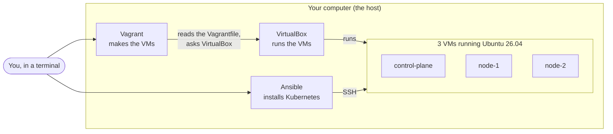
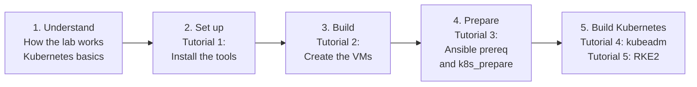

# Start here

- This is the front page of the lab docs. Read it first.

# What is this lab?

- A small Kubernetes cluster that runs entirely on your own computer.
- It is made of 3 virtual machines (VMs):
  - `control-plane` manages the cluster.
  - `node-1` and `node-2` run your apps.
- Every VM has 3 CPUs, 6 GB of memory, a 10 GB OS disk, a 20 GB data disk and a private network card.
- You can install 2 kinds of Kubernetes on the same 3 VMs:
  - **kubeadm**: plain upstream Kubernetes, built step by step.
  - **RKE2**: SUSE Rancher's Kubernetes, with stricter security defaults.
- You choose with one setting, `k8s_distro`, in `ansible/inventories/single-control-plane/group_vars/all/cluster.yml`.
- You can remove one and install the other without rebuilding the VMs.
- Nothing runs in the cloud and nothing costs money.

# Cluster layouts

- Each layout has its own folder and `Vagrantfile` under [vagrant/](../vagrant/README.md).

| Layout                  | VMs                              | Status  |
|-------------------------|----------------------------------|---------|
| `single-control-plane`  | 1 control plane, 2 nodes         | Ready. These docs use it. |
| `ha-control-plane`      | 3 control planes, 1 node, kube-vip | Planned |

- More: [Cluster layouts](diataxis/explanation/cluster-layouts.md).

# The big picture

- **Vagrant** reads one file, the `Vagrantfile`, and asks VirtualBox to create the VMs.
- **VirtualBox** runs the VMs, the same way it would run a VM you made by hand.
- **Ansible** logs into each VM over SSH and installs Kubernetes.
- Full detail: [How the lab works](diataxis/explanation/how-the-lab-works.md).

# What you need

| Item   | Needed                                  | Why                                                                 |
|--------|-----------------------------------------|---------------------------------------------------------------------|
| CPU    | 12 threads with VT-x or AMD-V           | The 3 VMs use 9 virtual CPUs. Your own system needs the rest.       |
| RAM    | 24 GB or more                           | The 3 VMs use 18 GB. Your own system needs the rest.                |
| Disk   | 50 GB free                              | Each VM has a 10 GB OS disk and a 20 GB data disk. They start at about 2.2 GB per VM and grow as data is written, up to 90 GB in total. |
| OS     | Linux (Ubuntu or Arch examples)         | VirtualBox also runs on Windows and Intel Macs, but the commands in these docs are for Linux. |
| Skills | Open a terminal, run commands, use `cd` | Everything else is explained here.                                  |

- The main lab computer has 12 CPU threads and 40 GB of RAM. The sizes were chosen for it. See [ADR 0005](adr/0005-node-sizes-and-ips.md).

# Learning path

# Reading order

1. [How the lab works](diataxis/explanation/how-the-lab-works.md): the big picture.
2. [Kubernetes basics](diataxis/explanation/kubernetes-basics.md): what Kubernetes is and what each node does.
3. [Install the tools](diataxis/tutorials/01-install-tools.md): set up your computer.
4. [The Vagrantfile explained](diataxis/explanation/vagrantfile-explained.md): read this before you create the VMs.
5. [Create the VMs](diataxis/tutorials/02-create-vms.md): build the 3 VMs.
   - [Cluster layouts](diataxis/explanation/cluster-layouts.md): why the Vagrantfile lives in `vagrant/single-control-plane/`.
6. [Lab networking](diataxis/explanation/lab-networking.md): how the VMs talk to each other.
7. [Disks and storage](diataxis/explanation/disks-and-storage.md): the OS disk and the data disk.
8. [The Ansible roles explained](diataxis/explanation/ansible-roles-explained.md): read this before tutorial 3.
9. [Prepare the nodes](diataxis/tutorials/03-prepare-nodes.md): run Ansible to get the VMs ready for Kubernetes.
10. [Installing Kubernetes explained](diataxis/explanation/installing-kubernetes-explained.md): read this before tutorial 4.
11. [Install the cluster](diataxis/tutorials/04-install-the-cluster.md): build the cluster with kubeadm and Cilium.
12. [Joining nodes explained](diataxis/explanation/joining-nodes-explained.md): the short lived join token and the CA hash.
13. [Services without kube-proxy](diataxis/explanation/services-without-kube-proxy.md): how Cilium does kube-proxy's job.
14. [kubeadm vs RKE2](diataxis/explanation/kubeadm-vs-rke2.md): how the two differ.
15. [Switch to RKE2 and upgrade](diataxis/tutorials/05-switch-to-rke2-and-upgrade.md): try the other distribution and an upgrade.

- Keep these open while you work:
  - [Nodes and IPs](diataxis/reference/nodes-and-ips.md)
  - [Vagrant commands](diataxis/reference/vagrant-commands.md)
  - [Ansible settings](diataxis/reference/ansible-settings.md)
  - [Glossary](diataxis/reference/glossary.md)

# Where to find things

| Folder                                                  | Open it when                                   | Example                       |
|---------------------------------------------------------|------------------------------------------------|-------------------------------|
| [diataxis/tutorials/](diataxis/tutorials/README.md)     | You are learning and want steps in order.      | Create the VMs.               |
| [diataxis/how-to/](diataxis/how-to/README.md)           | You know the goal and need the steps.          | Stop the VMs for the night.   |
| [diataxis/explanation/](diataxis/explanation/README.md) | You want to understand how and why.            | How the network works.        |
| [diataxis/reference/](diataxis/reference/README.md)     | You need an exact fact quickly.                | The IP of `node-2`.           |
| [adr/](adr/README.md)                                   | You want to know why a choice was made.        | Why 3 CPUs per node.          |
| [../knowledge/okf/](../knowledge/okf/index.md)          | You want the facts as short pages with a header, for people and tools. | The `node-1` fact page. |

- Why the docs are split like this: [How these docs work](diataxis/explanation/how-these-docs-work.md).

# The 3 things you do most

| You want to                         | Do this                                                                  |
|-------------------------------------|--------------------------------------------------------------------------|
| Build or upgrade the cluster        | Edit `cluster.yml`, then `cd ansible && ansible-playbook site.yml`        |
| Switch between kubeadm and RKE2     | `ansible-playbook reset.yml`, change `k8s_distro`, `ansible-playbook site.yml` |
| Change any other setting            | Edit the matching file in `group_vars/all/`, then `ansible-playbook site.yml` |
| Check pods, DNS and Services work   | `cd ansible && ansible-playbook verify-network.yml`                       |

# How to read the commands in these docs

- Text in `this style` is something you type, or something you see on screen.
- Every command block has a **Run on** line above it:
  - **Run on: your computer** means a normal terminal on your computer. Vagrant commands are run in the layout folder, `vagrant/single-control-plane/`. Other commands are run in the `kube-lab` folder unless the step says otherwise.
  - **Run on: control-plane** (or another node name) means inside that VM, after `vagrant ssh control-plane`.
- **Expected result** shows what success looks like. If you see something else, check the "If something goes wrong" section at the bottom of the page.
- Commands that start with `sudo` ask for your password. That is normal.
- Diagrams are drawn with Mermaid. GitHub shows them as pictures. In a plain text editor you see the diagram source instead.
