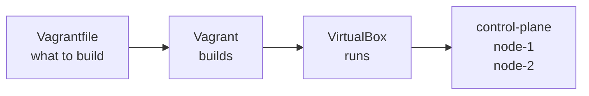

# 0001: Use Vagrant and VirtualBox for the VMs

- **Status**: accepted
- **Date**: 2026-11-08

# Context

- The lab needs 3 VMs that anyone can create, delete and rebuild in minutes.
- Making VMs by hand in a GUI is slow, and every person ends up with slightly different VMs.
- The setup must be easy for beginners and free to use.

# Decision

- Describe all VMs in one `Vagrantfile` and create them with **Vagrant**.
- Run the VMs with **VirtualBox**.

# Why

- One command, `vagrant up`, builds the same 3 VMs every time.
- The `Vagrantfile` is in git, so every change to the VMs is tracked.
- VirtualBox is free and works on Linux, Windows and Intel Macs.
- VirtualBox was already installed on the main lab computer.
- Vagrant can set CPUs, memory, network cards and extra disks for VirtualBox without any plugin.
- Vagrant with VirtualBox is used in many beginner guides, so help is easy to find.

# Options we looked at

| Option                 | Good                                       | Bad                                                 |
|------------------------|--------------------------------------------|-----------------------------------------------------|
| Vagrant + VirtualBox   | Simple, works on most computers, common    | Slower than KVM on Linux, can clash with KVM        |
| Vagrant + libvirt (KVM)| Faster on Linux                            | Needs the `vagrant-libvirt` plugin, Linux only      |
| Multipass              | Very simple                                | Ubuntu only, fewer guides for multi-node labs       |
| VMs made by hand       | No extra tools                             | Slow, not repeatable, easy to get wrong             |

# Consequences

- **Good**: the whole lab can be rebuilt with `vagrant destroy -f` and `vagrant up`.
- **Bad**: on Linux, KVM can block VirtualBox. Covered in [Fix the VirtualBox and KVM error](../diataxis/how-to/fix-virtualbox-kvm-error.md).
- **Bad**: Apple Silicon Macs need a different provider. Out of scope for now.
- **Follow up**: private IPs must stay in `192.168.56.0/21`, the range VirtualBox allows by default.
