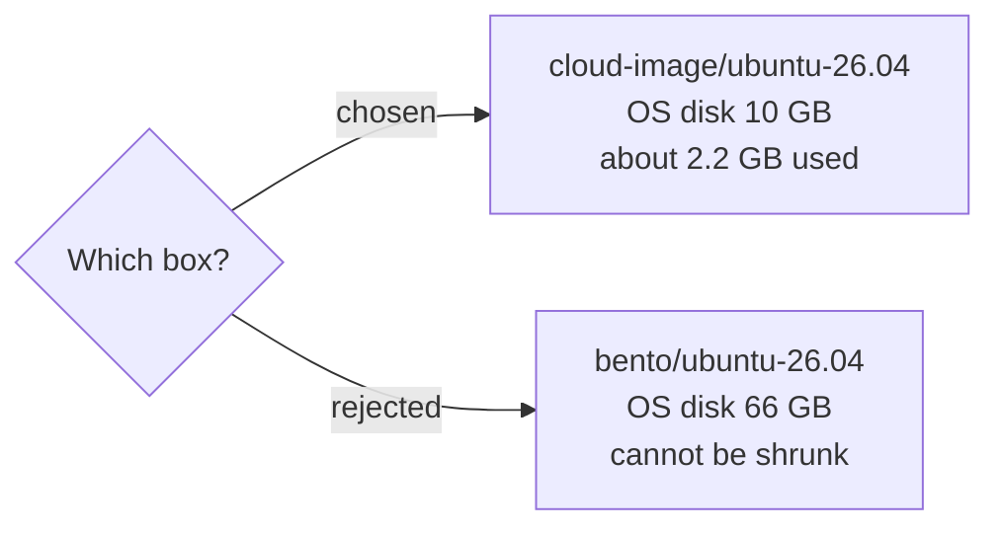

# 0002: Use Ubuntu 26.04 LTS from the cloud-image box

- **Status**: accepted
- **Date**: 2026-11-08

# Context

- All 3 VMs need the same operating system, so tutorials work the same on every node.
- It must be supported by kubeadm and RKE2.
- It must have a Vagrant box for VirtualBox.
- The OS disk should be small. VirtualBox can grow a disk but can never shrink one.

# Decision

- Use **Ubuntu 26.04 LTS** from the `cloud-image/ubuntu-26.04` box.
- Fix two problems the box ships with (see Consequences).

# Why

- Ubuntu 26.04 is the newest Ubuntu LTS release, so it gets updates for years.
- Ubuntu is the most common OS in Kubernetes guides, so examples match what you see.
- The box is the **official Ubuntu cloud image**, with only a `vagrant` user added.
- Its OS disk is **10 GB**, small and light. The bento box is built with 66 GB, which can never be made smaller.
- It has a VirtualBox build for amd64. Its disk controller is VirtIO SCSI with 14 ports, enough for the extra data disk.

# Options we looked at

| Option                          | Good                                         | Bad                                                 |
|---------------------------------|----------------------------------------------|-----------------------------------------------------|
| `cloud-image/ubuntu-26.04`      | Official cloud image, small 10 GB disk       | Community packaging, ships with 2 small bugs (below) |
| `bento/ubuntu-26.04`            | Very widely used, well maintained            | Built with a 66 GB disk                             |
| Ubuntu 24.04 LTS                | Very well tested                             | Older, shorter remaining support                    |
| Debian                          | Light on memory, very stable                 | Fewer beginner Kubernetes guides                    |
| Rocky or Alma Linux             | Practice for RHEL style systems              | Different package tool (`dnf`), different defaults  |

# Consequences

- **Good**: one OS everywhere, `apt` for all packages, a small OS disk.
- **Bad**: the box ships with the VM's **IO-APIC turned off**. Without it Linux uses only 1 CPU. Fixed in the `Vagrantfile` with `vb.customize ["modifyvm", :id, "--ioapic", "on"]`.
- **Bad**: on this box, GRUB writes a **broken `/boot/grub/grubenv`** (a stray byte at the start) at **every boot**. Rewriting the file was tested and does not last: the next boot breaks it again. Two GRUB services then fail and systemd reports `degraded`. The Ansible `prereq` role masks those two services. They only clear GRUB's "last boot failed" marker for the console boot menu, which the lab never uses.
- **Bad**: the box has old VirtualBox Guest Additions (6.0.0). Vagrant prints a warning on every boot. It only matters for shared folders, which the lab turns off.
- **Bad**: the first boot is a little slower, because cloud-init runs.
- **Follow up**: each Kubernetes tutorial must note if that distribution does not support 26.04 yet, and how to work around it.
