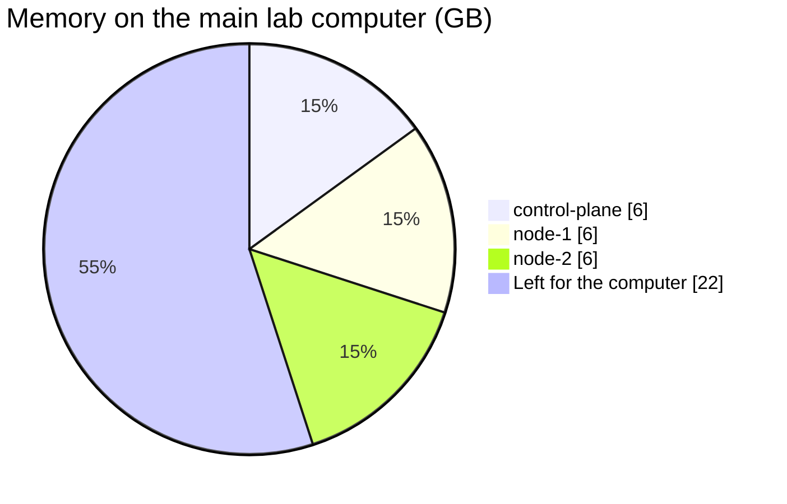

# 0005: Node names, sizes and fixed IPs

- **Status**: accepted
- **Date**: 2026-11-08

# Context

- The main lab computer has **12 CPU threads and 40 GB of RAM**.
- Each Kubernetes distribution has minimum CPU and memory needs. RKE2 asks for the most: 4 GB on a server.
- Ansible and Kubernetes need node addresses that never change.
- The names should say what each VM does.

# Decision

| Name            | IP              | CPUs | Memory |
|-----------------|-----------------|------|--------|
| `control-plane` | `192.168.56.10` | 3    | 6 GB   |
| `node-1`        | `192.168.56.11` | 3    | 6 GB   |
| `node-2`        | `192.168.56.12` | 3    | 6 GB   |

- Names say what each VM does: `control-plane` manages, `node-1` and `node-2` run apps.
- All 3 VMs are the same size, so any of them can take any role later.
- IPs are fixed and set in the `Vagrantfile`.
- Disks are covered in [ADR 0006](0006-two-disks-per-node.md).

# Why

- **3 CPUs**: more than kubeadm's minimum of 2, so the control plane and apps are not starved. 9 in total leaves 3 threads for the computer itself.
- **6 GB memory**: provides more headroom for the control plane and workloads. 18 GB in total leaves 22 GB for the computer. Increased from 4 GB per VM on 2026-11-08.
- **Same size everywhere**: simpler to understand and to change.
- **Fixed IPs**: Ansible's inventory and Kubernetes' node IPs must not change between restarts.
- **192.168.56.x**: the range VirtualBox allows for host-only networks by default.
- **.10, .11, .12**: easy to remember, and leaves `.1` for your computer and `.13` and up for more nodes.

# Options we looked at

| Option                         | Good                                  | Bad                                              |
|--------------------------------|---------------------------------------|--------------------------------------------------|
| 3 CPU, 4 GB each               | Fits RKE2, leaves plenty for the host | Needs a computer with 16 GB or more              |
| 2 CPU, 2 GB each               | Fits 8 GB laptops                     | Too tight for RKE2, slow with real apps          |
| 4 CPU, 8 GB each               | Room for heavy apps                   | 12 of 12 threads used, the host would be slow    |
| IPs from DHCP                  | No setup                              | Addresses can change, which breaks the cluster   |

# Consequences

- **Good**: all three distributions run without changing the `Vagrantfile`.
- **Bad**: the lab no longer fits on an 8 GB laptop. Lower `cpus` and `memory` in the `Vagrantfile` for smaller computers, and skip RKE2.
- **Follow up**: if sizes or IPs change, update the `Vagrantfile`, [Nodes and IPs](../diataxis/reference/nodes-and-ips.md) and the pages in `knowledge/okf/nodes/`.
