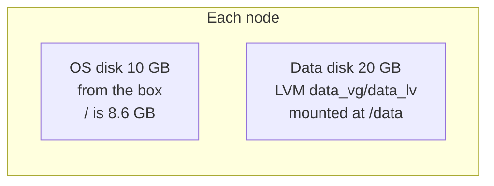

# 0006: Two disks per node: the box's 10 GB OS disk and a 20 GB data disk

- **Status**: accepted
- **Date**: 2026-11-08

# Context

- The OS, Kubernetes and container images need a disk.
- Kubernetes storage (local volumes, Longhorn, Ceph and similar) is easier to practise on a disk that holds nothing else.
- Filling the OS disk by mistake can break a node.
- Vagrant has a built-in way to set disks: `vm.disk`. In Vagrant 2.4.9 it needs no plugin and no experimental flag.
- The box's OS disk is 10 GB. An earlier version of the lab grew it to 20 GB. That resize was removed to keep the setup simple.

# Decision

- Every node gets 2 disks:

| Disk      | Size  | Set with                                                   | Contents                   |
|-----------|-------|------------------------------------------------------------|----------------------------|
| OS disk   | 10 GB | Nothing. It comes with the box and is **not resized**      | Ubuntu, Kubernetes, images |
| Data disk | 20 GB | `vm.disk :disk, name: "<node>-data", size: "20GB"`         | Empty, not formatted       |

- The data disk name includes the node name, so files are easy to tell apart: `node-1-data.vdi`.
- Vagrant creates and attaches the data disk, but does not format or mount it.
- The Ansible `prereq` role makes it an LVM volume (`data_vg/data_lv`), formats it ext4 and mounts it at `/data` through `/etc/fstab`. See [ADR 0008](0008-prereq-and-k8s-prepare-roles.md).

# Why

- Leaving the OS disk as the box made it means no resize step, a faster `vagrant up` and nothing to go wrong on first boot.
- A separate data disk keeps storage experiments away from the OS.
- Disk files are dynamically allocated: a fresh VM uses about 2.2 GB on the host.
- `vm.disk` is part of Vagrant itself, so there are no scripts or plugins to maintain.

# Options we looked at

| Option                                   | Good                                   | Bad                                              |
|------------------------------------------|----------------------------------------|--------------------------------------------------|
| Box OS disk (10 GB) plus 20 GB data disk | Simple, no resize, room for storage practice | Only about 6.7 GB free on `/` when new     |
| OS disk grown to 20 GB plus data disk    | More room for images                   | Extra resize step on every new VM                |
| One large OS disk only                   | Simple                                 | Storage tools would share the OS disk            |

# Consequences

- **Good**: `vagrant up` is simpler and faster.
- **Good**: all Kubernetes data goes on `/data` (`/dev/sdb`, seen on all 3 VMs), never on the OS disk.
- **Bad**: only about 6.7 GB is free on `/` when a VM is new. Watch it with `df -h /`, especially for RKE2 and kubeadm. If it runs short, add the resize back with `vm.disk :disk, name: "<node>-os", size: "20GB", primary: true` and rebuild.
- **Bad**: `vagrant destroy` deletes both disks. Nothing on the data disk survives a rebuild.
- **Follow up**: host disk use can reach 90 GB if all 6 disks fill up. Watch free space on the host.
