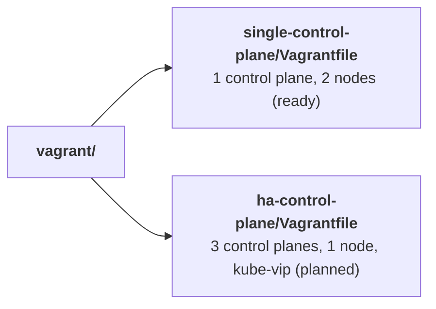

# 0007: One folder and Vagrantfile per cluster layout

- **Status**: accepted
- **Date**: 2026-11-08

# Context

- The lab has one layout today: 1 control plane and 2 nodes.
- A second layout is planned: 3 control planes and 1 node, with a kube-vip virtual IP.
- Vagrant reads the `Vagrantfile` in the current folder, and keeps VM state in `.vagrant/` next to it.
- VirtualBox VM names must be unique on the computer.

# Decision

- Keep every layout in its own folder under `vagrant/`, each with its own `Vagrantfile`.

- Give each layout its own VirtualBox name prefix and its own IP range:

| Layout                 | VirtualBox prefix  | IPs                                  |
|------------------------|--------------------|--------------------------------------|
| `single-control-plane` | `kube-lab-single-` | `192.168.56.10` to `.12`             |
| `ha-control-plane`     | `kube-lab-ha-`     | VIP `192.168.56.20`, VMs `.21` to `.24` |

# Why

- Each `Vagrantfile` stays short and simple, with no logic to pick a layout.
- Each layout has separate state, so commands in one folder cannot affect the other.
- Different prefixes and IPs let both layouts exist without clashing.
- Folder names say what the layout is, so beginners can pick the right one.

# Options we looked at

| Option                                    | Good                                  | Bad                                             |
|-------------------------------------------|---------------------------------------|-------------------------------------------------|
| One folder per layout                     | Simple files, separate state          | Some settings repeated in each `Vagrantfile`     |
| One `Vagrantfile` with a `LAYOUT` variable| No repetition                         | `if` logic in Ruby, shared state, hard for beginners |
| Several files picked with `VAGRANT_VAGRANTFILE` | One folder                      | Easy to forget the variable and act on the wrong VMs |

# Consequences

- **Good**: adding a layout means adding a folder. Nothing else changes.
- **Bad**: shared settings (box, disk sizes) are repeated in each `Vagrantfile`. A change must be made in each one.
- **Follow up**: every `vagrant` command in the docs must say which folder to run it from.
- **Follow up**: Ansible needs one inventory per layout, pointing at that layout's IPs and `.vagrant/` keys.
