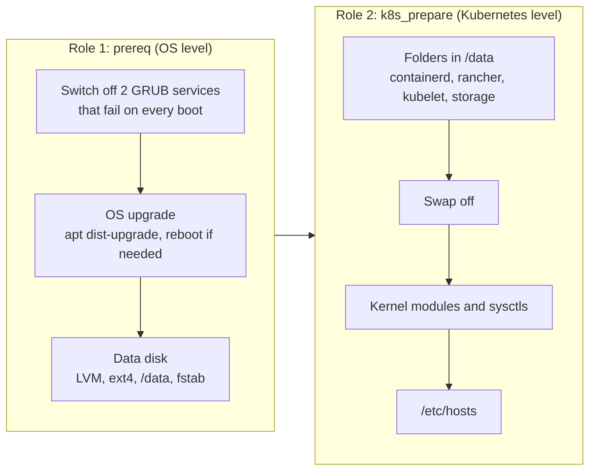

# 0008: Two Ansible roles before Kubernetes: prereq and k8s_prepare

- **Status**: accepted
- **Date**: 2026-11-08

# Context

- Before kubeadm or RKE2 can be installed, every VM needs the same setup.
- Some of it is about the OS: updates, the box's GRUB problem, the data disk.
- Some of it is about Kubernetes: data folders, swap, kernel settings, node names.
- Container images must go on the 20 GB data disk, never on the 10 GB OS disk.
- The steps must be easy for beginners to read and safe to run again.

# Decision

- Two roles, always run in this order by `ansible/prepare.yml`:

- The data disk uses **LVM**: `/dev/sdb` becomes a physical volume in volume group `data_vg`, with one logical volume `data_lv` using all the space, formatted **ext4** and mounted at **`/data`** through `/etc/fstab`.
- `k8s_prepare` only **makes the folders** in `/data`. Each Kubernetes role points its own settings at them later (RKE2 `data-dir`, containerd `root`, kubelet `root-dir`). No bind mounts or symlinks.
- OS updates are done by Ansible, not cloud-init.
- Settings shared by several roles (the disk, `/data`, the folder paths) live in the inventory's `group_vars/all/` files.

# Why

- **Two roles**: OS work and Kubernetes work are different jobs. Each role is short and can be read on its own.
- **LVM**: the data volume can be grown later by adding another disk to `data_vg`, without moving data.
- **Folders, not bind mounts**: each distribution's own setting is the official way to move its data. Nothing is hidden behind a mount.
- **Ansible, not cloud-init, for updates**: Vagrant's cloud-init needs the `mkisofs` program on the host and only runs on first boot. Ansible needs nothing extra and can be run again any time.
- **Simple disk setting**: the disk is named in `group_vars/all/lab.yml` (`/dev/sdb`) instead of being found by complex logic. A safety check refuses to use a disk that is not blank.

# Options we looked at

| Option                                      | Good                                    | Bad                                              |
|---------------------------------------------|-----------------------------------------|--------------------------------------------------|
| prereq plus k8s_prepare                     | Clear split, short roles                | Two roles to learn                               |
| One big prepare role                        | One place                               | Long, mixes OS and Kubernetes work               |
| Plain partition instead of LVM              | Simpler                                 | Harder to grow later                             |
| Bind mount /data folders over /var/lib      | Works for every distribution unchanged  | Hides where data really is, extra fstab lines    |
| cloud-init for OS updates                   | Runs before SSH                         | Needs `mkisofs` on the host, first boot only     |

# Consequences

- **Good**: `ansible-playbook prepare.yml` gets any VM ready, and running it again changes nothing.
- **Good**: about 19.5 GB of data space per node, separate from the OS.
- **Bad**: every Kubernetes role must remember to point its data settings at the `/data` folders.
- **Follow up**: `site.yml` runs `prepare.yml` first, for both kubeadm and RKE2.
