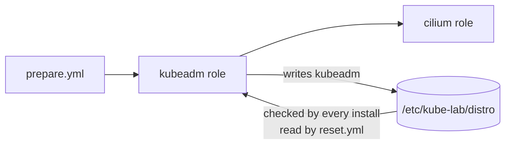

# 0009: kubeadm with containerd, Cilium with Helm, one playbook per distribution

- **Status**: accepted. The "one playbook per distribution" part is superseded by [ADR 0010](0010-one-site-playbook-driven-by-vars.md). The "keep kube-proxy" part is superseded by [ADR 0012](0012-cilium-replaces-kube-proxy.md). The "Helm from the host" part is superseded by [ADR 0011](0011-run-helm-on-control-plane.md). The Cilium values now live in the role's template, see [ADR 0014](0014-config-files-in-the-roles.md)
- **Date**: 2026-11-08

# Context

- kubeadm is the first distribution. RKE2 comes next, on the same VMs.
- kubeadm needs a container runtime and a pod network (CNI). It includes neither.
- All Kubernetes data must go on `/data`, never on the 10 GB OS disk.
- Helm and kubectl are on the host (installed with Homebrew). Your personal Helm setup has repositories that may be broken.

# Decision

- **Kubernetes**: v1.37.2 from `pkgs.k8s.io`, versions held with `dpkg` hold.
- **Container runtime**: Ubuntu's `containerd` 2.2.2, `root = /data/containerd`, `SystemdCgroup = true`.
- **kubeadm config** in templates (`kubeadm-init.yaml.j2`, `kubeadm-join.yaml.j2`, API `v1beta4`):
  - node IPs and the API address on the private network,
  - kubelet `root-dir` `/data/kubelet`, etcd `dataDir` `/data/etcd`,
  - pods `10.244.0.0/16`, services `10.96.0.0/12`,
  - `controlPlaneEndpoint` set from the start, ready for an HA address later.
- **Pod network**: Cilium 1.20.4, installed by a separate `cilium` role with Helm from the host, settings first in a `values.yaml` file, now `cilium_values` in `group_vars/all/cilium.yml` ([ADR 0010](0010-one-site-playbook-driven-by-vars.md)), `ipam.mode: kubernetes`.
- **Helm isolation**: the role uses `/data/helm/` for Helm's repository list and cache.
- **Switching** (first idea, replaced by [ADR 0010](0010-one-site-playbook-driven-by-vars.md)): one playbook per distribution, all starting with `prepare.yml`, plus a `reset.yml`. Each install writes `/etc/kube-lab/distro`, and refuses to run if another distribution is named there.

# Why

- **containerd from Ubuntu**: one `apt install`, maintained with the OS, the version kubeadm 1.37 supports.
- **Config files instead of command flags**: every setting is in one readable file on the VM, and `kubeadm config validate` checks it before use.
- **Cilium**: a modern, widely used CNI with good tooling (`cilium status`). A separate role means RKE2 can reuse it.
- **Helm from the host**: Helm is already there. Nothing extra is installed in the VMs.
- **values.yaml file**: the Cilium settings are in one file that is easy to read and change, the same way Helm is used outside Ansible.
- **Own Helm setup**: a broken repository in the personal Helm setup made the first installs fail. Separating them removes that risk for good.
- **One playbook per distribution**: what you run is what you get. No hidden switch variable.
- **Marker file**: stops two distributions being installed on top of each other.

# Options we looked at

| Option                                   | Good                                  | Bad                                             |
|------------------------------------------|---------------------------------------|-------------------------------------------------|
| Cilium with Helm (chosen)                | Modern, good tooling, reusable role   | Needs Helm on the host                          |
| Flannel from a YAML manifest             | Very simple                           | Must be patched to use the private card. Fewer features |
| Calico                                   | Popular, network policies             | Its example pod range overlaps `192.168.56.0/24` |
| One `site.yml` with a `distro` variable  | One command                           | Harder to read, easy to run the wrong distro    |
| containerd from Docker's repository      | Newest version                        | Extra repository to manage                      |

# Consequences

- **Good**: the kubeadm playbook (now `site.yml` with `k8s_distro: kubeadm`) builds a working cluster from prepared VMs, and running it again changes nothing.
- **Good**: tested on 2026-11-08: 3 nodes `Ready`, pod to pod across nodes, DNS, services and internet from pods all work.
- **Bad**: kube-proxy still runs next to Cilium. Cilium can replace it, but that is more to explain. It can be turned on later in `cilium_values`.
- **Bad**: on 3 CPU VMs the scheduler and controller manager may restart once during the first install, while images download.
- **Follow up**: done in [ADR 0010](0010-one-site-playbook-driven-by-vars.md): `site.yml`, `reset.yml`, the `rke2` role and all settings in vars files.
