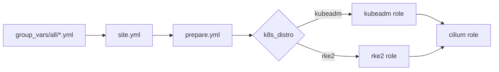

# 0010: One site playbook, every setting in vars files

- **Status**: accepted
- **Date**: 2026-11-08
- **Replaces**: the "one playbook per distribution" part of [ADR 0009](0009-kubeadm-with-containerd-and-cilium.md)

# Context

- The lab needs two distributions: kubeadm and RKE2.
- Changing a version or a setting should be: edit one file, run one command.
- Values written directly in roles or templates are hard to find and easy to forget.
- During an RKE2 upgrade, kube-proxy restarts. New Cilium agents that started at that moment could not reach the API through `10.96.0.1` and stayed stuck. This was seen in testing.

# Decision

- **One playbook to install or upgrade**: `site.yml`. It reads `k8s_distro` and runs the `kubeadm` or the `rke2` role, then the `cilium` role.
- **One playbook to remove**: `reset.yml`. It reads the marker `/etc/kube-lab/distro` and removes that distribution, keeping the VMs and `/data`.
- **Every setting in vars files** in `group_vars/all/`:

```
cluster.yml   k8s_distro, versions, API address, subnets
kubeadm.yml   containerd, packages, the full kubeadm config blocks
rke2.yml      switches, the full RKE2 server and agent config blocks
cilium.yml    Helm chart and all Cilium values
os.yml        OS upgrade, GRUB, LVM, kernel
lab.yml       login, disk, folders, file locations
```

- **Templates print config blocks from vars** with `to_nice_yaml`, so the vars file shows exactly what lands on the VM. For kubeadm and Cilium this was replaced by [ADR 0014](0014-config-files-in-the-roles.md): their config files are written out in the roles' templates and the vars hold only values.
- **Role defaults hold no settings.** Only paths that the tools themselves fix (such as `/etc/rancher/rke2`) stay in the roles, marked as such.
- **Upgrades**: raising a version and running `site.yml` upgrades in the right order. kubeadm uses `kubeadm upgrade apply` and `kubeadm upgrade node`. RKE2 downloads and unpacks the tarball of the new version. Cilium uses `helm upgrade`.
- **Cilium uses the API address directly** (`k8sServiceHost`, `k8sServicePort`), not `10.96.0.1`.
- **RKE2 uses the same pod and service ranges as kubeadm**, and `cni: none` so the same Cilium role is used.



# Why

- One command for every change is easy to remember and hard to get wrong.
- Settings in plain YAML blocks are easy to read, search and compare.
- The guard and the marker stop a second distribution being installed on top of the first.
- Using the direct API address removes Cilium's dependency on kube-proxy during upgrades.

# Options we looked at

| Option                                    | Good                                 | Bad                                              |
|-------------------------------------------|--------------------------------------|--------------------------------------------------|
| `site.yml` with `k8s_distro` (chosen)     | One command, settings decide         | The distro is not in the command name            |
| One playbook per distribution             | The command says what it installs    | More files, settings spread out                  |
| Settings inside role defaults             | Roles work on their own              | Hidden, spread over many files                   |
| Config written field by field in templates| Short vars files                     | Every new option means editing a template        |

# Consequences

- **Good**: tested on 2026-11-08: kubeadm install, kubeadm 1.37.1 to 1.37.2 upgrade, RKE2 v1.37.1 install, RKE2 v1.37.2 and Cilium 1.20.4 upgrade, Traefik switched off, reset of both.
- **Good**: a run with no setting changed reports `changed=0`.
- **Bad**: the settings files are long. Each starts with a comment saying what it is for.
- **Bad**: the HA layout will need its own copy of the `group_vars` folder.
