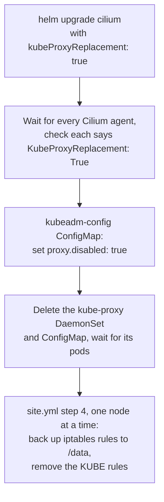

# 0012: Cilium replaces kube-proxy

- **Status**: accepted
- **Date**: 2026-11-08
- **Replaces**: the "keep kube-proxy" part of [ADR 0009](0009-kubeadm-with-containerd-and-cilium.md)

# Context

- Every Kubernetes cluster needs something that sends Service traffic (a ClusterIP or a NodePort) to the right pods.
- By default that is **kube-proxy**: a pod on every node that writes thousands of iptables firewall rules.
- Cilium, the lab's pod network, can do the same job itself with eBPF programs in the Linux kernel.
- Running both means two programs share one job, and more parts to debug.
- During an RKE2 upgrade kube-proxy restarted, and new Cilium agents could not reach the API through the Service IP `10.96.0.1` ([ADR 0010](0010-one-site-playbook-driven-by-vars.md)).

# Decision

- Turn on Cilium's kube-proxy replacement: `cilium_kube_proxy_replacement: true` in `cilium.yml`, used as `kubeProxyReplacement` in the role's `values.yaml.j2`.
- Never install kube-proxy:
  - kubeadm: `proxy.disabled` in the `ClusterConfiguration` of `kubeadm-init.yaml.j2`, set from `kubeadm_kube_proxy_disabled: true` (kubeadm.yml). `kubeadm init` and `kubeadm upgrade` both skip it.
  - RKE2: `disable-kube-proxy` in `roles/rke2/templates/config-server.yaml.j2`, from `rke2_disable_kube_proxy: true` (rke2.yml).
- Cilium talks to the API at `api_server_address:api_server_port` directly (`k8sServiceHost`, `k8sServicePort`), because without kube-proxy the Service IP only works once Cilium runs.
- Clusters built before this decision are migrated by `site.yml`, in a safe order:

- If a check fails, the playbook stops before kube-proxy is removed, so Services keep working.

# Why

- One program for pod traffic and Service traffic: fewer parts and one place to look.
- eBPF lookups stay fast with many Services. iptables rule lists grow long.
- Cilium no longer depends on kube-proxy to reach the API, which fixes the RKE2 upgrade problem.
- It is a common real world setup worth learning.

# Options we looked at

| Option                                   | Good                                      | Bad                                         |
|------------------------------------------|-------------------------------------------|---------------------------------------------|
| Cilium replaces kube-proxy (chosen)      | One program, fast, no API chicken and egg | Cilium must be healthy before Services work |
| Keep kube-proxy next to Cilium           | The default, nothing to change            | Two programs, the RKE2 upgrade problem      |
| kube-proxy in IPVS or nftables mode      | Faster than iptables                      | Still a second program to run and debug     |

# Consequences

- **Good**: no kube-proxy pods, no `KUBE-` iptables rules on new clusters.
- **Bad**: until Cilium runs, Services (and CoreDNS) do not work. That is expected right after `kubeadm init`.
- **Bad**: existing Service connections may reconnect once during a migration.
- **Follow up**: `ansible-playbook verify-network.yml` checks pod to pod, DNS, ClusterIP and NodePort traffic across nodes. See [Check the network works](../diataxis/how-to/verify-the-network.md).

# References

- [Cilium: Kubernetes without kube-proxy](https://docs.cilium.io/en/stable/network/kubernetes/kubeproxy-free/)
- [kubeadm configuration API v1beta4](https://kubernetes.io/docs/reference/config-api/kubeadm-config.v1beta4/)
- [RKE2 networking](https://docs.rke2.io/networking/basic_network_options)
