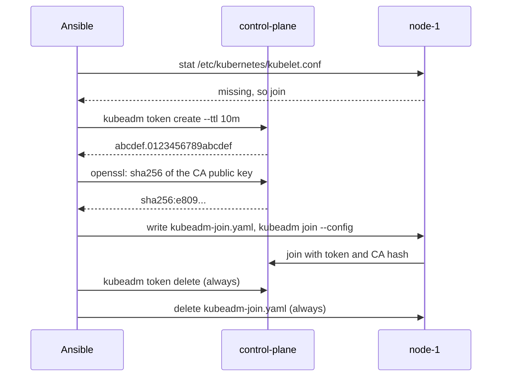

# 0013: Short lived join tokens, made per node by Ansible

- **Status**: accepted
- **Date**: 2026-11-08

# Context

- A node joins a kubeadm cluster with a **bootstrap token** (a short password) and the **CA hash** (the fingerprint of the cluster's certificate authority).
- `kubeadm init` and `kubeadm join` already use YAML config files (`kubeadm-init.yaml`, `kubeadm-join.yaml`).
- The first version of the join had problems, found on 2026-11-08:
  - It ran `kubeadm token create --print-join-command` and cut the token out of the printed command with a regular expression. That breaks if kubeadm changes its output.
  - Every token lived 24 hours (kubeadm's default) and was never deleted. A built cluster had 3 tokens left over: one from `kubeadm init` and one per node.
  - The `kubeadm init` output, with a token in it, was printed in the Ansible log.
  - `lab.yml` picked the SSH key with `inventory_hostname`. When a node task ran a step on the control plane (`delegate_to`), Ansible used the node's key and could not log in.

# Decision

- For each node that has not joined yet, `roles/kubeadm/tasks/join.yml`:
  1. runs `kubeadm token create --ttl 10m --description "kube-lab join token for <node>"` on the control plane. It prints only the token, nothing to cut out.
  2. works out the CA hash from `/etc/kubernetes/pki/ca.crt` with `openssl`, the method in the kubeadm docs.
  3. writes `kubeadm-join.yaml`, checks it with `kubeadm config validate`, runs `kubeadm join --config`.
  4. always, even when the join fails: deletes the token and the file.
- The init token is short lived too: `bootstrapTokens` in the `InitConfiguration` of `kubeadm-init.yaml.j2` with `ttl: 15m` and no token value, so kubeadm makes a random one.
- Token tasks have `no_log: true`. The init output is shown without lines holding a token.
- Each host in `hosts.ini` has `vagrant_machine`, and `lab.yml` uses it for the SSH key path, so `delegate_to` always uses the right key.
- Settings: `kubeadm_init_token_ttl`, `kubeadm_join_token_ttl` and the descriptions, in `kubeadm.yml`.

# Why

- No secret stays behind: the token is gone a few seconds after it is used.
- `kubeadm token create` without `--print-join-command` has a stable, one line output.
- One token per node keeps each node's join on its own. If one join fails, the others are not touched.
- The `delegate_to` fix also helps the RKE2 agent, which reads the token file on the server the same way.

# Options we looked at

| Option                                             | Good                                  | Bad                                            |
|----------------------------------------------------|---------------------------------------|------------------------------------------------|
| A new short lived token per node, deleted (chosen) | Nothing left over, simple tasks       | One more task per node                         |
| `--print-join-command` and a regex (old)           | Few tasks                             | Brittle parsing, 24 hour tokens left over      |
| Make a token in Ansible, put it in `kubeadm-init.yaml` | One token for everything          | The token sits in a file and in the vars, new nodes later need a new one anyway |
| Join with a kubeconfig file (`discovery.file`)     | No CA hash needed                     | Still needs a token, and a file copy between VMs |

# Consequences

- **Good**: `kubeadm token list` on the control plane is empty after `site.yml`, except the init token for its first 15 minutes.
- **Good**: rejoining a node is simple: reset it, then run `site.yml`. See [Rejoin a node](../diataxis/how-to/rejoin-a-node.md).
- **Bad**: a join must finish within `kubeadm_join_token_ttl` (10 minutes). Raise it on a very slow computer.
