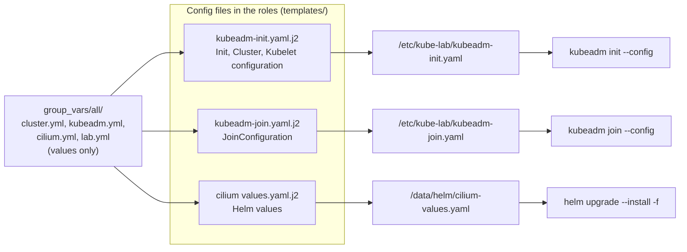

# 0014: Config files live in the roles, vars hold only values

- **Status**: accepted
- **Date**: 2026-11-08
- **Replaces**: for kubeadm, Cilium and RKE2, the "templates print config blocks from vars" part of [ADR 0010](0010-one-site-playbook-driven-by-vars.md)

# Context

- `kubeadm init` and `kubeadm join` read YAML config files: `kind: InitConfiguration`, `ClusterConfiguration`, `KubeletConfiguration`, `JoinConfiguration`.
- Until now the whole config was written as YAML blocks inside `group_vars/all/kubeadm.yml` (`kubeadm_init_configuration` and others). The templates only printed those blocks with `to_nice_yaml`.
- The Cilium Helm values were the same: one `cilium_values` block in `cilium.yml`, printed into the values file.
- That mixed two things in the vars files: the **shape** of the kubeadm config (apiVersion, kind, field names) and the **values** (IPs, versions, folders).
- Someone reading the role could not see the kubeadm config. Someone reading the vars file had to read a whole kubeadm config to find one value.

# Decision

- The kubeadm config files are written out in the role, as kubeadm reads them:
  - `roles/kubeadm/templates/kubeadm-init.yaml.j2`
  - `roles/kubeadm/templates/kubeadm-join.yaml.j2`
  - `roles/cilium/templates/values.yaml.j2`, the Helm values file for Cilium.
  - `roles/rke2/templates/config-server.yaml.j2` and `config-agent.yaml.j2`, the RKE2 config files.
- Only the values are `{{ variables }}`. The vars files hold only values, such as `kubeadm_cgroup_driver`, `kubeadm_kube_proxy_disabled`, `cilium_kube_proxy_replacement` and `cilium_operator_replicas`.
- Values shared with RKE2 (versions, API address, subnets, folders) stay in `cluster.yml` and `lab.yml`, and both templates use them.
- They are in `templates/`, not `files/`: Ansible's `copy` module sends files from `files/` unchanged, so they could not hold this VM's IP or name. The `template` module fills the values in first.

# Why

- The role shows the real kubeadm config, so it can be read next to the kubeadm docs.
- The vars file is short and only has things you would change.
- The rendered files were checked to be the same as before: kubeadm init, kubeadm join and the Cilium values.

# Options we looked at

| Option                                       | Good                                     | Bad                                          |
|----------------------------------------------|------------------------------------------|----------------------------------------------|
| Config files in the roles' templates, values in vars (chosen) | Real config in one place, short vars | A new kubeadm option means editing the template |
| Whole config as YAML blocks in vars (old)    | Any option can be added in the vars file | Vars file holds the config shape, hard to read |
| Fixed files in `files/`                      | Plain YAML, no Jinja                     | No way to put in each VM's IP, name or the join token |

# Consequences

- **Good**: `kubeadm.yml`, `cilium.yml` and `rke2.yml` have values only.
- **Bad**: to add a kubeadm or Cilium option that has no variable, edit the template in the role.
- **Follow up (done)**: RKE2 moved the same way: `roles/rke2/templates/config-server.yaml.j2` and `config-agent.yaml.j2`. The `rke2_*_extra_config` hooks were removed: add a new option to the template.
