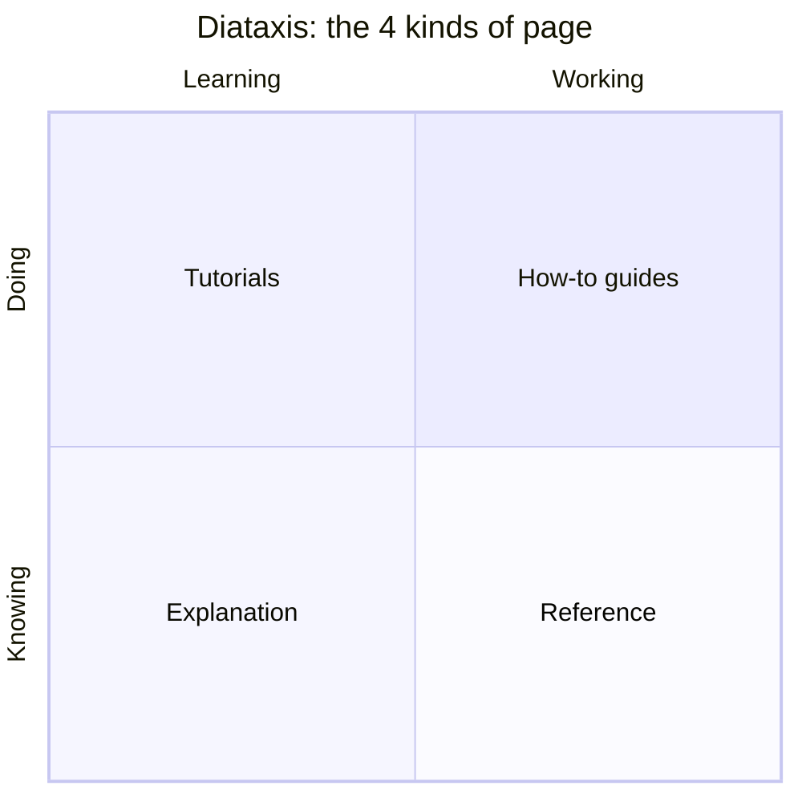

# Diataxis docs

- These pages are sorted by what you need right now.
- New here? Start with [docs/README.md](../README.md) for the reading order.

| Folder                         | Open it when                                   |
|--------------------------------|------------------------------------------------|
| [tutorials/](tutorials/README.md)     | You are learning and want steps in order. |
| [how-to/](how-to/README.md)           | You know the goal and need the steps.     |
| [explanation/](explanation/README.md) | You want to understand how and why.       |
| [reference/](reference/README.md)     | You need an exact fact or command.        |
