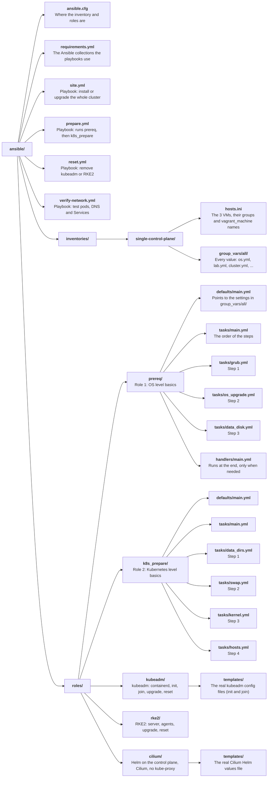
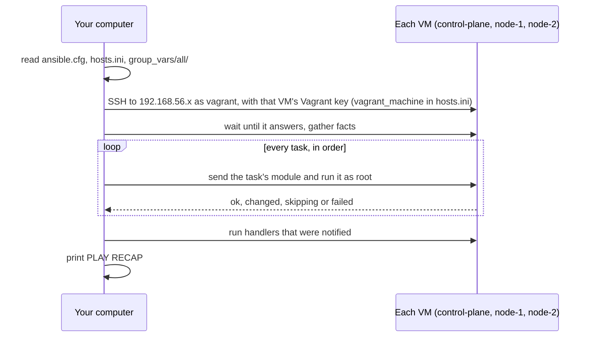
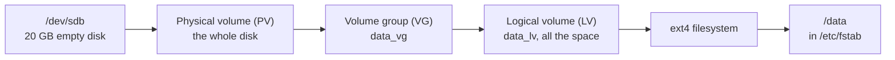
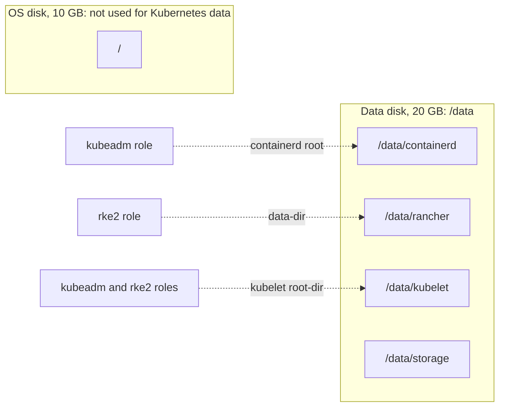

# The Ansible roles explained

- This page explains how the `ansible/` folder is built, the Ansible words you need, and what the `prereq` and `k8s_prepare` roles do, step by step.

# The Ansible words you need

| Word           | Meaning                                                              | In this lab                                     |
|----------------|----------------------------------------------------------------------|-------------------------------------------------|
| Inventory      | The list of machines Ansible manages, sorted into groups             | `inventories/single-control-plane/hosts.ini`    |
| Group          | A name for some machines in the inventory                            | `control_plane`, `nodes`, and `cluster` (all 3) |
| Group vars     | Settings for every machine in a group                                | `inventories/single-control-plane/group_vars/all/` |
| Playbook       | A file that says which roles to run on which group                   | `prepare.yml`                                   |
| Role           | A folder of tasks for one job, reusable in many playbooks            | `roles/prereq`, `roles/k8s_prepare`             |
| Task           | One step, using one module                                           | "Mount it at /data and add it to /etc/fstab"    |
| Module         | The tool a task uses. Each module does one kind of thing             | `ansible.builtin.apt`, `community.general.lvg`  |
| Handler        | A task that runs once at the end, only if another task asked for it  | "Clear old systemd failures"                    |
| Tag            | A label on tasks, so you can run only some of them                   | `data_disk`, `kernel`, `os_upgrade`             |
| Idempotent     | Running it again changes nothing if everything is already done       | A second run shows `changed=0`                  |
| `become`       | Run as root, with sudo                                               | `become: true` in `prepare.yml`                 |

# How the folder is built



- Each role has a `tasks/main.yml` that lists its steps in order. Each step is its own small file.
- **Where settings live**: every setting is in `inventories/single-control-plane/group_vars/all/`. The roles have no fixed values.
  - `os.yml`: OS upgrade, GRUB, LVM names, filesystem, kernel modules and sysctls (prereq and k8s_prepare).
  - `lab.yml`: SSH login, the data disk, `/data` and its folders.
  - `cluster.yml`, `kubeadm.yml`, `rke2.yml`, `cilium.yml`: the Kubernetes side, see [Installing Kubernetes explained](installing-kubernetes-explained.md).
  - `roles/<role>/defaults/main.yml` only says where the settings are, plus a few paths the tools themselves fix.
  - Every setting with its value: [Ansible settings](../reference/ansible-settings.md).

# How a run works



- Tasks run on all 3 VMs at the same time, one task after another.
- Ansible copies a small Python program for each task to the VM, runs it, then deletes it. Nothing is left installed for Ansible.

# Role 1: prereq

## Step 1: Switch off 2 GRUB services

- On this box, GRUB (the boot loader) writes a broken `/boot/grub/grubenv` at every boot.
- Two small services then fail at every boot, and systemd says `degraded`.
- Rewriting the file does not help: it was tested, and GRUB breaks it again at the next boot.
- Those services only clear GRUB's "last boot failed" marker for the boot menu on the VM's screen. Lab VMs are used over SSH, so the role **masks** them: systemd never starts them.
- To undo: `sudo systemctl unmask grub2-common.service grub-initrd-fallback.service`.

## Step 2: OS upgrade

- The same as `apt update` then `apt dist-upgrade`.
- `dist-upgrade` also installs new kernels.
- If Ubuntu creates `/var/run/reboot-required`, the role reboots the VM and waits for it.

## Step 3: Data disk with LVM



- **LVM** (Logical Volume Manager) puts a flexible layer between the disk and the filesystem.
  - A **physical volume** is a real disk given to LVM.
  - A **volume group** is a pool made from one or more physical volumes.
  - A **logical volume** is a slice of the pool that you format and mount, like a partition.
- Why LVM: if `/data` gets full, you can add another disk to `data_vg` and grow `data_lv` without moving any data.
- Safety first:
  - If `data_vg` already exists, the disk is left alone.
  - Before the first setup, `wipefs --no-act /dev/sdb` lists anything on the disk. If it is not blank, the role stops and touches nothing.
  - The format step only formats when there is no filesystem yet.
- `/etc/fstab` gets this line, so `/data` is mounted at every boot:

```
/dev/data_vg/data_lv /data ext4 defaults,nofail 0 0
```

- `nofail` means the VM still boots if the data disk is ever missing.

# Role 2: k8s_prepare

## Step 1: Folders in /data

| Folder              | Used by        | For                                          |
|---------------------|----------------|----------------------------------------------|
| `/data/containerd`  | kubeadm        | containerd images and containers             |
| `/data/rancher`     | RKE2           | its whole data folder, images included       |
| `/data/kubelet`     | all three      | kubelet data and pod volumes                 |
| `/data/storage`     | all three      | app volumes (local storage) later            |

- The role first checks that `/data` is really mounted. Otherwise the folders would land on the OS disk.
- The folders are only made here. Each Kubernetes role points its own setting at them later, so the 10 GB OS disk never fills with images.



## Step 2: Swap off

- By default the kubelet will not start while swap is on.
- The cloud image has no swap, so this step is usually skipped. It keeps the role correct on other machines.

## Step 3: Kernel modules and settings

| Item                                     | Why Kubernetes needs it                                   |
|------------------------------------------|-----------------------------------------------------------|
| Module `overlay`                         | The filesystem container images are built from           |
| Module `br_netfilter`                    | Lets the firewall see traffic between pods on a bridge    |
| `net.bridge.bridge-nf-call-iptables = 1` | Sends bridged pod traffic through iptables rules          |
| `net.bridge.bridge-nf-call-ip6tables = 1`| The same for IPv6                                         |
| `net.ipv4.ip_forward = 1`                | Lets the node pass traffic between pods and nodes         |

- Files written so they stay after a reboot: `/etc/modules-load.d/kubernetes.conf` and `/etc/sysctl.d/99-kubernetes.conf`.

## Step 4: /etc/hosts

- Adds every node's private IP and name, so `ping node-1` works on every VM without a DNS server.
- The block is marked with `# BEGIN kube-lab nodes` and `# END kube-lab nodes`, so Ansible updates only its own lines.

# Why Ansible and not cloud-init

- Vagrant's cloud-init needs the `mkisofs` program on your computer and only runs on a VM's first boot.
- Ansible needs nothing extra, can be run again any time, and the same roles work on real servers.
- The decision: [ADR 0008](../../adr/0008-prereq-and-k8s-prepare-roles.md).
