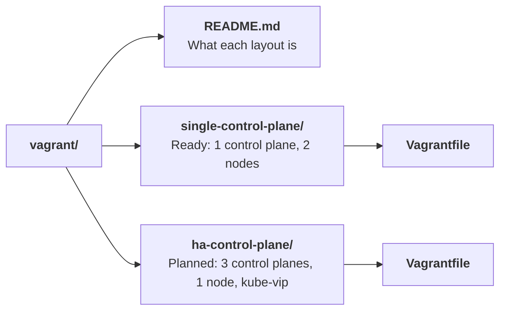
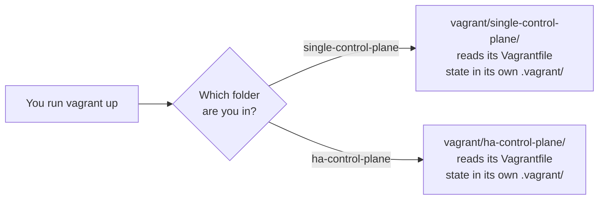
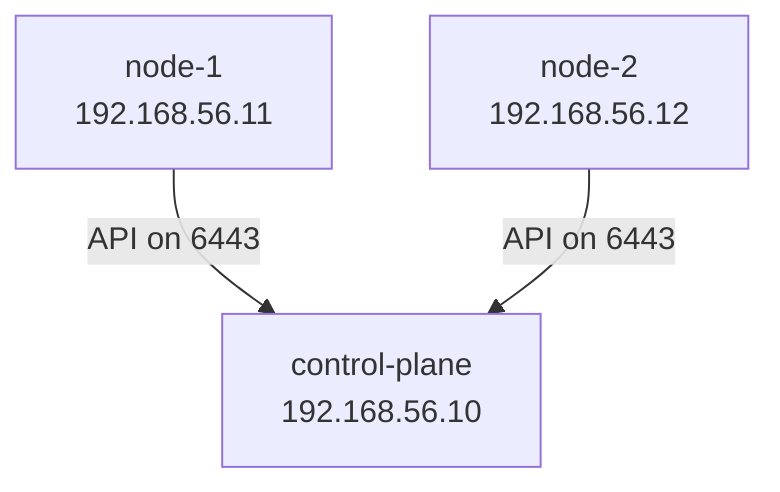
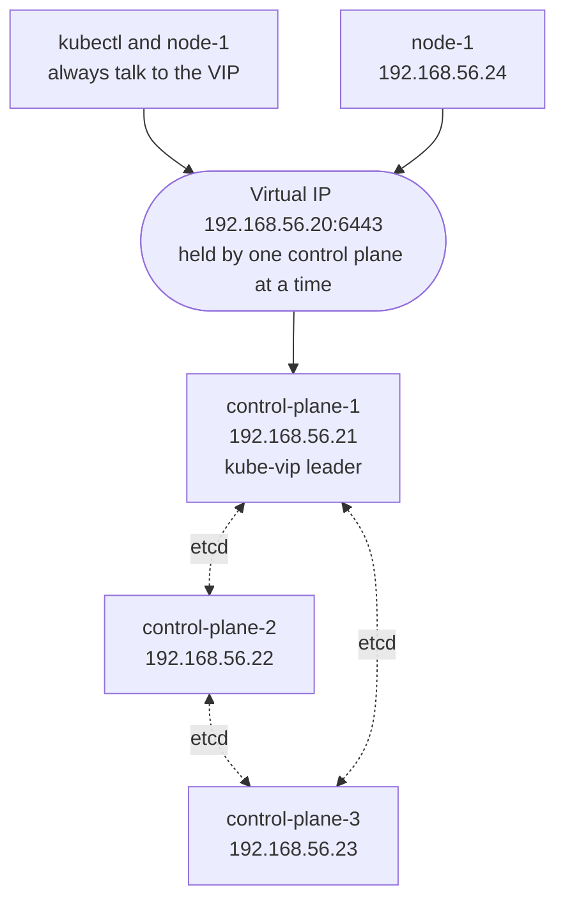
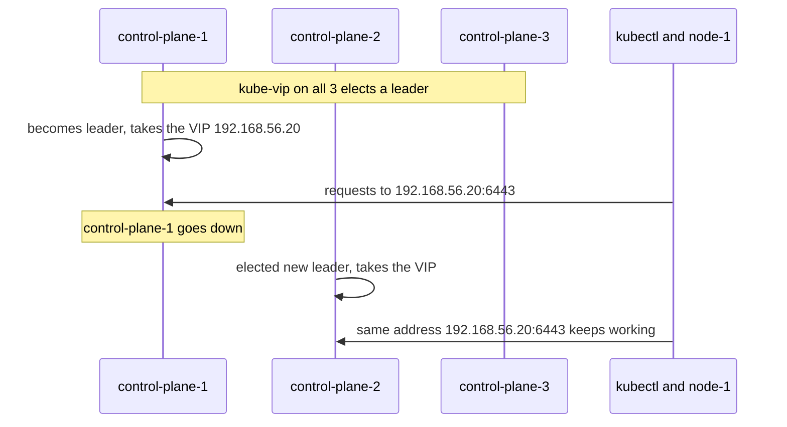

# Cluster layouts

- This page explains why each cluster layout has its own folder and `Vagrantfile`, what the two layouts are, and how kube-vip fits into the planned HA layout.

# The short version

- A **layout** is one shape of cluster: how many control planes, how many nodes, which IPs.
- Each layout lives in its own folder under `vagrant/`, with its own `Vagrantfile`.
- You `cd` into a layout's folder before running any `vagrant` command.



# Why one folder per layout

- Vagrant always reads the file named `Vagrantfile` in the folder you are in.
- Vagrant keeps the state of the VMs (their IDs and SSH keys) in a `.vagrant/` folder next to that `Vagrantfile`.
- One folder per layout means:
  - Each layout has its own `Vagrantfile`, with no `if` statements to switch between layouts.
  - Each layout has its own `.vagrant/` state, so `vagrant destroy` in one folder never touches the other.
  - `vagrant status` in a folder only shows that layout's VMs.



- The decision is recorded in [ADR 0007](../../adr/0007-one-folder-per-cluster-layout.md).

# Layout 1: single-control-plane (ready)



- 1 control plane and 2 nodes.
- Simple to understand. Every tutorial so far uses it.
- **Weak point**: if `control-plane` goes down, the cluster cannot be managed until it comes back. Running apps keep running, but nothing new can be scheduled.

# Layout 2: ha-control-plane (planned)

- HA means **high availability**: the cluster keeps working when one control plane fails.
- 3 control planes and 1 node.
- A **virtual IP** (VIP) from **kube-vip** sits in front of the 3 control planes.



# Why 3 control planes

- The control plane stores everything in **etcd**.
- etcd only works while a **majority** of its members are up. This is called a **quorum**.

| Control planes | Majority needed | Can lose | Worth it?                          |
|----------------|-----------------|----------|------------------------------------|
| 1              | 1               | 0        | No HA at all                       |
| 2              | 2               | 0        | No better than 1, and more to break |
| 3              | 2               | 1        | Yes. The smallest real HA setup    |
| 5              | 3               | 2        | For large clusters                 |

- That is why the HA layout has **3**, not 2.

# What kube-vip does

- With 3 control planes, there are 3 API server addresses. kubectl and the nodes need **one** address that always works.
- kube-vip runs on each control plane and provides that one address: the **virtual IP**.



- Only the **leader** answers for the VIP on the network.
- If the leader fails, another control plane becomes leader and takes over the VIP within seconds.
- kubectl and `node-1` never change the address they use.
- The VIP is not tied to any one VM, so it is not in any VM's network card settings. kube-vip adds it.

# How the two layouts compare

| Topic                       | single-control-plane            | ha-control-plane (planned)              |
|-----------------------------|---------------------------------|-----------------------------------------|
| Folder                      | `vagrant/single-control-plane/` | `vagrant/ha-control-plane/`             |
| Control planes              | 1: `control-plane`              | 3: `control-plane-1` to `control-plane-3` |
| Nodes                       | 2: `node-1`, `node-2`           | 1: `node-1`                             |
| API address                 | `192.168.56.10:6443`            | VIP `192.168.56.20:6443`                |
| IP range                    | `192.168.56.10` to `.12`        | `192.168.56.20` to `.24`                |
| VirtualBox name prefix      | `kube-lab-single-`              | `kube-lab-ha-`                          |
| Survives a control plane failure | No                         | Yes, 1 of 3                             |
| Total CPU and memory        | 9 CPUs, 18 GB                   | 12 CPUs, 24 GB                          |
| Best for                    | Learning the basics             | Learning HA, upgrades, failure tests    |

# Running both layouts

- They use different VM names and different IPs, so both can **exist** at the same time.
- Running both **at once** needs 21 CPUs and 22 GB of memory. On a 12 thread computer, run one at a time:

**Run on: your computer**

```bash
cd kube-lab/vagrant/single-control-plane
vagrant halt
cd ../ha-control-plane
vagrant up
```

- The commands for the HA layout will work once its `Vagrantfile` is added.
