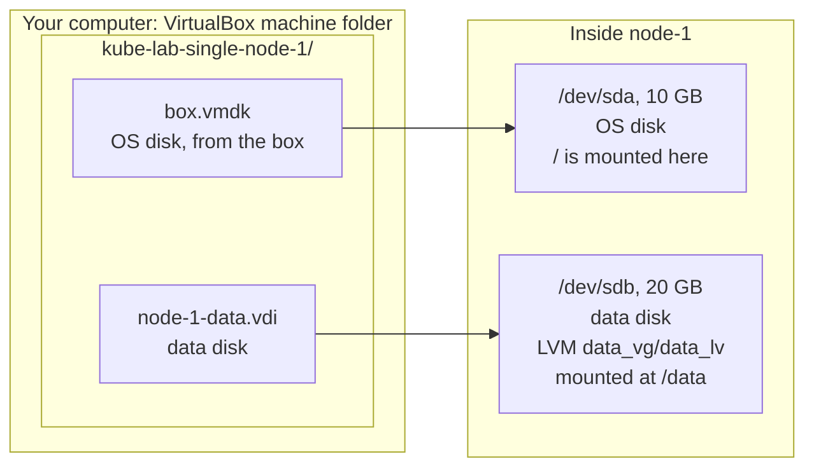
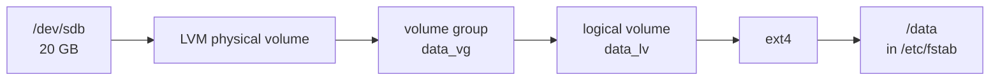
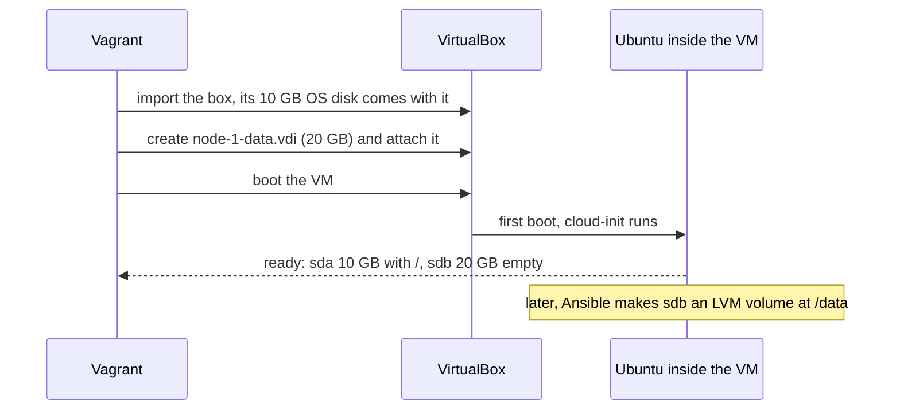

# Disks and storage

- This page explains the 2 disks in every VM: what each is for, where the files live, and what happens to them.

# The short version

- Every VM has **2 disks**:
  - **Disk 1, OS disk, 10 GB**: comes with the box and is **not resized**. Holds Ubuntu, Kubernetes and container images.
  - **Disk 2, data disk, 20 GB**: created empty by Vagrant. The Ansible `prereq` role turns it into an LVM volume mounted at **`/data`**. All Kubernetes data (container images, pod data, app volumes) goes there.
- Both disks are **dynamically allocated**: they start small on your computer and grow only as data is written.
- Both disks are deleted by `vagrant destroy`.

# The picture



- Seen on the real VMs: the OS disk is `sda` and the data disk is `sdb`. Still check with `lsblk`, because device names are not guaranteed.
- Each VM has its own folder and its own disk files. The same layout repeats for `control-plane` and `node-2`.

# How the Vagrantfile sets them up

```ruby
DATA_DISK_SIZE = "20GB"

vm.vm.disk :disk, name: "#{node[:name]}-data", size: DATA_DISK_SIZE
```

| Part                | Meaning                                                                    |
|---------------------|----------------------------------------------------------------------------|
| `vm.vm.disk :disk`  | "This VM has an extra hard disk." (Other types exist, such as `:dvd`.)     |
| `name:`             | The disk's name. It is also the file name: `node-1-data.vdi`.              |
| `size:`             | The largest the disk can grow to.                                          |

- There is **no line for the OS disk**. Each VM keeps the disk that comes inside the box, at its original 10 GB.
- This uses Vagrant's built-in disk feature. It needs no plugin and no extra flag in Vagrant 2.4.9.
- Vagrant's guide: [Vagrant disks usage](https://developer.hashicorp.com/vagrant/docs/disks/usage).

# The OS disk

- Size: **10 GB**, the size the box was built with.
- Partitions, as seen on the real VMs:

| Partition | Size     | Mounted at   | Holds                               |
|-----------|----------|--------------|-------------------------------------|
| `sda1`    | 8.6 GB   | `/`          | Ubuntu, and later Kubernetes and images |
| `sda13`   | 1 GB     | `/boot`      | Linux kernels                       |
| `sda14`   | 4 MB     | (none)       | BIOS boot code                      |
| `sda15`   | 106 MB   | `/boot/efi`  | UEFI boot files                     |

- Right after `vagrant up`, `/` has about **6.7 GB free**.
- Container images go to `/data`, so the OS disk only needs room for the OS itself. Check it now and then with `df -h /`.
- Why the OS disk is not resized: [ADR 0006](../../adr/0006-two-disks-per-node.md).

# The data disk

- Vagrant creates an empty file, `node-1-data.vdi`, in the VM's folder, and attaches it as a second disk.
- You see this line in the output: `Disk 'node-1-data' not found in guest. Creating and attaching disk to guest...`
- Vagrant does **not** partition, format or mount it.
- The Ansible `prereq` role ([tutorial 3](../tutorials/03-prepare-nodes.md)) then sets it up:



- The `k8s_prepare` role then makes the Kubernetes folders on it:

| Folder              | Used by        | For                                       |
|---------------------|----------------|-------------------------------------------|
| `/data/containerd`  | kubeadm        | containerd images and containers          |
| `/data/rancher`     | RKE2           | its data folder, images included          |
| `/data/kubelet`     | all three      | kubelet data and pod volumes              |
| `/data/storage`     | all three      | app volumes later                         |

- Why: container images are big. They go on the 20 GB data disk so the 10 GB OS disk never fills up.
- Full explanation: [The Ansible roles explained](ansible-roles-explained.md).



# Rules VirtualBox enforces

- **Disks can grow, never shrink.** If you lower a size in the `Vagrantfile`, Vagrant prints `VirtualBox does not support shrinking disk sizes` and keeps the old size.
- **There is a limit on disks per controller.** The box uses a VirtIO SCSI controller with 14 ports, so 2 disks is far below the limit.

# What happens to the disks over time

| Action                          | OS disk                       | Data disk                   |
|---------------------------------|-------------------------------|-----------------------------|
| `vagrant halt`, `vagrant up`    | Kept                          | Kept                        |
| `vagrant reload`                | Kept                          | Kept                        |
| `ansible-playbook prepare.yml` again | OS upgraded, rest kept | Kept, never formatted again |
| Reset playbook (coming next)    | Kubernetes removed, rest kept | Kept                        |
| Remove the data disk line from the `Vagrantfile`, then `vagrant reload` | Kept | **Detached and deleted** |
| `vagrant destroy -f`            | **Deleted**                   | **Deleted**                 |

# How much space on your computer

| When                       | Per VM                  | All 3 VMs              |
|----------------------------|-------------------------|------------------------|
| Just after `vagrant up` (measured) | About 2.2 GB     | About 6.6 GB           |
| With Kubernetes and apps   | Grows with use          | Grows with use         |
| The most it can ever use   | 30 GB (10 + 20)         | 90 GB                  |

- The downloaded box itself (about 2.2 GB) is kept once in `~/.vagrant.d/boxes/` and copied for each VM.

# Where the disk files are

- VirtualBox keeps each VM in its **default machine folder**. On a fresh install that is `~/VirtualBox VMs/`, but it can be changed.
- Find yours:

**Run on: your computer**

```bash
VBoxManage list systemproperties | grep -i "default machine folder"
```

- On the main lab computer it is `~/Templates/VirtualBox VM's/`.
- Inside it, each VM has a folder named after it, such as `kube-lab-single-node-1/`.

# How to look at the disks

**Run on: node-1** (after `vagrant ssh node-1`)

```bash
lsblk
df -h /
```

Output on the real VMs:

```
NAME     SIZE TYPE MOUNTPOINTS
sda       10G disk
|-sda1   8.6G part /
|-sda13    1G part /boot
|-sda14    4M part
`-sda15  106M part /boot/efi
sdb       20G disk
```

- `sda` has partitions: it is the OS disk.
- `sdb` has none: it is the empty data disk, before tutorial 3.
- After tutorial 3, `lsblk` shows `sdb` with `data_vg-data_lv` mounted at `/data`.
- `df -h /` shows `Size` about `8.6G` and `Avail` about `6.7G` on a fresh VM.
