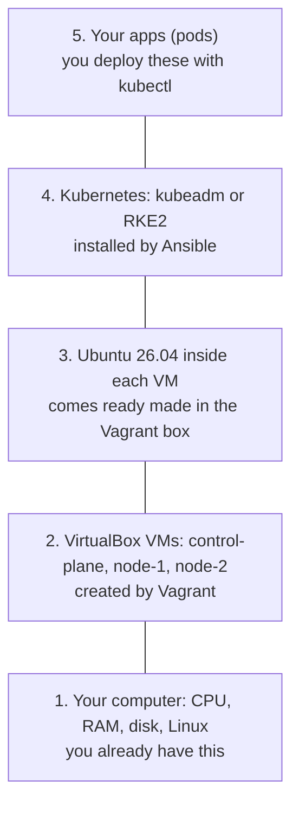
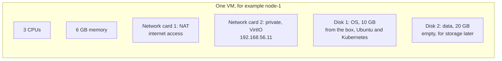
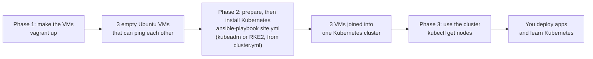
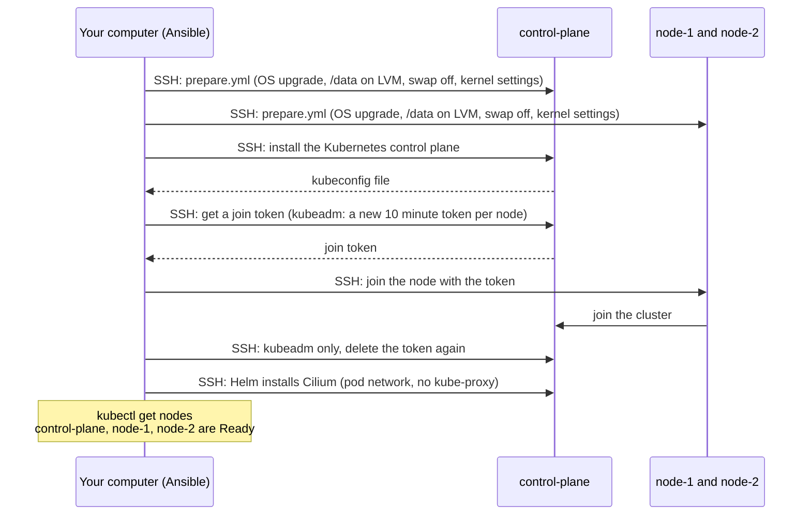
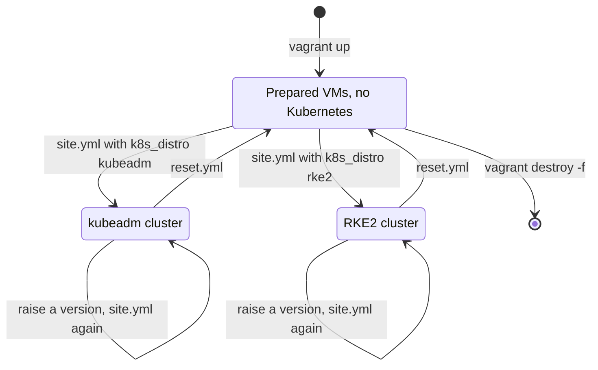

# How the lab works

- This page gives the big picture: the layers, which tool does what, and how the lab is built.

# The layers

- The lab is built in layers. Each layer sits on top of the one below it.

- **Layer 1, your computer**: lends part of its CPU, memory and disk to the VMs.
- **Layer 2, the VMs**: each VM acts like a separate computer with its own disks and network cards.
- **Layer 3, Ubuntu**: the operating system inside each VM. It comes pre-installed in the Vagrant box, so there is no installer to click through.
- **Layer 4, Kubernetes**: joins the 3 VMs into one cluster that can run apps.
- **Layer 5, your apps**: what you actually want to run, packaged as containers.

# What each VM has

- All 3 VMs are the same size. Only the name and the private IP differ.
- Networks: [Lab networking](lab-networking.md). Disks: [Disks and storage](disks-and-storage.md).

# Who does what

| Tool       | Its one job                                 | Runs on                | Reads this file             | When you use it               |
|------------|---------------------------------------------|------------------------|-----------------------------|-------------------------------|
| VirtualBox | Runs the VMs                                | Your computer          | (none, Vagrant drives it)   | All the time, in the background |
| Vagrant    | Creates, starts, stops, deletes VMs         | Your computer          | `Vagrantfile`               | Building or removing the lab  |
| Ansible    | Installs and configures software on the VMs | Your computer          | `ansible/` folder (coming next) | Installing Kubernetes     |
| kubectl    | Talks to Kubernetes                         | Your computer or `control-plane` | `kubeconfig`      | Using the cluster             |

- Ansible and kubectl run on **your computer**, not inside the VMs.
- They reach the VMs over the private network. See [Lab networking](lab-networking.md).

# How the lab is built: 3 phases

- **Phase 1** is covered in [Create the VMs](../tutorials/02-create-vms.md).
- **Phase 2** is [Prepare the nodes](../tutorials/03-prepare-nodes.md), then [Install the cluster](../tutorials/04-install-the-cluster.md).
- **Phase 3** is where the learning happens.

# What happens in phase 2, step by step

- The control plane is always installed first, because `node-1` and `node-2` need it to join.
- The **join token** is a password that proves a node is allowed to join. With kubeadm, kube-lab makes a new one for each node and deletes it right after the join: [Joining nodes explained](joining-nodes-explained.md).
- The **kubeconfig** file holds the address and credentials kubectl needs.

# Why Vagrant and Ansible are kept apart

- Vagrant only makes VMs. It has no install scripts in it.
- Ansible only installs software. It does not care where the VMs came from.
- Benefits:
  - You can wipe Kubernetes and reinstall it without rebuilding the VMs. That is much faster.
  - You can point the same Ansible files at real servers or cloud VMs later.
  - Each tool is easier to learn on its own.
- The decision is recorded in [ADR 0004](../../adr/0004-keep-vms-and-provisioning-separate.md).

# The life of the lab

- **Build**: `vagrant up` once, set `k8s_distro` in `cluster.yml`, run `ansible-playbook site.yml`.
- **Upgrade**: raise a version in `cluster.yml`, run `site.yml` again.
- **Switch**: run `reset.yml`, change `k8s_distro`, run `site.yml`. The VMs stay.
- **Pause**: `vagrant halt` shuts the VMs down. Everything is kept for next time.
- **Remove**: `vagrant destroy -f` deletes all 3 VMs and their disks, from any state.

# Where everything lives

- See [Repo layout](../reference/repo-layout.md) for every file and folder in the repo.
