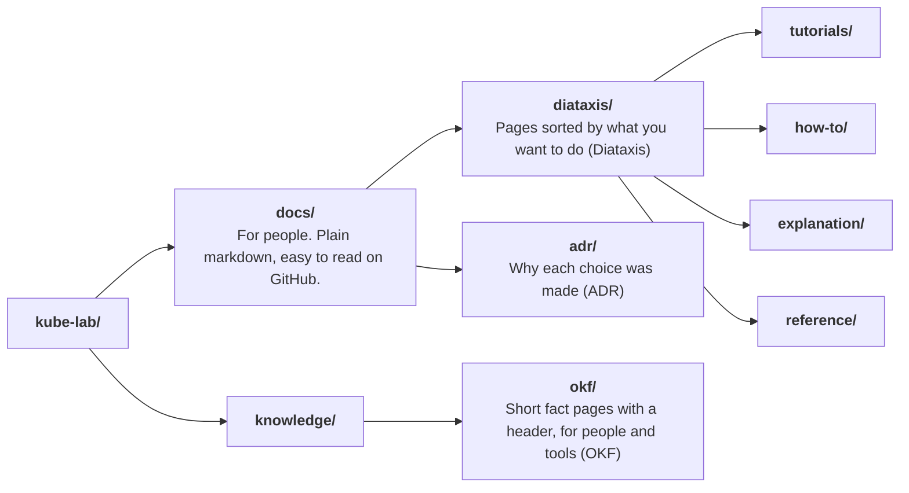
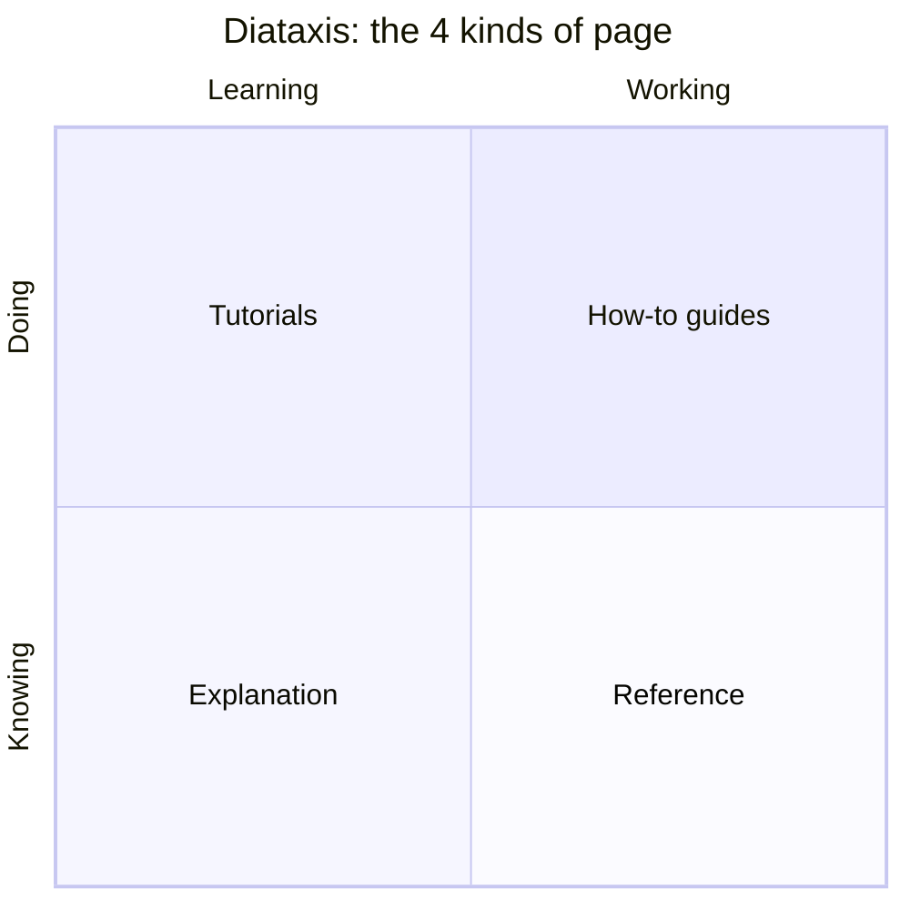
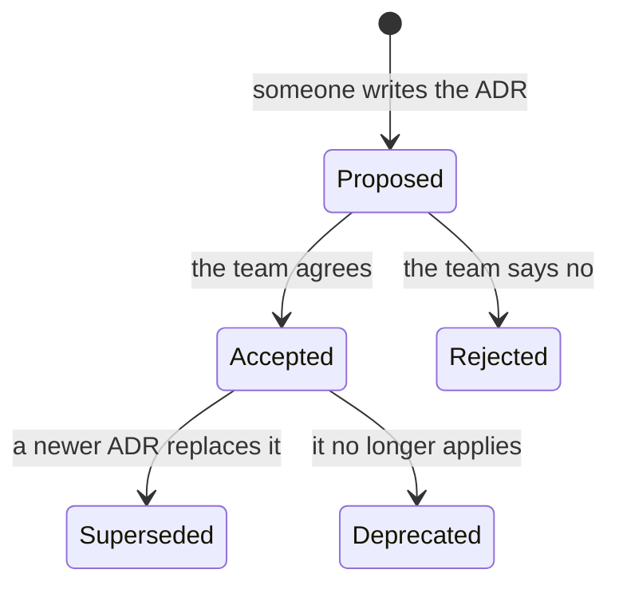
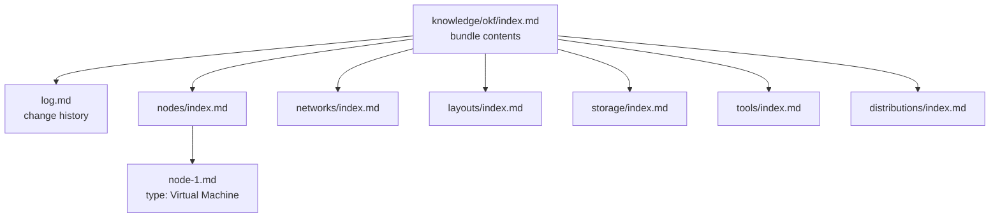
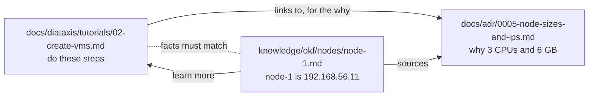

# How these docs work

- The docs are split into two top level folders, each with its own job:



| Folder            | Method   | Answers                          | Written as                          |
|-------------------|----------|----------------------------------|-------------------------------------|
| `docs/diataxis/`  | Diataxis | "How do I?" and "Why does it?"   | Step by step pages and explanations |
| `docs/adr/`       | ADR      | "Why did we choose this?"        | One short record per decision       |
| `knowledge/okf/`  | OKF      | "What is this, exactly?"         | One small fact page per thing       |

- The reasons for this split are in [ADR 0003](../../adr/0003-docs-with-diataxis-adr-and-okf.md).

# Part 1: Diataxis

- Diataxis is a way to sort documentation by **what the reader needs right now**.
- It has 4 kinds of page. Each kind has one job.



- **Left side, learning**: you are new and studying.
- **Right side, working**: you know the basics and are getting a job done.
- **Top, doing**: steps to follow.
- **Bottom, knowing**: facts and ideas.

| Kind          | Folder          | Reader is            | Contains                                   | Does not contain             |
|---------------|-----------------|----------------------|--------------------------------------------|------------------------------|
| Tutorial      | `tutorials/`    | New, learning        | Numbered steps, expected results, one path | Choices, long theory         |
| How-to guide  | `how-to/`       | Working on a task    | The steps for one goal                     | Teaching from zero           |
| Explanation   | `explanation/`  | Curious              | Why things work, diagrams, trade-offs      | Step by step commands        |
| Reference     | `reference/`    | Looking something up | Tables, lists, exact values                | Opinions, stories            |

- Why it helps: a page that teaches, explains and lists everything at once is hard to follow. One job per page keeps each page short and clear.

# Part 2: ADR (Architecture Decision Record)

- An ADR is a short note that records **one decision** and **why** it was made.
- Files are numbered in order: `0001-...md`, `0002-...md`, and so on.



- Rules:
  - One decision per file.
  - Never delete an old ADR. If a decision changes, write a new ADR and mark the old one as superseded.
  - Keep it short. Most ADRs fit on one screen.
- Every ADR has the same sections. Copy [the ADR template](../../adr/template.md) to start a new one.
- Why it helps: in six months nobody remembers why a choice was made. The ADR does.

# Part 3: OKF (Open Knowledge Format)

- OKF is an open format from Google for storing knowledge as plain markdown files. This lab follows version 0.2.
- `knowledge/okf/` is an OKF **bundle**: a folder of small pages, one per thing (a node, a network, a disk, a tool).
- Each page is called a **concept**.
- Why it helps:
  - Each fact lives in exactly one place.
  - The header makes pages easy to search and easy for tools and AI agents to read.
  - It is still plain markdown, so it reads fine on GitHub.

What one OKF page looks like:

```yaml
---
type: Virtual Machine                  # REQUIRED: the kind of thing
title: node-1                          # display name
description: Runs apps. 3 CPU, 6 GB.   # one line summary
tags: [vm, node]                       # for searching
resource: ../../../vagrant/single-control-plane/Vagrantfile         # the file it describes
---

# Facts                                # normal markdown from here on
- IP: 192.168.56.11
```

| Header field  | Required?   | What it holds                                        |
|---------------|-------------|------------------------------------------------------|
| `type`        | Yes         | The kind of thing. We use: `Cluster Layout`, `Virtual Machine`, `Network`, `Disk`, `Tool`, `Ansible Role`, `Kubernetes Distribution`. |
| `title`       | Recommended | The name shown in lists.                             |
| `description` | Recommended | One sentence summary.                                |
| `tags`        | Optional    | Words for searching.                                 |
| `resource`    | Optional    | The file or URL the page describes.                  |
| `status`      | Optional    | `draft`, `stable` or `deprecated`. Missing means `stable`. |
| `sources`     | Optional    | Where the facts come from, such as an ADR. Each has an `id` used in footnotes. |

- Two file names are special in OKF and are not concept pages:
  - `index.md`: lists what is in its folder. No header, only links.
  - `log.md`: change history, newest date first.



# How the three link together



- Tutorials and explanations link to ADRs for the "why".
- OKF pages link to the docs pages that explain them, and list the ADRs behind them in `sources`.

# Rules for writing any page

- Use plain English. Short sentences. Bullet points.
- After every command, say what it does and why you run it.
- Show the expected result after every step.
- Put a **Run on** line above every command block.
- Draw diagrams with Mermaid in a fenced code block marked `mermaid`.
- Use relative links, such as `../reference/nodes-and-ips.md`, so they work on GitHub and on your computer.
- Do not use em dashes or en dashes. Use commas, colons or full stops.
- Mark untested pages with `> Status: draft` at the top.

# Checklist when you add or change something

1. Write or update the page in the right Diataxis folder.
2. Add it to the `README.md` in that folder.
3. If you made a choice, write a new ADR.
4. If a fact changed (an IP, a size, a version), update the matching OKF page in `knowledge/okf/`.
5. Add a line to `knowledge/okf/log.md`.
