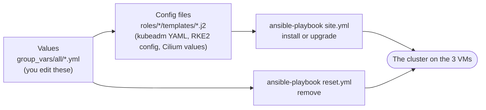
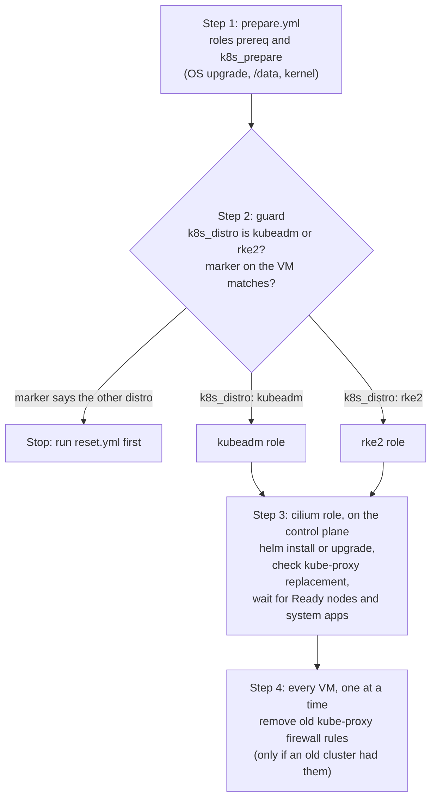
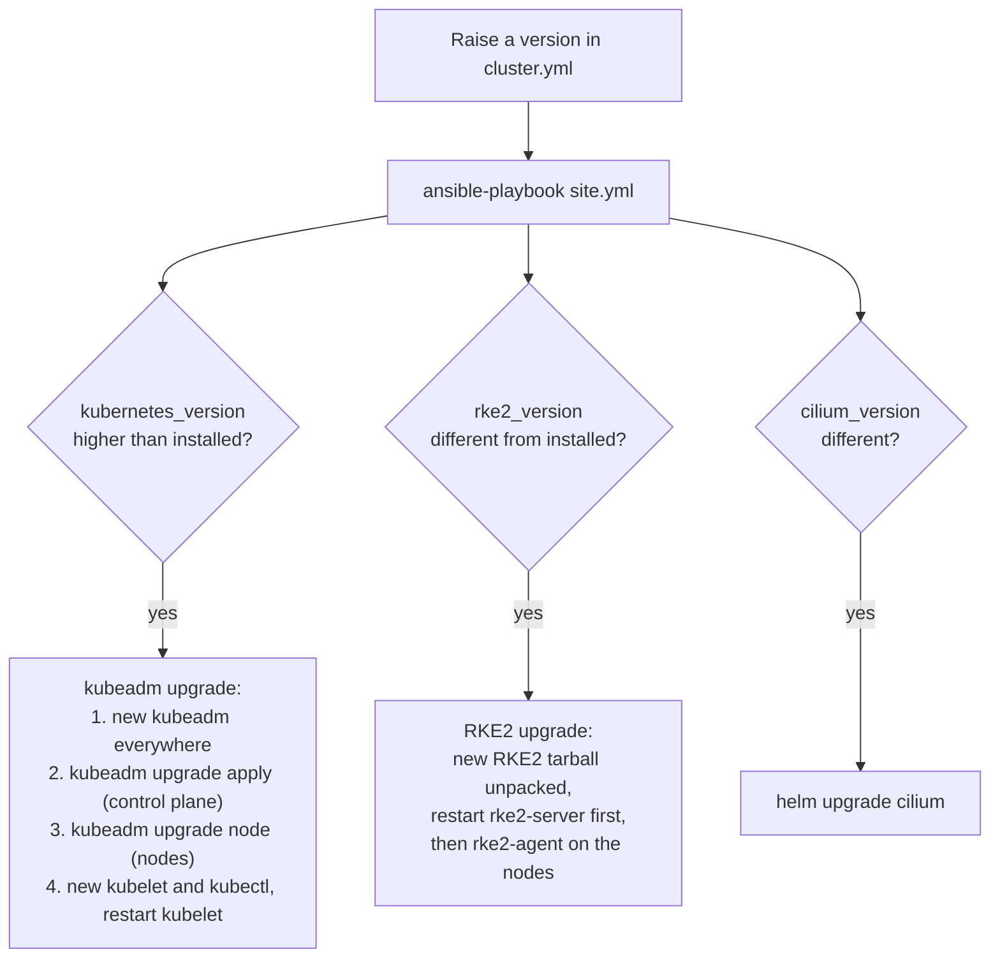
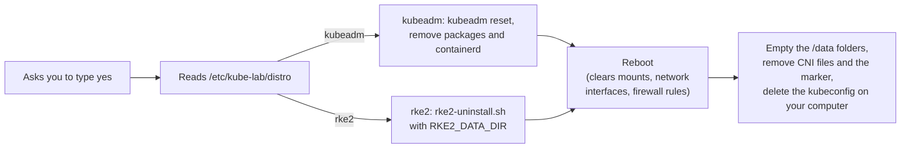

# Installing Kubernetes explained

- This page explains how the lab installs, upgrades and removes Kubernetes: the settings files, the 2 playbooks you run, and the roles behind them.

# The idea in one picture



- **Every value is in a vars file.** The roles and templates contain no fixed values. They only read variables.
- **`site.yml` makes the cluster match the settings.** On new VMs it installs. If you raised a version, it upgrades. If nothing changed, it changes nothing.
- **`reset.yml` removes the installed distribution**, so you can switch to the other one.

# The settings files

All in `ansible/inventories/single-control-plane/group_vars/all/`. Ansible reads every file in this folder for every VM.

| File          | What is in it                                                   | You change it when                         |
|---------------|-----------------------------------------------------------------|--------------------------------------------|
| `cluster.yml` | `k8s_distro`, the versions, API address, pod and service ranges | You pick a distribution or upgrade         |
| `kubeadm.yml` | containerd, packages, join tokens, and the kubeadm config values | You want a different kubeadm value        |
| `rke2.yml`    | Ingress, servicelb, disable list, and the **whole** RKE2 config | You want a different RKE2 setting          |
| `cilium.yml`  | The Helm chart, Helm itself, and the Cilium values              | You want a different Cilium value          |
| `os.yml`      | OS upgrade, GRUB, LVM names, kernel modules and sysctls         | Rarely                                     |
| `lab.yml`     | SSH login, data disk, `/data` folders, file locations           | Rarely                                     |

# Where the config files come from

- **kubeadm**: the config files are in the role, written out as kubeadm reads them. Only the values are variables ([ADR 0014](../../adr/0014-config-files-in-the-roles.md)).
  - `roles/kubeadm/templates/kubeadm-init.yaml.j2` becomes `/etc/kube-lab/kubeadm-init.yaml` on the control plane.
  - `roles/kubeadm/templates/kubeadm-join.yaml.j2` becomes `/etc/kube-lab/kubeadm-join.yaml` on a node, only during its join.
- A piece of `kubeadm-init.yaml.j2`:

```yaml
apiVersion: kubeadm.k8s.io/v1beta4
kind: ClusterConfiguration
clusterName: "{{ cluster_name }}"                  # cluster.yml
kubernetesVersion: "v{{ kubernetes_version }}"     # cluster.yml
networking:
  podSubnet: "{{ pod_subnet }}"                    # cluster.yml
proxy:
  disabled: {{ kubeadm_kube_proxy_disabled | bool | lower }}   # kubeadm.yml
etcd:
  local:
    dataDir: "{{ k8s_etcd_dir }}"                  # lab.yml
```

- Ansible's `template` module fills in the values for each VM, then writes the file. kubeadm reads it with `kubeadm init --config`.
- Why `templates/` and not `files/`: files in `files/` are copied unchanged, so they could not hold each VM's own IP and name.
- To change a value: edit the vars file. To add a kubeadm option: add it to the template.
- **Cilium** works the same way: `roles/cilium/templates/values.yaml.j2` is the real Helm values file, with values from `cilium.yml`. It is written to `/data/helm/cilium-values.yaml`.
- **RKE2** works the same way: `roles/rke2/templates/config-server.yaml.j2` and `config-agent.yaml.j2` are the real RKE2 config files, written to `/etc/rancher/rke2/config.yaml`, with values from `rke2.yml`.

# What site.yml does



- **The marker** is the file `/etc/kube-lab/distro` on each VM. The installed role writes its name there. If it names the other distribution, `site.yml` stops before changing anything.

# The kubeadm role

| Step       | What it does                                                                                  |
|------------|-----------------------------------------------------------------------------------------------|
| containerd | Installs `containerd_package`, sets `root` to `containerd_root_dir`, sets `SystemdCgroup` from `containerd_systemd_cgroup` |
| packages   | Adds the repository `kubernetes_apt_repo_url`, installs `kubernetes_packages` at `kubernetes_version`, holds them. New VMs only |
| init       | Writes `kubeadm-init.yaml` from the role's template `kubeadm-init.yaml.j2`, checks it with `kubeadm config validate`, runs `kubeadm init` once |
| join       | Makes a 10 minute token on the control plane, works out the CA hash, writes `kubeadm-join.yaml`, runs `kubeadm join`, then always deletes the token and the file. See [Joining nodes explained](joining-nodes-explained.md) |
| upgrade    | Only when `kubernetes_version` is higher than what is installed (see below)                   |
| marker     | Writes `kubeadm` to `/etc/kube-lab/distro`                                                    |

# The rke2 role

| Step    | What it does                                                                                   |
|---------|------------------------------------------------------------------------------------------------|
| install | Reads the installed RKE2 version. When `rke2_version` differs, downloads only the RKE2 tarball (`rke2_download_url`) and unpacks it into `/usr/local`. No install script, no checksum file |
| server  | Writes `config.yaml` from the role's `config-server.yaml.j2`, starts `rke2-server`, copies the kubeconfig |
| agent   | Reads the join token from the server, writes `config.yaml` from the role's `config-agent.yaml.j2`, starts `rke2-agent` |
| marker  | Writes `rke2` to `/etc/kube-lab/distro`                                                        |

- RKE2's own components are switched with `rke2.yml`:
  - `rke2_ingress_controller: none` turns off the bundled Traefik ingress.
  - `rke2_enable_servicelb: false` keeps RKE2's service load balancer off.
  - `rke2_disable` leaves out packaged parts, such as `rke2-metrics-server`.

# How upgrades work

- You raise a version in `cluster.yml` and run `site.yml` again.



| Rule                                              | Why                                             |
|---------------------------------------------------|-------------------------------------------------|
| Never go down                                     | kubeadm and RKE2 do not support downgrades. The roles stop if you try |
| kubeadm: one minor version at a time (1.37 to 1.38) | kubeadm only supports that. The role stops otherwise |
| The control plane is upgraded before the nodes    | Nodes must never be newer than the control plane. Ansible runs each step on the control plane first |
| Lab shortcut: nodes are not drained first         | Pods keep running while the kubelet restarts. Real clusters drain each node |

# How reset.yml works



- It keeps the VMs, the OS upgrade, the `/data` disk and the kernel settings, so the next `site.yml` is quick.

# Cilium with Helm

- The `cilium` role runs over SSH on the **first control plane**. It installs Helm in `/data/helm/bin` and uses the `vagrant` user's kubeconfig.
- It writes the role's `values.yaml.j2`, filled in from `cilium.yml`, to `/data/helm/cilium-values.yaml`, then runs `helm upgrade --install`.
- It uses its own Helm repository list and cache in `/data/helm/`, so a broken repository in your personal Helm setup cannot break the lab.
- Only Helm itself is installed, no Helm plugins.
- How a change is found: the `kubernetes.core.helm` module reads the values Cilium runs with now (`helm get values`) and the chart version, and compares them with the new ones.
  - Different values or a new `cilium_version`: it runs `helm upgrade` and reports `changed`.
  - The same: it does nothing and reports `ok`.

The values the lab sets:

| Value                     | Why                                                                         |
|---------------------------|-----------------------------------------------------------------------------|
| `k8sServiceHost`, `k8sServicePort` | Cilium reaches the API directly at `192.168.56.10:6443`, before Service routing is available |
| `ipam.mode: kubernetes`   | Pods get IPs from `pod_subnet`. Cilium's default `10.0.0.0/8` overlaps the VirtualBox NAT `10.0.2.0/24` |
| `operator.replicas: 1`    | One operator is enough for 3 nodes                                          |
| `kubeProxyReplacement: true` | Cilium handles Services, kube-proxy is not installed                     |
| `rollOutCiliumPods: true` | The Cilium agents restart when their settings change                        |

# Where the data goes

| Data                  | kubeadm               | RKE2                         |
|-----------------------|-----------------------|------------------------------|
| Images and containers | `/data/containerd`    | `/data/rancher/rke2`         |
| etcd                  | `/data/etcd`          | `/data/rancher/rke2`         |
| kubelet and pod data  | `/data/kubelet`       | `/data/kubelet`              |

- Nothing large goes on the 10 GB OS disk with either distribution.
- Decisions: [ADR 0009](../../adr/0009-kubeadm-with-containerd-and-cilium.md), [ADR 0010](../../adr/0010-one-site-playbook-driven-by-vars.md).

# No kube-proxy

- Cilium does kube-proxy's job with eBPF (`kubeProxyReplacement` in the role's `values.yaml.j2`, from `cilium_kube_proxy_replacement: true` in `cilium.yml`).
- kubeadm never installs kube-proxy: `proxy.disabled` in `kubeadm-init.yaml.j2`, from `kubeadm_kube_proxy_disabled: true`.
- RKE2 never starts it: `disable-kube-proxy` in `config-server.yaml.j2`, from `rke2_disable_kube_proxy: true`.
- A cluster built with kube-proxy is moved over only after every Cilium agent says `KubeProxyReplacement: True`.
- The whole story: [Services without kube-proxy](services-without-kube-proxy.md). The decision: [ADR 0012](../../adr/0012-cilium-replaces-kube-proxy.md).
