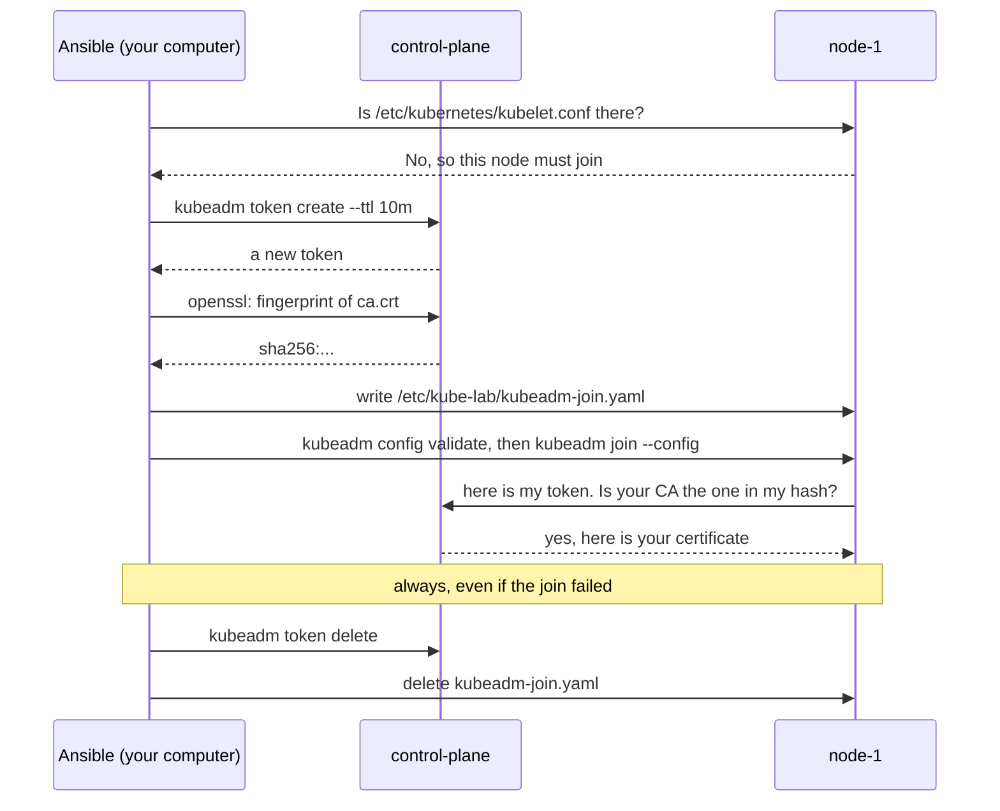

# Joining nodes explained (kubeadm)

- How `node-1` and `node-2` become part of the cluster the control plane made with `kubeadm init`.
- What the **bootstrap token** and the **CA hash** are, and why kube-lab deletes the token right away.
- The steps to do it yourself: [Rejoin a node](../how-to/rejoin-a-node.md). The decision: [ADR 0013](../../adr/0013-short-lived-join-tokens.md).

# The problem a join solves

- A new node and the control plane do not know each other yet. Both must check the other:

| Who checks | Question | Answered by |
|------------|----------|-------------|
| The node | "Is this really my cluster's control plane, not a fake one?" | The **CA hash** |
| The control plane | "Is this node allowed to join?" | The **bootstrap token** |

- After the join the node has its own certificate. It never uses the token again.

# The two secrets, in plain words

- **Bootstrap token**
  - A short password, for example `abcdef.0123456789abcdef`.
  - The first part (`abcdef`) is its name, shown by `kubeadm token list`. The second part is the secret.
  - It has a **TTL** (time to live). After that Kubernetes deletes it by itself.
  - Anyone with a valid token can add a machine to the cluster. So it should live as short as possible.
- **CA hash**
  - The CA (certificate authority) is the cluster's own stamp: every certificate in the cluster is signed with it. It lives in `/etc/kubernetes/pki/ca.crt` on the control plane.
  - The hash is a `sha256` fingerprint of the CA's public key, for example `sha256:e809...`.
  - It is **not** a secret. It is like checking a phone number before you give out your password.

# How kube-lab joins a node

- The `kubeadm` role, file `ansible/roles/kubeadm/tasks/join.yml`.
- It runs once per node, only when `/etc/kubernetes/kubelet.conf` is missing (a joined node has it).



- Step by step:
  1. **Make a token** on the control plane with `kubeadm token create`. It prints only the token, so Ansible can use the output as it is.
  2. **Work out the CA hash** on the control plane with `openssl`, the method from the kubeadm docs.
  3. **Write `kubeadm-join.yaml`** from the role's template `kubeadm-join.yaml.j2` (`kind: JoinConfiguration`), filled in with the token and the hash. Mode `0600`: only root can read it.
  4. **Check and join**: `kubeadm config validate`, then `kubeadm join --config`.
  5. **Clean up, always**: the token is deleted on the control plane, the file on the node. This runs in an Ansible `always:` block, so it also runs after an error.
- Each node gets its own token, with the node's name in the description: `kube-lab join token for node-1`.

# The token from kubeadm init

- `kubeadm init` always makes a token too, so the cluster is ready for joins.
- kube-lab never uses it, because every node gets its own.
- So the `InitConfiguration` in `kubeadm-init.yaml.j2` makes it short lived, with values from `kubeadm.yml`:

```yaml
bootstrapTokens:
  - description: "{{ kubeadm_init_token_description }}"   # kube-lab init token, not used
    ttl: "{{ kubeadm_init_token_ttl }}"                     # 15m
```

- There is no `token:` field: kubeadm makes a random one. No token is ever written in a vars file.
- After 15 minutes Kubernetes deletes it by itself.

# Keeping secrets out of the log

| Where a token could show up | What kube-lab does |
|-----------------------------|--------------------|
| The output of `kubeadm token create` | The task has `no_log: true`: Ansible prints `the output has been hidden` |
| The `kubeadm token delete <token>` command | `no_log: true` as well |
| `kubeadm-join.yaml` when you run with `--diff` | The template task has `diff: false` |
| The end of the `kubeadm init` output (a `kubeadm join ... --token ...` example) | Those lines are left out when the output is shown |

# Why delegate_to needs the right SSH key

- Steps 1, 2 and 5 run **on the control plane**, while Ansible works on **node-1**. Ansible calls this `delegate_to`.
- Ansible picks the SSH key from `ansible_ssh_private_key_file` in `lab.yml`.
- During a delegated step, `inventory_hostname` still says `node-1`. A key path built from it points at node-1's key, and the control plane refuses it (`UNREACHABLE`).
- So each host in `hosts.ini` has `vagrant_machine`, and the key path uses that. Ansible reads it from the host it really connects to.

# Check it yourself

**Run on: control-plane** (`vagrant ssh control-plane`)

```bash
sudo kubeadm token list
```

- Right after `site.yml`, the list is empty, or has only the init token in its first 15 minutes.

```bash
sudo cat /etc/kube-lab/kubeadm-init.yaml
```

- Shows the init config. The `bootstrapTokens` part has a description and a TTL, but no token.

# Learn more

- [kubeadm join](https://kubernetes.io/docs/reference/setup-tools/kubeadm/kubeadm-join/)
- [Bootstrap tokens](https://kubernetes.io/docs/reference/access-authn-authz/bootstrap-tokens/)
- [Installing Kubernetes explained](installing-kubernetes-explained.md)
