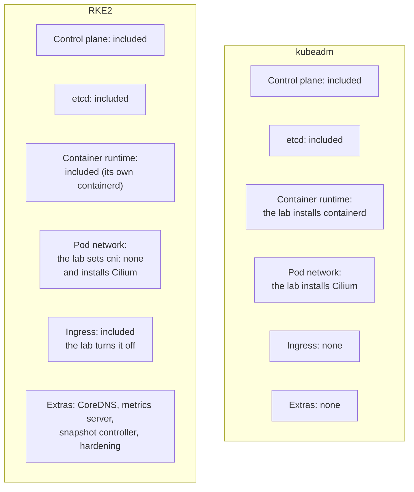
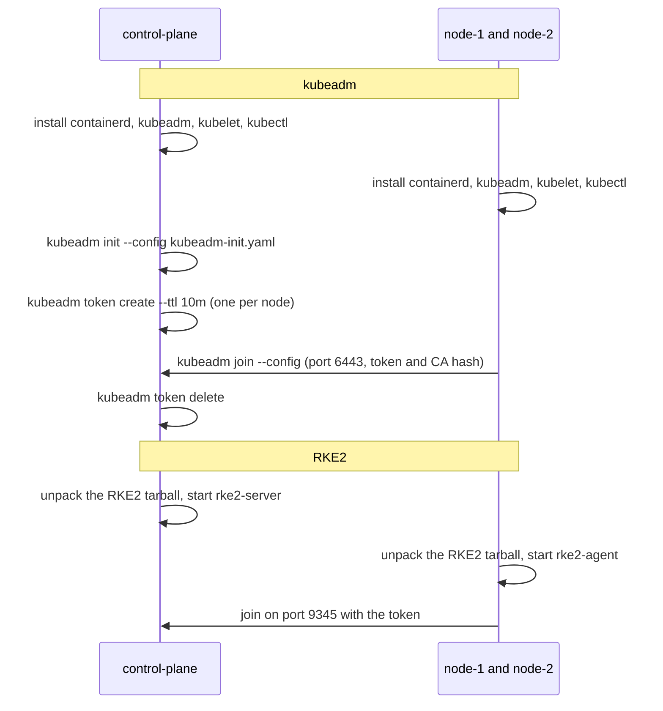
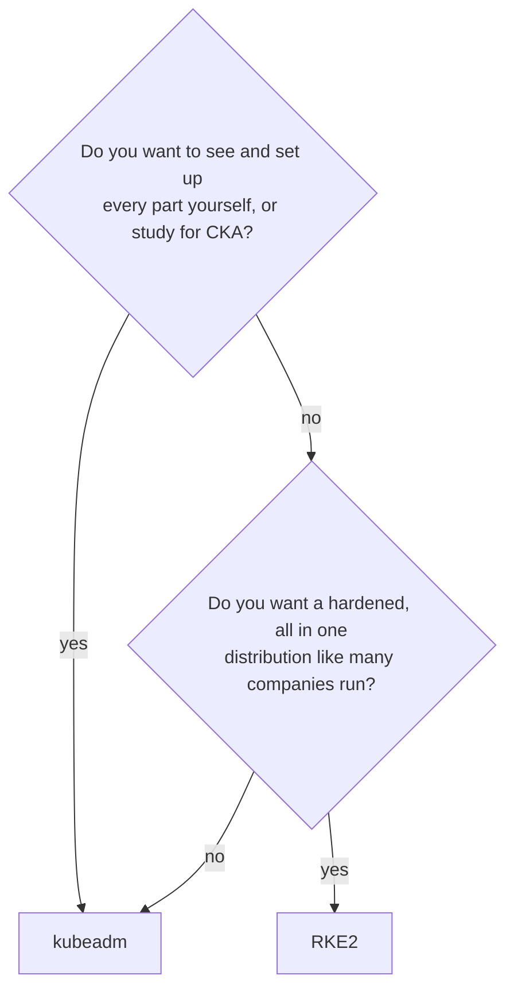

# kubeadm vs RKE2

- The lab can build its cluster with **kubeadm** or **RKE2**. Both give you a real, certified Kubernetes.
- You pick one with `k8s_distro` in `cluster.yml`. Only one is installed at a time.
- This page explains how they differ, and what the lab does with each.

# What comes in the box



# Side by side

| Topic                      | kubeadm                                           | RKE2                                                  |
|----------------------------|---------------------------------------------------|-------------------------------------------------------|
| Made by                    | The Kubernetes project                            | SUSE Rancher                                          |
| What the lab installs      | containerd, then `kubeadm`, `kubelet`, `kubectl` packages | One program, `rke2`, from the RKE2 release tarball (no install script) |
| Version setting            | `kubernetes_version` (for example `1.37.2`)       | `rke2_version` (for example `v1.37.2+rke2r1`)         |
| Control plane is called    | control plane                                     | server                                                |
| Other nodes are called     | node                                              | agent                                                 |
| Nodes join with            | `kubeadm join --config`, a 10 minute token (deleted after the join) and a CA hash, port 6443 | The server address on port 9345 and a token           |
| API server port            | 6443                                              | 6443                                                  |
| Container runtime          | Ubuntu's containerd, root `/data/containerd`      | RKE2's own containerd, inside `/data/rancher/rke2`    |
| etcd data                  | `/data/etcd`                                      | inside `/data/rancher/rke2`                           |
| kubelet data               | `/data/kubelet`                                   | `/data/kubelet`                                       |
| Pod network in the lab     | Cilium with Helm                                  | Cilium with Helm (`cni: none`)                        |
| Pod and service ranges     | `10.244.0.0/16`, `10.96.0.0/12`                   | the same                                              |
| Ingress controller         | none                                              | `rke2_ingress_controller` (lab: `none`)               |
| Config the lab writes      | `/etc/kube-lab/kubeadm-init.yaml`, `kubeadm-join.yaml`, from the role's templates | `/etc/rancher/rke2/config.yaml`                  |
| Its settings in the lab    | Values in `group_vars/all/kubeadm.yml`            | `group_vars/all/rke2.yml`                             |
| How the lab upgrades it    | `kubeadm upgrade apply`, then `kubeadm upgrade node`, then new kubelet | Downloads and unpacks the new RKE2 tarball, restarts the service |
| Memory on the control plane| At least 2 GB                                     | RKE2 docs ask for 4 GB (the lab has 6 GB)             |
| Security defaults          | Normal                                            | Strict. Built to pass CIS hardening checks            |
| Best for learning          | How every part fits together, the CKA exam        | How companies run hardened clusters                   |

# How each one is built



- In both cases the `cilium` role then installs Cilium with Helm on the control plane, and the nodes become `Ready`.

# Which one should I use?



- Try both. Switching takes 3 commands and keeps the VMs:

```bash
ansible-playbook reset.yml
# change k8s_distro in cluster.yml
ansible-playbook site.yml
```

- How the switch works: [Installing Kubernetes explained](installing-kubernetes-explained.md).
