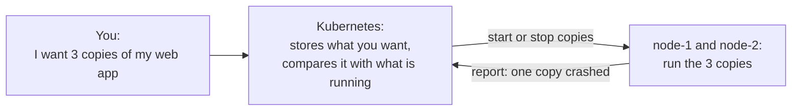
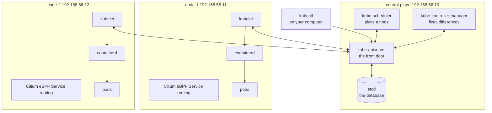
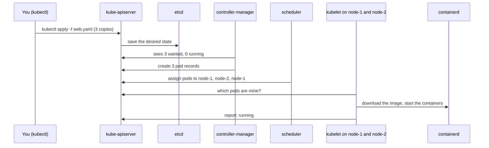
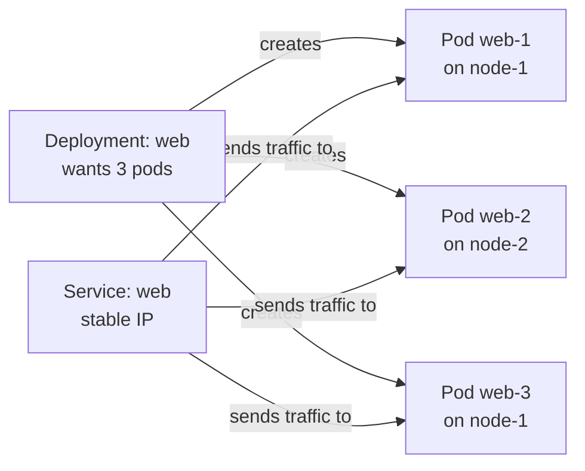

# Kubernetes basics

- This page explains what Kubernetes is and what runs on each VM in the lab.
- There are no commands to run here. It is background for the Kubernetes tutorials.

# What problem Kubernetes solves

- Apps today are often packaged as **containers**. A container holds an app and everything it needs to run.
- Running one container on one computer is easy. Running many containers across many computers is hard:
  - Which computer should each container run on?
  - What happens when a container crashes?
  - What happens when a whole computer goes down?
  - How do containers on different computers find each other?
- **Kubernetes** answers all of these. You tell it what you want, and it keeps making it true.

# The main idea: desired state

- You write down the **desired state**: what should be running.
- Kubernetes keeps checking the **actual state**: what is really running.
- When they differ, Kubernetes acts to fix it. If a copy crashes, it starts a new one. This never stops.

# The parts of a cluster

- A **cluster** is a group of computers, called **nodes**, managed by Kubernetes as one.
- In this lab the cluster has 3 nodes:

# What runs on the control plane

- The **control plane** is the brain. It decides; it does not usually run your apps.

| Part                       | Its job                                                         |
|----------------------------|-----------------------------------------------------------------|
| `kube-apiserver`           | The front door. Every request, from you or from other parts, goes through it. |
| `etcd`                     | The database. Stores the desired state and the current state of everything. |
| `kube-scheduler`           | Picks which node each new pod should run on.                    |
| `kube-controller-manager`  | Runs the loops that compare desired and actual state and fix differences. |

- The control plane also runs `kubelet` and a container runtime, because its own parts run as containers too.

# What runs on node-1 and node-2

- These nodes run your apps.

| Part          | Its job                                                              |
|---------------|----------------------------------------------------------------------|
| `kubelet`     | The node's agent. Asks the API server what should run here, then makes it happen. |
| `containerd`  | The container runtime. Actually starts and stops containers.        |
| Service routing | Sends Service traffic to the right pods. This lab uses Cilium eBPF instead of kube-proxy. |
| CNI plugin    | Gives every pod an IP address and connects pods across nodes. Examples: Flannel, Calico, Cilium. |

# What happens when you deploy an app

# The objects you will use first

| Object       | What it is                                                         | Example                            |
|--------------|--------------------------------------------------------------------|------------------------------------|
| Node         | One computer in the cluster.                                       | `control-plane`, `node-1`, `node-2`|
| Pod          | The smallest thing Kubernetes runs: one or more containers together. It gets its own IP. | One copy of a web server |
| Deployment   | Keeps a set number of identical pods running, and updates them safely. | "Always run 3 web pods"        |
| Service      | A stable name and IP in front of a group of pods. Pods come and go; the service stays. | `web` service on port 80 |
| Namespace    | A folder for objects, to keep things apart.                        | `default`, `kube-system`           |

# How you talk to the cluster

- **kubectl** is the command line tool for Kubernetes.
- It reads a file called **kubeconfig** to know:
  - Where the API server is: `https://192.168.56.10:6443`.
  - Which credentials to use.
- In this lab, Ansible will copy the kubeconfig to your computer so you can run `kubectl` there.

# How this maps to kubeadm and RKE2

- Both give you the same parts listed above. They differ in how the parts are packaged and installed.
- In RKE2, the control plane is called a **server** and the other nodes are called **agents**.
- In kubeadm, you run `kubeadm init` on the control plane and `kubeadm join` on the other nodes.
- Details: [kubeadm vs RKE2](kubeadm-vs-rke2.md).
