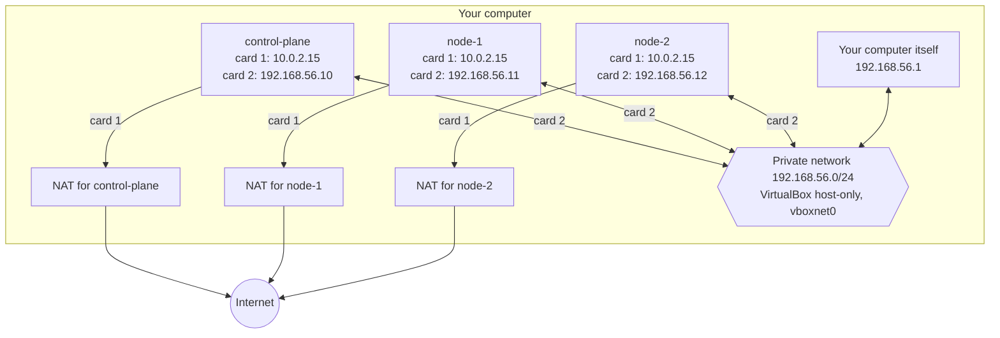
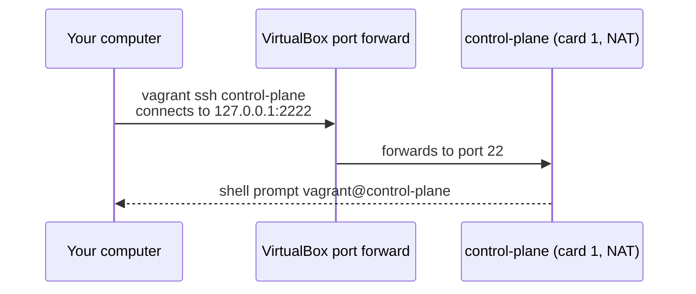
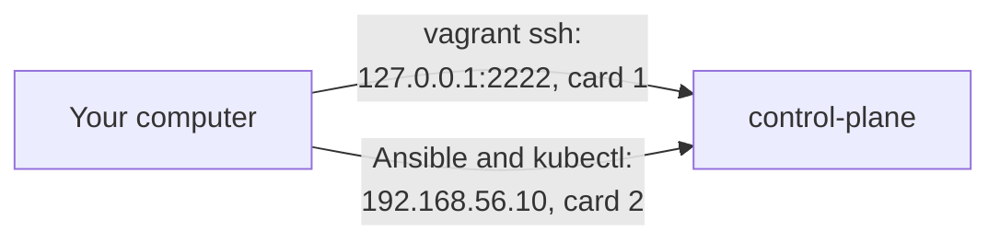
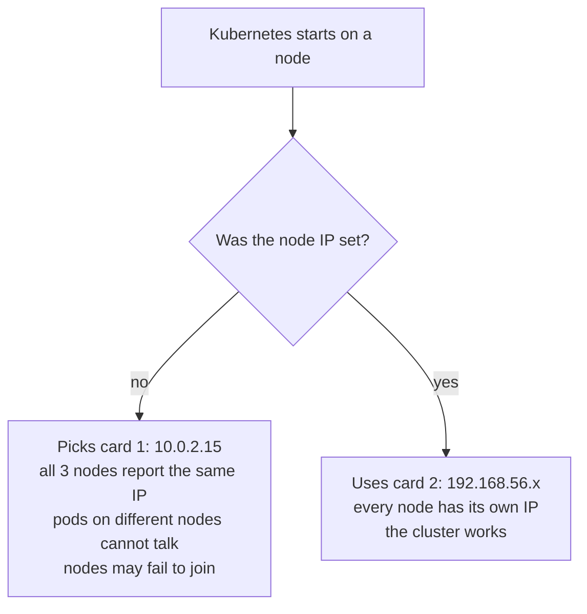
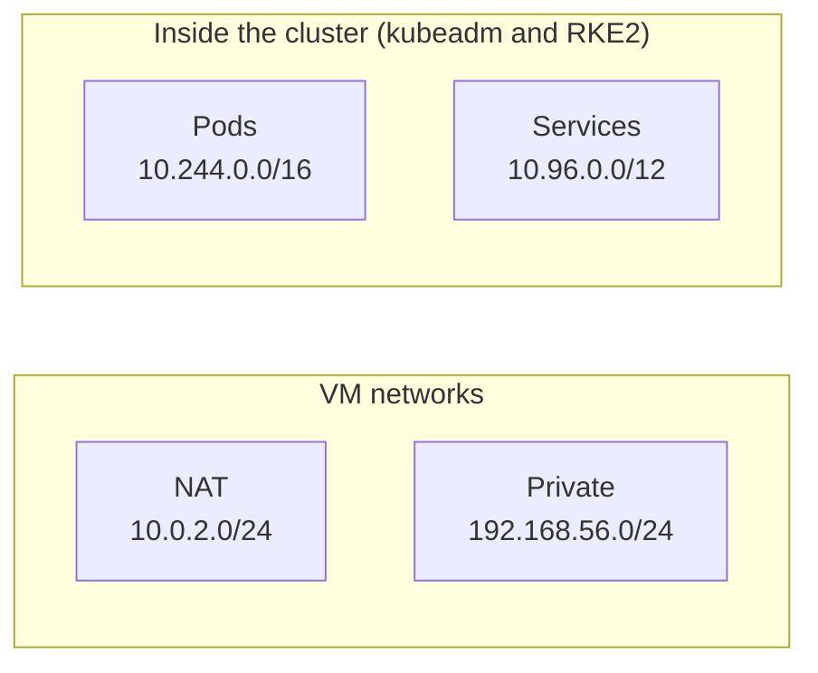

# Lab networking

- This page explains the two network cards in each VM, which one Kubernetes must use, and which address ranges must never overlap.

# The short version

- Every VM has **2 network cards**.
  - **Card 1, NAT**: lets the VM reach the internet. Every VM gets the same address here, `10.0.2.15`.
  - **Card 2, private**: lets the VMs reach each other and your computer. Each VM has its own fixed address, `192.168.56.10` to `.12`.
- Kubernetes must always use **card 2**, the private card.

# The full picture



- Each VM has its **own** NAT. The 3 NATs are not connected to each other.
- All 3 VMs and your computer share **one** private network.

# Card 1: NAT

- NAT stands for Network Address Translation.
- VirtualBox gives each VM its own small, private NAT network. Your computer forwards its traffic to the internet.
- Vagrant always adds this card first. You do not see it in the `Vagrantfile`.
- What it is used for:
  - Downloading packages (`apt install`, Kubernetes images).
  - `vagrant ssh`, through a forwarded port (see below).
- What it cannot do:
  - VMs **cannot** reach each other over NAT. Each VM is alone in its own NAT network.
  - The address is `10.0.2.15` on **every** VM, so it cannot tell nodes apart.

# Card 2: private network (host-only)

- Vagrant adds this card because of this line in the `Vagrantfile`:

```ruby
vm.vm.network "private_network", ip: node[:ip]
```

- VirtualBox calls this a **host-only** network. Only the VMs and your computer are on it.
- Your computer gets the address `192.168.56.1` on a virtual card named `vboxnet0`. VirtualBox creates it the first time.
- What it is used for:
  - VM to VM traffic. All Kubernetes traffic goes here.
  - Your computer to VM traffic. Ansible and kubectl use it.
- It is not reachable from other computers on your home network.

# Who can reach whom

| From                            | To                    | Works? | Over which card          |
|---------------------------------|-----------------------|--------|--------------------------|
| A VM                            | The internet          | Yes    | Card 1, NAT              |
| A VM                            | Another VM            | Yes    | Card 2, private          |
| Your computer                   | A VM                  | Yes    | Card 2, private          |
| A VM                            | Your computer         | Yes    | Card 2, `192.168.56.1`   |
| Another computer on your Wi-Fi  | A VM                  | No     | Not exposed              |

# How `vagrant ssh` connects



- Vagrant forwards a port on your computer (usually `2222` for the first VM) to the SSH port inside the VM.
- The other VMs get different ports, such as `2200` and `2201`. Vagrant picks them for you.
- Run `vagrant ssh-config` to see the exact port for each VM.
- Ansible will not use this path. It will connect straight to `192.168.56.x` on card 2, which is simpler and the same as real servers.



# Why Kubernetes must use card 2

- When Kubernetes starts, it picks a **node IP**: the address it tells other nodes to use.
- By default it picks the card with the internet route, which is card 1, `10.0.2.15`.



- The fix: tell Kubernetes the node IP and the network card name for card 2. The Ansible roles will do this for you.

# Network card names

- Inside a VM, run `ip -br addr` to see the cards.
- The names depend on the box and the virtual hardware. A common pair is `enp0s3` (card 1) and `enp0s8` (card 2).
- Always find card 2 by its address (`192.168.56.x`), not by its name.

Example output, run on control-plane (names may differ on your VM):

```
lo       UNKNOWN  127.0.0.1/8
enp0s3   UP       10.0.2.15/24        <- card 1, NAT, ignore for Kubernetes
enp0s8   UP       192.168.56.10/24    <- card 2, private, Kubernetes uses this
```

# Address ranges that must never overlap

- Kubernetes creates 2 more networks inside the cluster:
  - The **pod network**: every pod gets an address from it.
  - The **service network**: every service gets a stable address from it.
- These must not overlap with each other or with the VM networks. If they overlap, traffic goes to the wrong place.



| Network                 | Range              | Set by                                         |
|-------------------------|--------------------|------------------------------------------------|
| NAT (card 1)            | `10.0.2.0/24`      | VirtualBox                                     |
| Private (card 2)        | `192.168.56.0/24`  | `Vagrantfile`                                  |
| Pods                    | `10.244.0.0/16`    | `pod_subnet` in `cluster.yml`, both distros    |
| Services                | `10.96.0.0/12`     | `service_subnet` in `cluster.yml`, both distros|

- Watch out: Calico's example pod range is `192.168.0.0/16`. That range contains `192.168.56.0/24`, so do **not** use it in this lab.
- Watch out: Cilium's default pod range is `10.0.0.0/8`. That range contains the NAT network `10.0.2.0/24`. The lab sets Cilium to `ipam.mode: kubernetes`, so it uses `10.244.0.0/16` instead.
- RKE2's own defaults would be `10.42.0.0/16` and `10.43.0.0/16`. The lab sets RKE2 to the same ranges as kubeadm, so both clusters look the same.

# Allowed IP range for the private network

- On Linux and macOS, VirtualBox only allows host-only addresses in `192.168.56.0/21` by default. That is `192.168.56.0` to `192.168.63.255`.
- If you pick an address outside that range, `vagrant up` fails with an error about the IP range.
- You can allow other ranges in `/etc/vbox/networks.conf`, but there is no reason to in this lab.
