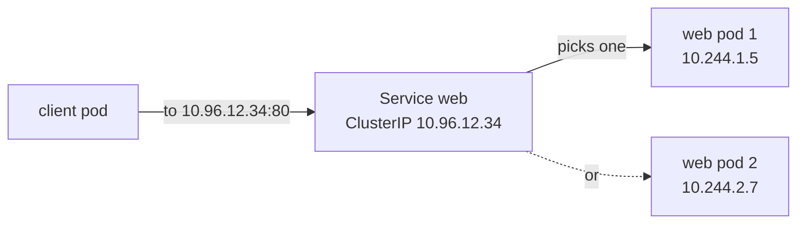
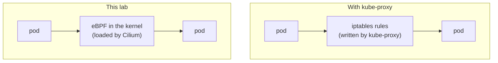
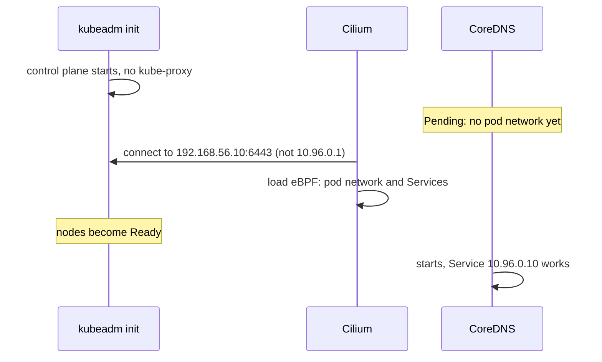

# Services without kube-proxy

- A **Service** gives a group of pods one stable address. Something on every node must send traffic for that address to a real pod.
- In most clusters that is **kube-proxy**. In this lab it is **Cilium**, and kube-proxy is never installed.
- The steps to check it: [Check the network works](../how-to/verify-the-network.md). The decision: [ADR 0012](../../adr/0012-cilium-replaces-kube-proxy.md).

# Why Services need help

- Pods come and go, and each new pod gets a new IP.
- A Service has a fixed **ClusterIP** from `service_subnet` (`10.96.0.0/12`), for example `10.96.0.10` for DNS.
- No machine really has that IP. Each node must catch packets for it and change the address to a live pod's IP.

# kube-proxy and Cilium side by side

| | kube-proxy (the default) | Cilium (this lab) |
|---|---|---|
| Runs as | A pod on every node | Part of the Cilium agent already on every node |
| How | Writes iptables firewall rules, `KUBE-SVC-...` | Small eBPF programs inside the Linux kernel |
| With many Services | Rule lists get long and slower to update | Lookups in kernel tables, stays fast |
| Handles | ClusterIP, NodePort, LoadBalancer | The same, plus pod to pod traffic (it is also the pod network) |

# The settings that do it

| File | Setting | Effect |
|------|---------|--------|
| `cilium.yml` | `kubeProxyReplacement: true` | Cilium handles all Service traffic |
| `cilium.yml` | `k8sServiceHost`, `k8sServicePort` | Cilium reaches the API at `192.168.56.10:6443` directly |
| `kubeadm.yml` | `kubeadm_kube_proxy_disabled: true`, used as `proxy.disabled` in `kubeadm-init.yaml.j2` | `kubeadm init` and `kubeadm upgrade` never install kube-proxy |
| `rke2.yml` | `rke2_disable_kube_proxy: true`, used as `disable-kube-proxy` in `config-server.yaml.j2` | RKE2 never starts kube-proxy |

# The chicken and egg problem

- The API server has a Service too: `kubernetes`, at `10.96.0.1`.
- Without kube-proxy, that address only works once Cilium runs. But Cilium needs the API to start.
- So Cilium gets the real address of the API (`k8sServiceHost`, `k8sServicePort`) and never needs `10.96.0.1`.

- Right after `kubeadm init`, the nodes are `NotReady` and CoreDNS is `Pending`. That is normal. The `cilium` role waits until both are fine.

# Clusters built before the change

- A cluster built with kube-proxy is moved over by `site.yml` in a safe order:
  1. Cilium is upgraded with `kubeProxyReplacement: true`.
  2. Ansible checks **every** Cilium agent says `KubeProxyReplacement: True`. If not, it stops here, and kube-proxy keeps working.
  3. kubeadm's stored config (`kubeadm-config` ConfigMap) gets `proxy.disabled: true`, so a later `kubeadm upgrade` does not bring kube-proxy back.
  4. The kube-proxy DaemonSet and ConfigMap are deleted.
  5. Step 4 of `site.yml`, one node at a time: the iptables rules are saved to `/data/kube-proxy-before-cilium-iptables.rules`, then every `KUBE` rule is removed. All other rules stay.
- A new cluster never had kube-proxy, so steps 3 to 5 find nothing and change nothing.

# Learn more

- [Cilium: Kubernetes without kube-proxy](https://docs.cilium.io/en/stable/network/kubernetes/kubeproxy-free/)
- [Kubernetes Services](https://kubernetes.io/docs/concepts/services-networking/service/)
- [Lab networking](lab-networking.md)
