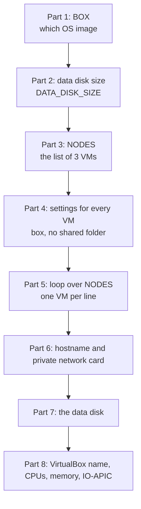
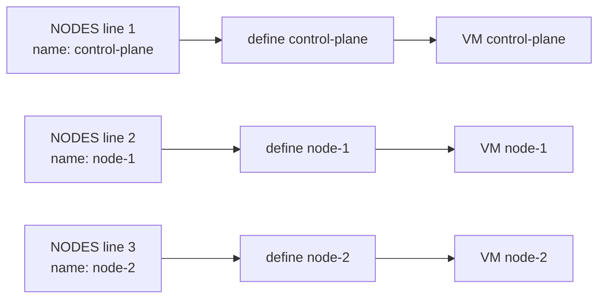

# The Vagrantfile explained

- This page walks through the lab's `Vagrantfile` part by part, with the small amount of Ruby you need to read it and change it safely.

# What the Vagrantfile is

- A plain text file named exactly `Vagrantfile`, with no file extension.
- This lab's file lives in `vagrant/single-control-plane/`. Each cluster layout has its own folder and its own `Vagrantfile`. See [Cluster layouts](cluster-layouts.md).
- It describes the VMs: which OS image, how many, their names, IPs, CPUs, memory and disks.
- Vagrant reads it every time you run a `vagrant` command in this folder.
- It is written in **Ruby**, a programming language. You only need the few Ruby basics below.

# How the file is built



# The Ruby you need

| You see                      | It means                                                       |
|------------------------------|----------------------------------------------------------------|
| `# some text`                | A comment. Ruby ignores it. It is there for humans.            |
| `BOX = "..."`                | A named value. Names in CAPITALS are values that do not change.|
| `"text"`                     | A piece of text (a string).                                    |
| `[ a, b, c ]`                | A list. Here, a list of VMs.                                   |
| `{ name: "node-1", ... }`    | A group of named settings for one thing. Here, one VM.         |
| `node[:name]`                | "Take the `name` setting from this node."                      |
| `:disk`                      | A fixed label (a symbol). Here it means "a hard disk".         |
| `do \|x\| ... end`           | A block of code. `x` is the item being worked on.              |
| `NODES.each do \|node\|`     | "Repeat the block once for every node in the list."            |
| `"kube-lab-single-#{node[:name]}"` | Text with a value inserted. Becomes `kube-lab-single-node-1`. |

# Part 1: the OS image

```ruby
BOX = "cloud-image/ubuntu-26.04"
```

- A **box** is a ready made VM disk image with an OS already installed.
- `cloud-image/ubuntu-26.04` means: the `ubuntu-26.04` box published by `cloud-image`.
- It is the official Ubuntu 26.04 cloud image, with only a `vagrant` user added.
- Vagrant downloads it once and reuses it for every VM.
- Downloaded boxes are kept in `~/.vagrant.d/boxes/` on your computer.
- Why this box: [ADR 0002](../../adr/0002-use-ubuntu-26-04.md).

# Part 2: data disk size

```ruby
DATA_DISK_SIZE = "20GB"
```

- A named value used later in part 7.
- Changing it here changes the data disk of every VM.
- There is no OS disk size. Every VM keeps the box's own 10 GB OS disk, unchanged.
- Disks can only grow, never shrink. See [Disks and storage](disks-and-storage.md).

# Part 3: the list of VMs

```ruby
NODES = [
  { name: "control-plane", ip: "192.168.56.10", cpus: 3, memory: 6144 },
  { name: "node-1",        ip: "192.168.56.11", cpus: 3, memory: 6144 },
  { name: "node-2",        ip: "192.168.56.12", cpus: 3, memory: 6144 },
]
```

- One line per VM. Each line has 4 settings:
  - `name`: the VM's name. You use it in commands like `vagrant ssh node-1`.
  - `ip`: the VM's fixed address on the private network.
  - `cpus`: how many virtual CPUs the VM gets.
  - `memory`: how much RAM the VM gets, in megabytes. `6144` is 6 GB.
- Why fixed IPs: Ansible and Kubernetes need addresses that never change.
- Why these sizes: [ADR 0005](../../adr/0005-node-sizes-and-ips.md).

# Part 4: settings for every VM

```ruby
Vagrant.configure("2") do |config|
  config.vm.box = BOX
  config.vm.synced_folder ".", "/vagrant", disabled: true
```

- `Vagrant.configure("2")`: starts the configuration. `"2"` is the format version. It is always `"2"` in modern Vagrant.
- `config.vm.box = BOX`: every VM uses the box from part 1.
- `synced_folder ... disabled: true`:
  - By default, Vagrant shares the folder that holds the `Vagrantfile` into each VM at `/vagrant`.
  - We turn it off because the VMs do not need it. Ansible copies what they need.
  - The cloud image has no VirtualBox Guest Additions, which the default shared folder needs, so leaving it on would cause an error.

# Part 5: the loop that makes each VM

```ruby
  NODES.each do |node|
    config.vm.define node[:name] do |vm|
```

- `NODES.each`: run the block below once per line in the list. That is 3 times.
- `config.vm.define node[:name]`: create a VM with that name.
- Inside the block, `vm` is the VM being set up right now.

How the loop turns 1 block into 3 VMs:



# Part 6: hostname and the private network card

```ruby
      vm.vm.hostname = node[:name]
      vm.vm.network "private_network", ip: node[:ip], nic_type: "virtio"
```

- `hostname`: the computer name inside the VM. Run `hostname` inside it to check.
- `private_network`: adds **network card 2**, a host-only card with the fixed IP.
- `nic_type: "virtio"`: makes card 2 a fast, modern VirtIO card.
  - Without it, VirtualBox picks an old emulated card (PCnet). It works, but it is slow and always shows its state as `UNKNOWN` instead of `UP`.
  - Inside the VM the card is still named `enp0s8`.
- **Network card 1** (NAT, for internet) is always added by Vagrant. It is not written in the file.
- Details: [Lab networking](lab-networking.md).

# Part 7: the data disk

```ruby
      vm.vm.disk :disk, name: "#{node[:name]}-data", size: DATA_DISK_SIZE
```

- Vagrant creates a **new, empty** 20 GB disk and attaches it as disk 2.
- The file is named after the VM, for example `node-1-data.vdi`.
- Vagrant does not format or mount it.
- Disk 1, the **OS disk**, is not in the file. It comes with the box at 10 GB and is left as it is.
- To grow the OS disk later, you would add `vm.vm.disk :disk, name: "#{node[:name]}-os", size: "20GB", primary: true`. `primary: true` means "grow the disk the OS boots from" instead of adding a new one.
- Details: [Disks and storage](disks-and-storage.md).

# Part 8: VirtualBox settings

```ruby
      vm.vm.provider "virtualbox" do |vb|
        vb.name   = "kube-lab-single-#{node[:name]}"
        vb.cpus   = node[:cpus]
        vb.memory = node[:memory]
        vb.customize ["modifyvm", :id, "--ioapic", "on"]
      end
```

- `provider "virtualbox"`: these settings only apply when VirtualBox runs the VM.
- `vb.name`: the name shown in the VirtualBox window, such as `kube-lab-single-node-1`.
  - `kube-lab-` makes lab VMs easy to spot.
  - `single-` is the layout. VirtualBox names must be unique, so the HA layout uses `kube-lab-ha-` and the two never clash.
- `vb.cpus` and `vb.memory`: take the values from the list in part 3.
- `vb.customize [...]`: runs one VirtualBox setting command before the VM starts.
  - `modifyvm :id --ioapic on` turns on the VM's **IO-APIC**, the part of the virtual hardware that lets Linux use more than one CPU.
  - The box ships with it **off**. Without this line, every VM shows `nproc` = `1`, no matter what `cpus` says.
  - `:id` is filled in by Vagrant with the VM's VirtualBox ID.

# Closing the blocks

```ruby
    end
  end
end
```

- Each `do` needs a matching `end`.
- If you get an error like `syntax error, unexpected end-of-input`, an `end` is missing.

# How to change things safely

- **Always run `vagrant validate` after editing.** It checks the file without touching any VM.

| You want to                  | Change                                          | Then run                       |
|------------------------------|-------------------------------------------------|--------------------------------|
| Give a VM more memory        | `memory: 8192` on that VM's line                | `vagrant reload <name>`        |
| Give a VM more CPUs          | `cpus: 4` on that VM's line                     | `vagrant reload <name>`        |
| Make the data disk bigger    | `DATA_DISK_SIZE`                                | `vagrant reload`               |
| Add a 4th VM                 | Add a line, for example `{ name: "node-3", ip: "192.168.56.13", cpus: 3, memory: 6144 },` | `vagrant up node-3` |
| Change a VM's IP             | Its `ip` value                                  | `vagrant reload <name>`, then update [Nodes and IPs](../reference/nodes-and-ips.md) |
| Rename a VM                  | Destroy it first, then change `name`            | `vagrant up <new name>`        |

Rules:

- Every `name` must be different.
- Every `ip` must be different and between `192.168.56.2` and `192.168.56.254`. `192.168.56.1` belongs to your computer, and `.20` to `.24` are reserved for the HA layout.
- Keep the comma at the end of every line inside `NODES`.
- Never make a disk size smaller. VirtualBox cannot shrink disks.
- Watch the totals. Today the VMs use 9 CPUs and 18 GB of memory. Leave enough for your own computer.
- Rename a VM only after `vagrant destroy -f <old name>`. Otherwise the old VM stays in VirtualBox with no name in the `Vagrantfile` to control it.
