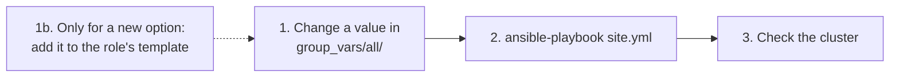

# How to change a setting or upgrade

- Every setting is in `ansible/inventories/single-control-plane/group_vars/all/`.
- The way is always the same: **edit the file, run `site.yml`**.



# Which file

| You want to change                                   | File          | Setting                                  |
|------------------------------------------------------|---------------|------------------------------------------|
| kubeadm or RKE2                                      | `cluster.yml` | `k8s_distro` (also run `reset.yml` first, see [Switch between kubeadm and RKE2](switch-distribution.md)) |
| The Kubernetes version (kubeadm)                     | `cluster.yml` | `kubernetes_version`                     |
| The RKE2 version                                     | `cluster.yml` | `rke2_version`                           |
| The Cilium version                                   | `cluster.yml` | `cilium_version`                         |
| A Cilium Helm value                                  | `cilium.yml`  | `cilium_kube_proxy_replacement`, `cilium_ipam_mode`, `cilium_operator_replicas`. A new option: add it to `roles/cilium/templates/values.yaml.j2`                          |
| RKE2 ingress, service load balancer, disabled parts  | `rke2.yml`    | `rke2_ingress_controller`, `rke2_enable_servicelb`, `rke2_disable` |
| Any other RKE2 option                                | `roles/rke2/templates/config-server.yaml.j2` or `config-agent.yaml.j2` | Add the option. Put its value in `rke2.yml` |
| A kubeadm config value                               | `kubeadm.yml` | `kubeadm_cgroup_driver`, `kubeadm_cert_sans`, `kubeadm_kube_proxy_disabled`, token TTLs |
| A kubeadm option with no variable yet                | `roles/kubeadm/templates/kubeadm-init.yaml.j2` or `kubeadm-join.yaml.j2` | Add the field. Use a new variable in `kubeadm.yml` for its value |
| Kernel modules or sysctls                            | `os.yml`      | `kernel_modules`, `kernel_sysctls`       |

- Every setting with its value: [Ansible settings](../reference/ansible-settings.md).

# Upgrade Kubernetes (kubeadm)

1. Find the new version: `curl -sL https://dl.k8s.io/release/stable.txt`, or choose a patch release of your minor version.
2. In `cluster.yml`, raise it:

```yaml
kubernetes_version: "1.37.2"
```

3. Run:

**Run on: your computer** (in `ansible/`)

```bash
ansible-playbook site.yml
```

- The role upgrades in the official order: control plane first (`kubeadm upgrade apply`), then the nodes (`kubeadm upgrade node`), then the kubelets.
- Rules: never go down, and at most one minor version per run (1.37.x to 1.38.x). The role stops with a message otherwise.
- New minor version: the package repository changes by itself, because `kubernetes_apt_repo_url` is built from the version.

# Upgrade RKE2

1. Pick a release from https://github.com/rancher/rke2/releases, for example `v1.37.2+rke2r1`.
2. In `cluster.yml`:

```yaml
rke2_version: "v1.37.2+rke2r1"
```

3. Run `ansible-playbook site.yml`.

- The role downloads and unpacks the RKE2 tarball of the new version, restarts `rke2-server` on the control plane first, then `rke2-agent` on the nodes.

# Upgrade Cilium

1. Pick a release from https://github.com/cilium/cilium/releases.
2. In `cluster.yml`:

```yaml
cilium_version: "1.20.4"
```

3. Run `ansible-playbook site.yml`.

- The role runs `helm upgrade`, then waits until Cilium, every node and every system app is ready.

# Change a Cilium value

- **A value that has a variable**: change it in `cilium.yml`, for example `cilium_operator_replicas: 2`.
- **A new option**: add it to the values file in the role, and put its value in `cilium.yml`.
- Example: turn on Hubble, Cilium's network observability tool.
  1. In `roles/cilium/templates/values.yaml.j2`, add:

```yaml
hubble:
  relay:
    enabled: {{ cilium_hubble_relay_enabled | bool | lower }}
```

  2. In `cilium.yml`, add:

```yaml
# Hubble Relay: lets the hubble tool see traffic of the whole cluster.
cilium_hubble_relay_enabled: true
```

- Run `ansible-playbook site.yml`. Ansible compares the new values with the ones Cilium runs with now. If they differ, it runs `helm upgrade` and the task says `changed`. If not, it says `ok` and changes nothing.
- See every value: `helm show values cilium/cilium --version <cilium_version>`.

# Change an RKE2 option

- Example: turn the Traefik ingress controller on. In `rke2.yml`:

```yaml
rke2_ingress_controller: traefik
```

- Example: an option that has no setting of its own, such as RKE2's CIS hardening profile.
  1. In `roles/rke2/templates/config-server.yaml.j2`, add:

```yaml
profile: "{{ rke2_profile }}"
```

  2. In `rke2.yml`, add:

```yaml
# RKE2's CIS hardening profile.
rke2_profile: cis
```

- Run `ansible-playbook site.yml`. The new `config.yaml` is written, and `rke2-server` restarts.

# Check the result

**Run on: your computer** (in `kube-lab/`)

```bash
export KUBECONFIG=$PWD/.kube/single-control-plane.conf
kubectl get nodes
cilium status
```

- `VERSION` shows the new Kubernetes or RKE2 version on every node.
- `cilium status` shows `OK` and the new chart version.
