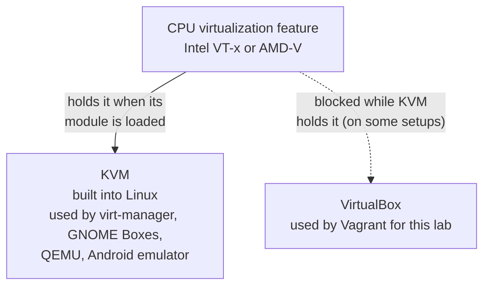

# How to fix the VirtualBox and KVM error

> Status: draft. These steps have not been tested end to end yet.

# When to use this page

- `vagrant up` fails and the error contains one of these:
  - `VERR_VMX_IN_VMX_ROOT_MODE`
  - `VERR_SVM_IN_USE`
  - "VT-x is being used by another hypervisor"
  - "AMD-V is being used by another hypervisor"
- If your VMs start fine, you do **not** need this page.

# Why it happens



- Your CPU has a special feature for running VMs fast.
- Linux has its own VM system called **KVM**. When KVM's kernel module is loaded, it can hold that feature.
- When KVM holds it, VirtualBox cannot start VMs and shows the error above.
- Newer VirtualBox versions can share the feature with KVM on some setups, which is why not everyone sees this.

# Step 1: Find your CPU type

**Run on: your computer**

```bash
lscpu | grep 'Vendor ID'
```

| Output contains  | Your CPU | KVM module name |
|------------------|----------|-----------------|
| `GenuineIntel`   | Intel    | `kvm_intel`     |
| `AuthenticAMD`   | AMD      | `kvm_amd`       |

# Step 2: Check if KVM is loaded

**Run on: your computer**

```bash
lsmod | grep kvm
```

- If you see `kvm_intel` or `kvm_amd`, KVM is loaded. Go to step 3.
- If you see nothing, KVM is not the problem. Check that virtualization is on in your BIOS (see [Tutorial 1](../tutorials/01-install-tools.md), step 1).

# Step 3: Unload KVM until the next restart

- Close any other VM programs first: virt-manager, GNOME Boxes, QEMU, Android emulator.

**Run on: your computer (Intel)**

```bash
sudo modprobe -r kvm_intel
```

**Run on: your computer (AMD)**

```bash
sudo modprobe -r kvm_amd
```

- `modprobe -r` removes a kernel module from memory.
- This lasts until you restart your computer.

**Check it worked**

```bash
lsmod | grep kvm
vagrant up
```

- `lsmod` should no longer show `kvm_intel` or `kvm_amd`. A plain `kvm` line may remain. That is fine.
- `vagrant up` should now work.

If `modprobe -r` says **"Module is in use"**:

- Another program is still using KVM. Close it, or restart your computer and try again before opening any other VM program.

# Step 4 (optional): Stop KVM from loading at boot

- Only do this if you never use KVM programs such as virt-manager or GNOME Boxes.
- It creates one small settings file. Nothing else is changed.

**Run on: your computer (Intel)**

```bash
echo "blacklist kvm_intel" | sudo tee /etc/modprobe.d/blacklist-kvm.conf
```

**Run on: your computer (AMD)**

```bash
echo "blacklist kvm_amd" | sudo tee /etc/modprobe.d/blacklist-kvm.conf
```

- `blacklist` tells Linux not to load that module at boot.
- Restart your computer to apply it.

**To undo it later**

```bash
sudo rm /etc/modprobe.d/blacklist-kvm.conf
```

- Then restart your computer.
