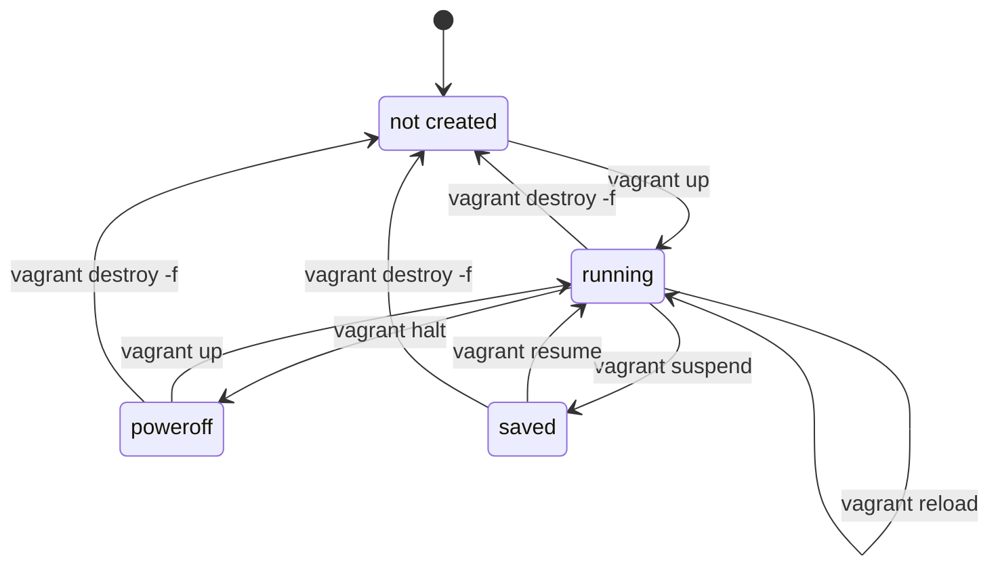

# How to start, stop and delete VMs

> Status: draft. These steps have not been tested end to end yet.

- Use this page when you know what you want to do with the VMs and just need the command.
- **Run every command on your computer, in the layout folder `vagrant/single-control-plane/`.** Vagrant only finds the VMs when it can see their `Vagrantfile`.
- First move there: `cd kube-lab/vagrant/single-control-plane`.

# The states a VM can be in



| State         | What it means                                       | Shown by `vagrant status` as |
|---------------|-----------------------------------------------------|------------------------------|
| not created   | No VM exists in VirtualBox                          | `not created (virtualbox)`   |
| running       | The VM is on                                        | `running (virtualbox)`       |
| poweroff      | The VM is shut down. Its disk is kept.              | `poweroff (virtualbox)`      |
| saved         | The VM is paused. Its memory is saved to disk.      | `saved (virtualbox)`         |

# What each command keeps and loses

| Command                 | VM after   | Disk and installed software | Running programs | Speed        |
|-------------------------|------------|-----------------------------|------------------|--------------|
| `vagrant halt`          | poweroff   | Kept                        | Stopped          | Seconds      |
| `vagrant suspend`       | saved      | Kept                        | Kept (paused)    | Seconds      |
| `vagrant resume`        | running    | Kept                        | Continue         | Seconds      |
| `vagrant up`            | running    | Kept, or created if new     | Start fresh      | Fast, or minutes if new |
| `vagrant reload`        | running    | Kept                        | Restarted        | About 1 minute |
| `vagrant destroy -f`    | not created| **Deleted**, both disks     | **Deleted**      | Seconds      |

# Stop the lab for today

```bash
vagrant halt
```

- Shuts down all 3 VMs cleanly, like pressing "Shut down" on a computer.
- Everything you installed stays.
- Frees the memory and CPU the VMs were using.

# Start the lab again

```bash
vagrant up
```

- Boots the existing VMs. Nothing is downloaded or rebuilt, so it is quick.
- Kubernetes, once installed, starts by itself when the VMs boot.

# Pause and continue exactly where you left off

```bash
vagrant suspend
vagrant resume
```

- `suspend` freezes the VMs and saves their memory to disk.
- `resume` continues them with programs still open.
- Uses disk space equal to the VMs' memory, about 18 GB for the whole lab.
- After a long suspend, the clocks inside the VMs can be wrong for a short while. If Kubernetes acts strangely after a resume, run `vagrant reload`.

# Restart a VM

```bash
vagrant reload node-1
```

- Shuts down `node-1`, re-reads the `Vagrantfile`, and starts it again.
- Use it after you change `cpus` or `memory` in the `Vagrantfile`. A normal restart from inside the VM does **not** pick up those changes.

# Rebuild one VM from scratch

```bash
vagrant destroy -f node-1
vagrant up node-1
```

- Deletes `node-1` and creates a clean one with the same name and IP.
- Anything installed on it is lost, and both its disks are replaced with new ones.
- The other VMs are not touched.
- If Kubernetes was installed, the cluster still remembers the old `node-1`. You need to run the Kubernetes playbook again so the new VM joins.

# Delete the whole lab

```bash
vagrant destroy -f
```

- Deletes all 3 VMs from VirtualBox, including both disks of each VM (the OS disk and the data disk).
- `-f` means "do not ask me to confirm each VM". Leave it out if you want to be asked.
- Your `Vagrantfile`, docs and other repo files are **not** deleted.
- The downloaded box stays in `~/.vagrant.d/boxes/`, so the next `vagrant up` does not download it again.

# Free disk space from old boxes

```bash
vagrant box list
vagrant box prune
```

- `box list` shows every box you have downloaded, with its version.
- `box prune` deletes old versions that no VM uses.
- To delete a box completely: `vagrant box remove cloud-image/ubuntu-26.04`. The next `vagrant up` downloads it again.

# Find VMs that Vagrant has lost track of

```bash
vagrant global-status --prune
VBoxManage list vms
```

- `global-status --prune` lists every Vagrant VM on your computer, from any folder, and removes stale entries.
- `VBoxManage list vms` lists every VM VirtualBox knows. Lab VMs start with `kube-lab-single-` (this layout) or `kube-lab-ha-` (the HA layout).
- If a `kube-lab-single-` VM is there but `vagrant status` says `not created`, delete it in the VirtualBox window, or run `VBoxManage unregistervm kube-lab-single-<name> --delete`.
