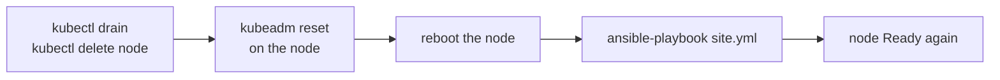

# How to rejoin a node (kubeadm)

- Use it when one node is broken, or you want to see a join again, without rebuilding the whole cluster.
- It removes the node from the cluster, wipes Kubernetes from it, and lets `site.yml` join it again.
- The join makes a new short lived token and deletes it afterwards. How that works: [Joining nodes explained](../explanation/joining-nodes-explained.md).
- The examples use `node-1`. Use the name of your node.



# Steps

**Run on: your computer** (in `kube-lab/`)

1. Move the pods away and remove the node from the cluster:

```bash
export KUBECONFIG=$PWD/.kube/single-control-plane.conf
kubectl drain node-1 --ignore-daemonsets --delete-emptydir-data
kubectl delete node node-1
```

**Run on: your computer** (in `ansible/`)

2. Wipe kubeadm's files from the node. The packages and containerd stay:

```bash
cd ansible
ansible node-1 --become -m ansible.builtin.command -a "kubeadm reset --force"
```

3. Reboot the node, so no old network interfaces or firewall rules are left:

```bash
ansible node-1 --become -m ansible.builtin.reboot
```

4. Join it again:

```bash
ansible-playbook site.yml
```

- The other VMs show `changed=0` or close to it. Only `node-1` joins.

**Expected result**

```bash
kubectl get nodes
```

```
NAME            STATUS   ROLES           AGE   VERSION
control-plane   Ready    control-plane   2h    v1.37.2
node-1          Ready    <none>          1m    v1.37.2
node-2          Ready    <none>          2h    v1.37.2
```

**Run on: control-plane** (`vagrant ssh control-plane`)

5. No join token is left behind:

```bash
sudo kubeadm token list
```

- Expected: no lines below the header, or only `kube-lab init token, not used` in a cluster less than 15 minutes old.

# If something goes wrong

| What you see | Why it happens | What to do |
|--------------|----------------|------------|
| `kubeadm join` fails with `could not find a JWS signature` | The token expired before the join, on a very slow computer | Raise `kubeadm_join_token_ttl` in `kubeadm.yml`, run `site.yml` again |
| `[ERROR FileAvailable--etc-kubernetes-kubelet.conf]` | Step 2 was skipped | Do step 2 and 3, then `site.yml` again |
| `UNREACHABLE` on `node-1 -> control-plane` | `vagrant_machine` is missing for a host in `hosts.ini` | Every host needs `vagrant_machine=<its name>`. See [Ansible settings](../reference/ansible-settings.md#hostsini) |
| The node joins but stays `NotReady` | Cilium has not started on it yet | Wait a minute. `kubectl -n kube-system get pods -o wide -l k8s-app=cilium` |

- For RKE2 the join is different: the agent uses RKE2's own token. Use [Switch between kubeadm and RKE2](switch-distribution.md) to rebuild instead.
