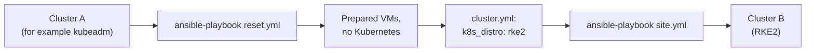

# How to switch between kubeadm and RKE2

- Only one distribution can be on the VMs at a time.
- Switching keeps the VMs, the OS upgrade and the `/data` disk. It deletes the cluster and all its data.



# Steps

**Run on: your computer** (in `ansible/`)

1. Remove the current distribution:

```bash
cd kube-lab/ansible
ansible-playbook reset.yml
```

- It asks: `This deletes the cluster and all its data in /data. Type yes to continue`. Type `yes`.
- It removes the distribution, reboots the VMs and empties the `/data` folders.

2. In `inventories/single-control-plane/group_vars/all/cluster.yml`, change:

```yaml
k8s_distro: rke2      # or kubeadm
```

3. Install the other distribution:

```bash
ansible-playbook site.yml
```

4. Use the new cluster:

```bash
cd ..
export KUBECONFIG=$PWD/.kube/single-control-plane.conf
kubectl get nodes
```

# What protects you

- If you change `k8s_distro` but forget `reset.yml`, `site.yml` stops before changing anything:

```
control-plane has kubeadm installed, but cluster.yml says k8s_distro: rke2.
Run "ansible-playbook reset.yml" first, then run site.yml again.
```

- It knows what is installed from the marker file `/etc/kube-lab/distro` on each VM.
