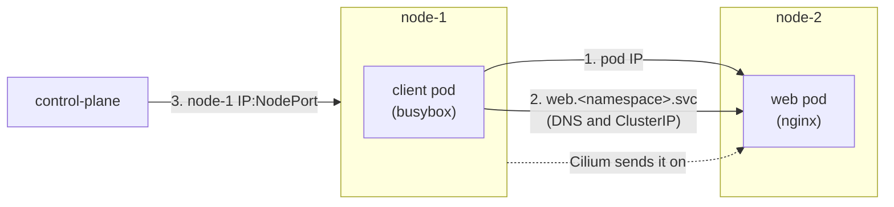

# How to check the network works

- The lab has no kube-proxy. Cilium handles pod traffic **and** Service traffic.
- This guide checks that both work, across nodes, in about one minute.
- Why there is no kube-proxy: [Services without kube-proxy](../explanation/services-without-kube-proxy.md).

# What the check does

- `verify-network.yml` makes a new namespace `kube-lab-netcheck-<time>` and always deletes it at the end, even when a check fails.



| Check | Proves |
|-------|--------|
| 1. client to the web pod IP | Pods on different nodes can reach each other (Cilium's pod network) |
| 2. client to the Service name | CoreDNS answers, and Cilium sends ClusterIP traffic to the pod |
| 3. control plane to a NodePort on node-1 | Cilium handles NodePorts, even when the pod is on another node |

- Each check must get the nginx page `Welcome to nginx!`, or the playbook fails.

# Steps

**Run on: your computer** (in `ansible/`)

```bash
cd kube-lab/ansible
ansible-playbook verify-network.yml
```

**Expected result**

- Every task is `ok`, and the recap shows `failed=0`:

```
PLAY RECAP *********************************************************************
control-plane : ok=10   changed=2    unreachable=0    failed=0    skipped=0
```

# Check by hand

**Run on: your computer** (in `kube-lab/`)

```bash
export KUBECONFIG=$PWD/.kube/single-control-plane.conf
```

1. Cilium says it replaced kube-proxy:

```bash
kubectl -n kube-system exec ds/cilium -- cilium-dbg status | grep KubeProxyReplacement
```

- Expected: `KubeProxyReplacement:    True   [enp0s8   192.168.56.10 ... (Direct Routing), enp0s3 ...]`

2. There is no kube-proxy:

```bash
kubectl -n kube-system get daemonset kube-proxy
```

- Expected: `Error from server (NotFound): daemonsets.apps "kube-proxy" not found`

**Run on: control-plane** (`vagrant ssh control-plane` from `vagrant/single-control-plane/`)

3. No kube-proxy firewall rules are left:

```bash
sudo iptables-save | grep -c KUBE-SVC
```

- Expected: `0`

# If something goes wrong

| What you see | Why it happens | What to do |
|--------------|----------------|------------|
| `Require two nodes for the cross-node check` fails | The inventory has fewer than 2 hosts in `nodes` | The check needs `node-1` and `node-2` |
| `Wait for the test pods` times out | The images cannot be downloaded, or a node is `NotReady` | `kubectl get nodes`, then `kubectl -n kube-lab-netcheck-<time> describe pods` while it waits |
| Check 1 fails | Cilium's pod network does not work between nodes | `kubectl -n kube-system get pods -l k8s-app=cilium`, then run `ansible-playbook site.yml` again |
| Check 2 fails, check 1 works | DNS or ClusterIP routing is broken | `kubectl -n kube-system get pods -l k8s-app=kube-dns`, and the `KubeProxyReplacement` check above |
| Check 3 fails, 1 and 2 work | NodePort routing is broken | The `KubeProxyReplacement` check above. Check `k8sServiceHost` in `cilium.yml` is the API IP |
