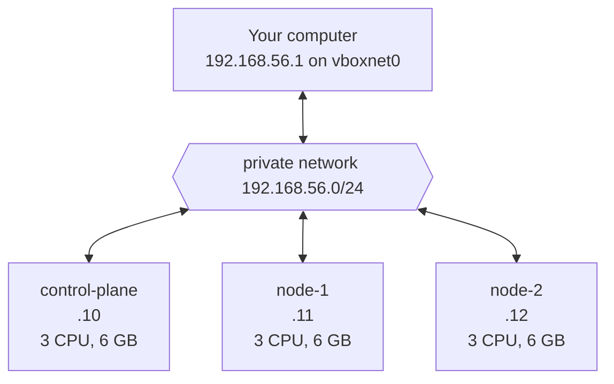

# Nodes and IPs

- This page is for the **single-control-plane** layout.
- All values on this page come from `vagrant/single-control-plane/Vagrantfile`.
- If you change the `Vagrantfile`, update this page and the matching pages in `knowledge/okf/nodes/`.

# Map

# Nodes

| Name            | Private IP      | CPUs | Memory | OS disk | Data disk | Job in the cluster   | VirtualBox name          |
|-----------------|-----------------|------|--------|---------|-----------|----------------------|--------------------------|
| `control-plane` | `192.168.56.10` | 3    | 6 GB   | 10 GB   | 20 GB     | Manages the cluster  | `kube-lab-single-control-plane` |
| `node-1`        | `192.168.56.11` | 3    | 6 GB   | 10 GB   | 20 GB     | Runs your apps       | `kube-lab-single-node-1`        |
| `node-2`        | `192.168.56.12` | 3    | 6 GB   | 10 GB   | 20 GB     | Runs your apps       | `kube-lab-single-node-2`        |

# Totals

| Resource   | All 3 VMs                    | Main lab computer | Left for the computer itself |
|------------|------------------------------|-------------------|------------------------------|
| CPUs       | 9                            | 12 threads        | 3                            |
| Memory     | 18 GB                        | 40 GB             | 22 GB                        |
| Disk       | Up to 90 GB (about 6.6 GB when new) | n/a        | n/a                          |

# Settings shared by all nodes

| Setting                  | Value                                         |
|--------------------------|-----------------------------------------------|
| Box (OS image)           | `cloud-image/ubuntu-26.04`                    |
| Operating system         | Ubuntu 26.04 LTS (official cloud image)       |
| Provider                 | VirtualBox                                    |
| Login user               | `vagrant` (passwordless `sudo`)               |
| Shared `/vagrant` folder | Turned off                                    |

# Network cards in each node

| Card   | Type                | Address                           | Used for                                  |
|--------|---------------------|-----------------------------------|-------------------------------------------|
| Card 1 | NAT                 | `10.0.2.15` (same on every node)  | Internet access, `vagrant ssh`            |
| Card 2 | Private (host-only) | `192.168.56.10` to `.12`          | Node to node, your computer to node, Kubernetes |

- Seen on all 3 VMs: `enp0s3` (card 1, Intel PRO/1000) and `enp0s8` (card 2, VirtIO). Find card 2 by its `192.168.56.x` address with `ip -br addr`.
- Full explanation: [Lab networking](../explanation/lab-networking.md).

# Disks in each node

| Disk   | Name in the Vagrantfile   | Size  | Usual device | File on your computer                    | Contents                     |
|--------|---------------------------|-------|--------------|------------------------------------------|------------------------------|
| Disk 1 | (none, from the box)      | 10 GB | `/dev/sda`   | `box.vmdk`, copied from the box          | Ubuntu, Kubernetes, images. `/` is 8.6 GB |
| Disk 2 | `<node>-data`             | 20 GB | `/dev/sdb`   | `<node>-data.vdi`                        | Empty, not formatted         |

- Files live in `<VirtualBox machine folder>/kube-lab-single-<node>/`.
- Seen on all 3 VMs: `sda` and `sdb`. Check with `lsblk`.
- Find the machine folder with `VBoxManage list systemproperties | grep -i "default machine folder"`.
- Full explanation: [Disks and storage](../explanation/disks-and-storage.md).

# SSH access

| Node            | `vagrant ssh` command       | SSH key file (on your computer)                               |
|-----------------|-----------------------------|---------------------------------------------------------------|
| `control-plane` | `vagrant ssh control-plane` | `vagrant/single-control-plane/.vagrant/machines/control-plane/virtualbox/private_key`      |
| `node-1`        | `vagrant ssh node-1`        | `vagrant/single-control-plane/.vagrant/machines/node-1/virtualbox/private_key`             |
| `node-2`        | `vagrant ssh node-2`        | `vagrant/single-control-plane/.vagrant/machines/node-2/virtualbox/private_key`             |

- Key files only exist after `vagrant up`.
- `vagrant ssh` uses a forwarded port on `127.0.0.1` (often `2222`, `2200`, `2201`). Run `vagrant ssh-config` for the exact port.
- Ansible connects straight to the private IP on port `22`, with the same key.

# Address ranges in use

| Range              | Used by                                    |
|--------------------|--------------------------------------------|
| `192.168.56.0/24`  | Private network (nodes and your computer)  |
| `10.0.2.0/24`      | VirtualBox NAT inside each node            |
| `10.244.0.0/16`    | Pods, kubeadm and RKE2 (`pod_subnet`)      |
| `10.96.0.0/12`     | Services, kubeadm and RKE2 (`service_subnet`) |

- Reserved for the planned HA layout: `192.168.56.20` (kube-vip virtual IP) and `192.168.56.21` to `.24`. See [Cluster layouts](../explanation/cluster-layouts.md).
- Free addresses for more nodes: `192.168.56.13` to `.19` and `192.168.56.25` to `.254`.
