# Repo layout

- Every file and folder in the repo, and what it is for.
- **Planned** means it will be added in a later step.

# Tree

```mermaid
flowchart LR
    n0["<b>kube-lab/</b>"]
    n1["<b>README.md</b><br/>Short intro, points to docs/"]
    n2["<b>.gitignore</b><br/>Files git must never commit"]
    n3["<b>.kube/</b><br/>Made by Ansible: cluster kubeconfig files (not in git, secret)"]
    n4["<b>docs/</b><br/>Docs for people (plain markdown)"]
    n5["<b>README.md</b><br/>Start here"]
    n6["<b>diataxis/</b>"]
    n7["<b>README.md</b><br/>Lists the 4 Diataxis folders"]
    n8["<b>tutorials/</b><br/>Step by step lessons, in order"]
    n9["<b>how-to/</b><br/>Steps for one task"]
    n10["<b>explanation/</b><br/>The why, with diagrams"]
    n11["<b>reference/</b><br/>Facts and tables"]
    n12["<b>adr/</b><br/>Decision records, 0001, 0002, ..."]
    n13["<b>vagrant/</b><br/>One folder per cluster layout"]
    n14["<b>README.md</b><br/>Lists the layouts"]
    n15["<b>single-control-plane/</b><br/>Ready: 1 control plane, 2 nodes"]
    n16["<b>Vagrantfile</b><br/>Defines the 3 VMs: CPUs, memory, network cards, disks"]
    n17["<b>.vagrant/</b><br/>Made by vagrant up: VM IDs and SSH keys (not in git)"]
    n18["<b>ha-control-plane/</b><br/>Planned: 3 control planes, 1 node, kube-vip"]
    n19["<b>knowledge/</b>"]
    n20["<b>okf/</b><br/>OKF bundle: one fact page per thing"]
    n21["<b>index.md</b><br/>Bundle contents"]
    n22["<b>log.md</b><br/>Change history"]
    n23["<b>layouts/</b><br/>One page per cluster layout"]
    n24["<b>nodes/</b><br/>One page per VM"]
    n25["<b>networks/</b><br/>One page per network"]
    n26["<b>storage/</b><br/>One page per disk type"]
    n27["<b>tools/</b><br/>One page per tool"]
    n28["<b>distributions/</b><br/>One page per Kubernetes distribution"]
    n29["<b>ansible/</b><br/>Sets up the VMs. Run ansible commands from here"]
    n30["<b>ansible.cfg</b><br/>Where the inventory and roles are"]
    n31["<b>site.yml</b><br/>THE playbook: install or upgrade what cluster.yml says"]
    n32["<b>reset.yml</b><br/>Remove the installed distribution, keep the VMs and /data"]
    n33["<b>prepare.yml</b><br/>Run by site.yml first: prereq, then k8s_prepare"]
    n34["<b>verify-network.yml</b><br/>Test pods, DNS and Services across nodes (no kube-proxy)"]
    n35["<b>requirements.yml</b><br/>Ansible collections the playbooks use"]
    n36["<b>inventories/</b>"]
    n37["<b>single-control-plane/</b>"]
    n38["<b>hosts.ini</b><br/>The 3 VMs, their groups, IPs and vagrant_machine names"]
    n39["<b>group_vars/all/</b><br/>Every value, in 6 files"]
    n40["<b>cluster.yml</b><br/>distribution, versions, API address, ranges"]
    n41["<b>kubeadm.yml</b><br/>containerd, packages, kubeadm config values, join tokens"]
    n42["<b>rke2.yml</b><br/>RKE2 switches, full RKE2 config"]
    n43["<b>cilium.yml</b><br/>Cilium Helm chart, Helm, Cilium values"]
    n44["<b>os.yml</b><br/>OS upgrade, GRUB, LVM, kernel"]
    n45["<b>lab.yml</b><br/>login, data disk, folders, file locations"]
    n46["<b>roles/</b>"]
    n47["<b>prereq/</b><br/>GRUB fix, OS upgrade, LVM data disk at /data"]
    n48["<b>k8s_prepare/</b><br/>/data folders, swap off, kernel settings, /etc/hosts"]
    n49["<b>kubeadm/</b><br/>containerd, kubeadm packages, init, join (short lived token), upgrade, reset"]
    n50["<b>templates/</b><br/>kubeadm-init.yaml.j2, kubeadm-join.yaml.j2: the real kubeadm config files"]
    n51["<b>rke2/</b><br/>RKE2 server and agents, upgrade, reset"]
    n52["<b>cilium/</b><br/>Helm on the control plane, Cilium, kube-proxy replacement, wait for Ready nodes"]
    n53["<b>templates/</b><br/>values.yaml.j2: the real Cilium Helm values file"]
    n54["<b>.helm/</b><br/>A local Helm setup on your computer (not in git)"]
    n55["<b>ansible/</b><br/>One page per Ansible role, and the inventory"]
    n0 --> n1
    n0 --> n2
    n0 --> n3
    n0 --> n4
    n4 --> n5
    n4 --> n6
    n6 --> n7
    n6 --> n8
    n6 --> n9
    n6 --> n10
    n6 --> n11
    n4 --> n12
    n0 --> n13
    n13 --> n14
    n13 --> n15
    n15 --> n16
    n15 --> n17
    n13 --> n18
    n0 --> n19
    n19 --> n20
    n20 --> n21
    n20 --> n22
    n20 --> n23
    n20 --> n24
    n20 --> n25
    n20 --> n26
    n20 --> n27
    n20 --> n28
    n0 --> n29
    n29 --> n30
    n29 --> n31
    n29 --> n32
    n29 --> n33
    n29 --> n34
    n29 --> n35
    n29 --> n36
    n36 --> n37
    n37 --> n38
    n37 --> n39
    n39 --> n40
    n39 --> n41
    n39 --> n42
    n39 --> n43
    n39 --> n44
    n39 --> n45
    n29 --> n46
    n46 --> n47
    n46 --> n48
    n46 --> n49
    n49 --> n50
    n46 --> n51
    n46 --> n52
    n52 --> n53
    n0 --> n54
    n20 --> n55
```

# Files git ignores

| Path          | Why it is ignored                                           |
|---------------|-------------------------------------------------------------|
| `vagrant/<layout>/.vagrant/` | Holds each VM's ID and private SSH key. Local only, secret. |
| `.kube/`      | Holds cluster admin credentials. Secret.                    |
| `.helm/`      | A local Helm setup on your computer (repository list and cache). The lab does not need it: Helm runs on the control plane. |

# Files outside the repo

| Path                                  | What is in it                                   |
|---------------------------------------|-------------------------------------------------|
| `~/.vagrant.d/boxes/`                 | The downloaded `cloud-image/ubuntu-26.04` box   |
| `<VirtualBox machine folder>/kube-lab-single-<node>/`   | Each VM's settings, OS disk (`.vmdk`) and data disk (`<node>-data.vdi`) |

# Which file do I edit?

| You want to                       | Edit                                     |
|-----------------------------------|------------------------------------------|
| Change VM CPU, memory, disks or IPs | `vagrant/<layout>/Vagrantfile`, then the reference and OKF node pages |
| Add a new cluster layout          | A new folder in `vagrant/` with its own `Vagrantfile`, then `vagrant/README.md` |
| Change what is installed (distribution, versions) | `ansible/inventories/<layout>/group_vars/all/cluster.yml` |
| Change a kubeadm, RKE2 or Cilium setting | `kubeadm.yml`, `rke2.yml` or `cilium.yml` in the same folder |
| Change OS, disk or folder settings | `os.yml` or `lab.yml` in the same folder |
| Fix or add a tutorial             | `docs/diataxis/tutorials/`               |
| Record a new decision             | A new file in `docs/adr/`                |
| Update a fact (IP, size, version) | The matching page in `knowledge/okf/`    |
