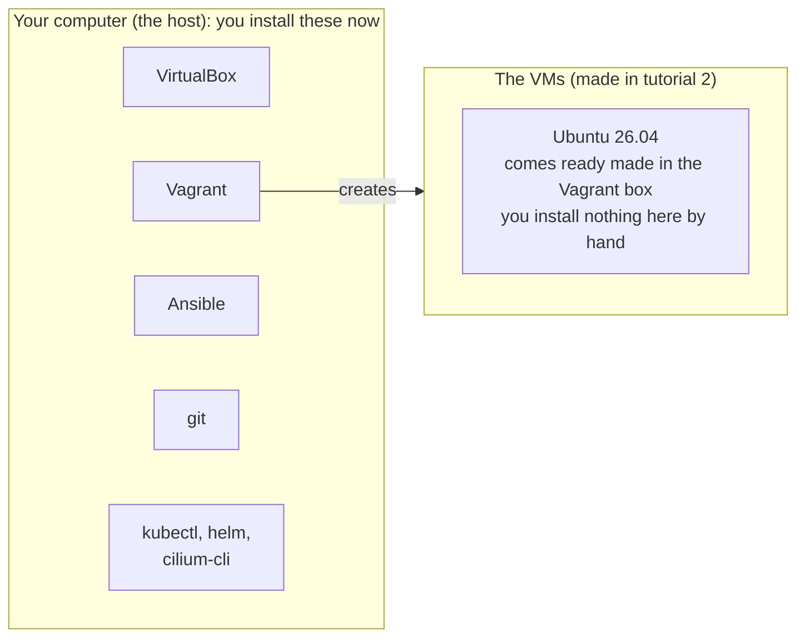

# Tutorial 1: Install the tools

> Status: draft. These steps have not been tested end to end yet.

# What you will do

- Check that your computer can run VMs.
- Install the tools on your computer: VirtualBox, Vagrant, Ansible, git, and the Kubernetes tools kubectl, helm and cilium-cli.
- Check that each tool works.
- Time needed: about 15 minutes.

# What gets installed where



- Everything in this tutorial goes on **your computer**.
- Nothing is installed inside the VMs by hand. Ansible will do that later.

# Before you start

- You need admin rights on your computer. That means you can run `sudo`.
- You need an internet connection.

# Step 1: Check your computer can run VMs

**Run on: your computer**

```bash
grep -cE 'vmx|svm' /proc/cpuinfo
nproc
free -h
df -h ~
```

What each command does:

- `grep -cE 'vmx|svm' /proc/cpuinfo` counts CPU cores that support virtualization.
  - `vmx` is the Intel feature (VT-x). `svm` is the AMD feature (AMD-V).
- `nproc` shows how many CPU cores you have.
- `free -h` shows how much memory you have. Look at the `total` column.
- `df -h ~` shows free disk space in your home folder. Look at the `Avail` column.

**Expected result**

| Command   | You need                    |
|-----------|-----------------------------|
| `grep`    | A number bigger than `0`    |
| `nproc`   | `12` or more                |
| `free -h` | `total` of `15Gi` or more   |
| `df -h ~` | `Avail` of `50G` or more    |

- Why these numbers: the 3 VMs together use 9 CPUs, 18 GB of memory and up to 90 GB of disk (the disks start at about 2.2 GB per VM and grow). See [ADR 0005](../../adr/0005-node-sizes-and-ips.md).
- The VMs can still start with fewer CPUs, but your computer will be slow while they run.

- If `grep` prints `0`, virtualization is turned off. Restart, open your BIOS or UEFI settings, and turn on "Intel VT-x", "Intel Virtualization Technology", "SVM" or "AMD-V". The name depends on your computer.

# Step 2: Install VirtualBox

- **What it is**: a program that runs virtual machines.
- **Why you need it**: it runs the 3 lab VMs.

**Run on: your computer (Ubuntu or Debian)**

```bash
sudo apt update
sudo apt install virtualbox
```

- `apt update` refreshes the list of available packages.
- `apt install virtualbox` installs VirtualBox and its kernel module.
- If apt says the package is not found, turn on the `multiverse` package source first with `sudo add-apt-repository multiverse`, then run both commands again.

**Run on: your computer (Arch Linux)**

```bash
sudo pacman -S virtualbox virtualbox-host-modules-arch
```

- `virtualbox` is the program.
- `virtualbox-host-modules-arch` is the kernel module for the standard `linux` kernel.
- If you use a different kernel (such as `linux-lts` or `linux-zen`), install `virtualbox-host-dkms` and the matching headers package (such as `linux-lts-headers`) instead.

**Then restart your computer.**

- Why: VirtualBox adds a kernel module called `vboxdrv`. A restart makes sure it loads.

**Check it works**

**Run on: your computer**

```bash
VBoxManage --version
lsmod | grep vboxdrv
```

**Expected result**

- `VBoxManage --version` prints a version, such as `7.2.22r175245`.
- `lsmod | grep vboxdrv` prints at least one line starting with `vboxdrv`.

# Step 3: Install Vagrant

- **What it is**: a tool that creates VMs from a text file called the `Vagrantfile`.
- **Why you need it**: one command, `vagrant up`, builds all 3 VMs the same way every time.

**Run on: your computer (Ubuntu or Debian)**

```bash
wget -O - https://apt.releases.hashicorp.com/gpg | sudo gpg --dearmor -o /usr/share/keyrings/hashicorp-archive-keyring.gpg
echo "deb [signed-by=/usr/share/keyrings/hashicorp-archive-keyring.gpg] https://apt.releases.hashicorp.com $(lsb_release -cs) main" | sudo tee /etc/apt/sources.list.d/hashicorp.list
sudo apt update
sudo apt install vagrant
```

What each line does:

- Line 1 downloads HashiCorp's signing key. apt uses it to check that packages really come from HashiCorp.
- Line 2 adds HashiCorp's package source. `$(lsb_release -cs)` fills in your Ubuntu version's code name.
- Line 3 refreshes the package list so apt sees the new source.
- Line 4 installs Vagrant.
- Why not use Ubuntu's own Vagrant package: it is often an old version.
- If `apt update` says the HashiCorp source has no `Release` file, HashiCorp does not support your Ubuntu version yet. Open `/etc/apt/sources.list.d/hashicorp.list`, replace your code name with `noble` (Ubuntu 24.04), save, and run `sudo apt update` again.

**Run on: your computer (Arch Linux)**

- Vagrant is not in the official Arch repositories.
- Install the `vagrant` package from the AUR with your AUR helper, for example `yay -S vagrant` or `paru -S vagrant`.

**Check it works**

**Run on: your computer**

```bash
vagrant --version
```

**Expected result**

- Prints a version, such as `Vagrant 2.4.9`.

# Step 4: Install Ansible

- **What it is**: a tool that logs into computers over SSH and sets them up from instructions written in files.
- **Why you need it**: it installs Kubernetes on the 3 VMs.
- It only runs on your computer. Nothing extra is installed in the VMs for Ansible. It only needs SSH and Python, which Ubuntu already has.

**Run on: your computer (Ubuntu or Debian)**

```bash
sudo apt install ansible
```

**Run on: your computer (Arch Linux)**

```bash
sudo pacman -S ansible
```

**Check it works**

**Run on: your computer**

```bash
ansible --version
```

**Expected result**

- The first line looks like `ansible [core 2.x.x]`.

**Install the collections the lab needs**

- The `ansible` package above already has them. You only need this if you installed `ansible-core` alone, or Ansible says `couldn't resolve module/action 'kubernetes.core.helm'`.

**Run on: your computer** (in `kube-lab/`, after step 5)

```bash
cd ansible
ansible-galaxy collection install -r requirements.yml
```

- `requirements.yml` lists `ansible.posix`, `community.general` and `kubernetes.core`.

# Step 5: Install git and get the lab files

- **What it is**: git downloads and tracks changes to the lab files.
- **Why you need it**: to get a copy of this repo.

**Run on: your computer (Ubuntu or Debian)**

```bash
sudo apt install git
```

**Run on: your computer (Arch Linux)**

```bash
sudo pacman -S git
```

**Then get the lab files**

**Run on: your computer**

```bash
git clone <repo-url> kube-lab
cd kube-lab
ls
```

- Replace `<repo-url>` with the address of this repo.
- `cd kube-lab` moves into the folder.
- The `Vagrantfile` for this lab is in `vagrant/single-control-plane/`. Tutorial 2 moves into that folder before running Vagrant.

**Expected result**

- `ls` shows at least `README.md`, `docs`, `knowledge` and `vagrant`.

# Step 6: Install kubectl, helm and cilium-cli

- **kubectl**: the command line tool to talk to Kubernetes.
- **helm**: the package manager for Kubernetes. Ansible uses it to install Cilium, the pod network.
- **cilium-cli**: shows if Cilium is healthy (`cilium status`).
- They all run on your computer and talk to the cluster over the private network.
- These docs install them with **Homebrew** (`brew`), which works the same on Linux and macOS. If you do not have Homebrew, see https://brew.sh.

**Run on: your computer**

```bash
brew install kubectl helm cilium-cli
```

**Check it works**

```bash
kubectl version --client
helm version --short
cilium version --client
```

**Expected result** (newer versions are fine)

```
Client Version: v1.37.2
v4.3.1+gc0d08d0
cilium-cli: v0.20.2 compiled with go1.27.3 on linux/amd64
```

- kubectl should be within one minor version of the cluster (Kubernetes v1.37).

# Step 7: Final check

**Run on: your computer**

```bash
VBoxManage --version && vagrant --version && ansible --version | head -1 && git --version && kubectl version --client && helm version --short && cilium version --client | head -1
```

- `&&` runs the next command only if the one before it worked.

**Expected result**

- One version for each of the 7 tools. If any line is missing, go back to that tool's step.

# Done

- Your computer is ready.
- Next: read [The Vagrantfile explained](../explanation/vagrantfile-explained.md), then do [Tutorial 2: Create the VMs](02-create-vms.md).

# If something goes wrong

| What you see                                   | Why it happens                                   | What to do                                  |
|------------------------------------------------|--------------------------------------------------|---------------------------------------------|
| `grep` prints `0`                              | Virtualization is off in the BIOS                | Turn on VT-x or AMD-V in the BIOS (step 1)  |
| `VBoxManage: command not found`                | VirtualBox did not install                       | Run the install command again and read the error |
| `lsmod` shows no `vboxdrv`                     | Kernel module did not load                       | Restart. On Arch, check you installed the module package for your kernel |
| VirtualBox says the module is not signed, or you saw a blue "Enroll MOK" screen | Secure Boot blocks unsigned modules | Enroll the key when the blue screen asks, or turn off Secure Boot |
| HashiCorp `apt update` error about `Release` file | No repo for your Ubuntu version yet           | Use `noble` instead (step 3)                |
| VMs later fail with `VERR_VMX_IN_VMX_ROOT_MODE` | KVM is using the CPU feature                    | See [Fix the VirtualBox and KVM error](../how-to/fix-virtualbox-kvm-error.md) |
