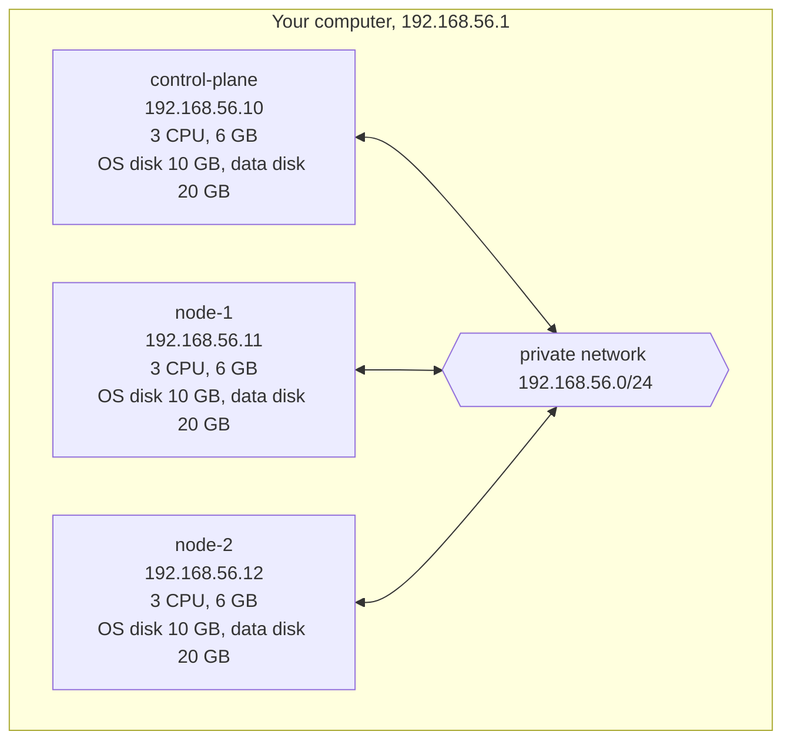
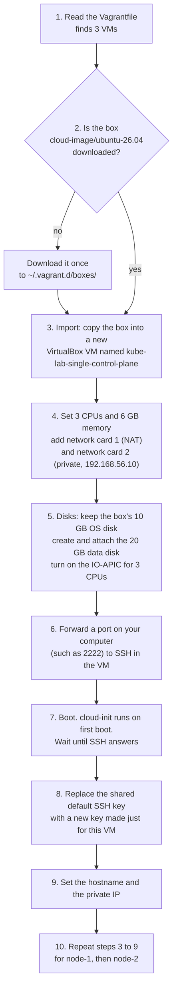
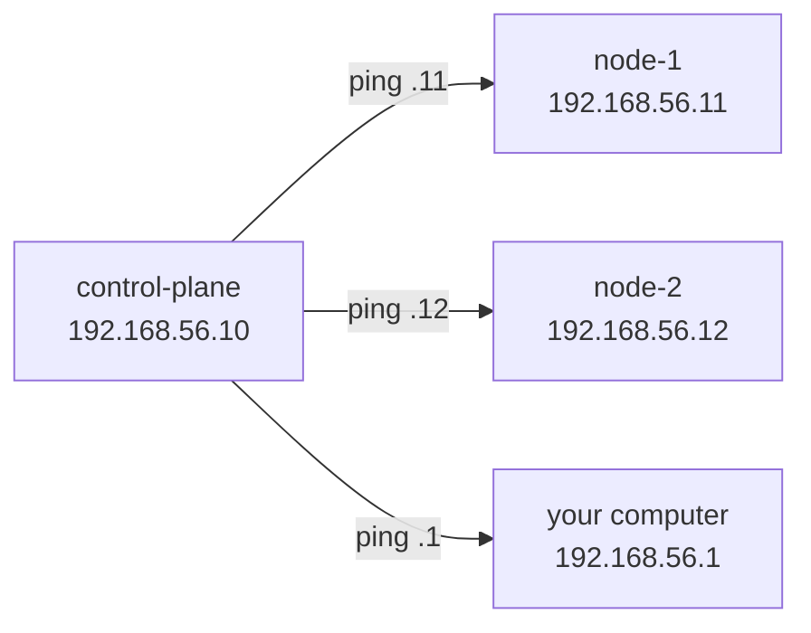

# Tutorial 2: Create the VMs

> Status: tested on 2026-11-08 on the main lab computer (Arch Linux, VirtualBox 7.2.22, Vagrant 2.4.9). Output below is from that run.

# What you will do

- Start 3 Ubuntu 26.04 VMs with one command.
- Log into a VM and look around: CPUs, memory, network cards and disks.
- Check that the VMs can reach each other, your computer and the internet.
- Time needed: 15 to 30 minutes the first time, mostly waiting for the download and first boot.

# What you will have at the end



- 3 running VMs, with no Kubernetes on them yet.
- Every VM can reach the other two, your computer and the internet.

# Before you start

- Finish [Tutorial 1: Install the tools](01-install-tools.md).
- Read [The Vagrantfile explained](../explanation/vagrantfile-explained.md). It explains what you are about to run.
- Open a terminal and move into the layout folder:

**Run on: your computer**

```bash
cd kube-lab/vagrant/single-control-plane
ls
```

- `ls` shows `Vagrantfile`. Vagrant reads the `Vagrantfile` in the folder you are in.
- **Run every `vagrant` command in this tutorial from this folder.**
- Why the extra folder: there will be more than one cluster layout. See [Cluster layouts](../explanation/cluster-layouts.md).

# Step 1: Check the Vagrantfile

**Run on: your computer**

```bash
vagrant validate
vagrant status
```

- `vagrant validate` checks the `Vagrantfile` for mistakes. It does not create anything.
- `vagrant status` lists the VMs the `Vagrantfile` describes.

**Expected result**

```
Vagrantfile validated successfully.
Current machine states:

control-plane             not created (virtualbox)
node-1                    not created (virtualbox)
node-2                    not created (virtualbox)
```

- `not created` is correct. They do not exist yet.

# Step 2: Start the VMs

**Run on: your computer**

```bash
vagrant up
```

What `vagrant up` does, in order:



**Expected result**

- Output from a real run (the lines repeat for `node-1` and `node-2`):

```
Bringing machine 'control-plane' up with 'virtualbox' provider...
Bringing machine 'node-1' up with 'virtualbox' provider...
Bringing machine 'node-2' up with 'virtualbox' provider...
==> control-plane: Box 'cloud-image/ubuntu-26.04' could not be found. Attempting to find and install...
==> control-plane: Successfully added box 'cloud-image/ubuntu-26.04' (v20260927.0.0) for 'virtualbox (amd64)'!
==> control-plane: Importing base box 'cloud-image/ubuntu-26.04'...
==> control-plane: Setting the name of the VM: kube-lab-single-control-plane
==> control-plane: Preparing network interfaces based on configuration...
    control-plane: Adapter 1: nat
    control-plane: Adapter 2: hostonly
==> control-plane: Forwarding ports...
    control-plane: 22 (guest) => 2222 (host) (adapter 1)
==> control-plane: Configuring storage mediums...
    control-plane: Disk 'control-plane-data' not found in guest. Creating and attaching disk to guest...
==> control-plane: Running 'pre-boot' VM customizations...
==> control-plane: Booting VM...
==> control-plane: Waiting for machine to boot. This may take a few minutes...
    control-plane: Warning: Connection reset. Retrying...
    control-plane: Vagrant insecure key detected. Vagrant will automatically replace
    control-plane: this with a newly generated keypair for better security.
    control-plane: Inserting generated public key within guest...
==> control-plane: Machine booted and ready!
==> control-plane: Checking for guest additions in VM...
    control-plane: The guest additions on this VM do not match the installed version of
    control-plane: VirtualBox! ...
    control-plane: Guest Additions Version: 6.0.0 r127566
    control-plane: VirtualBox Version: 7.2
==> control-plane: Setting hostname...
==> control-plane: Configuring and enabling network interfaces...
```

What the lines mean:

| Line                                        | Meaning                                                             | Problem? |
|---------------------------------------------|---------------------------------------------------------------------|----------|
| `Box ... could not be found`                | First run only: the box is being downloaded (about 2.2 GB)          | No       |
| `Adapter 1: nat`, `Adapter 2: hostonly`     | Network card 1 (internet) and card 2 (private network)              | No       |
| `Disk '...-data' not found in guest. Creating...` | The 20 GB data disk is being created                          | No       |
| `Running 'pre-boot' VM customizations`      | The IO-APIC setting is applied, so the VM can use 3 CPUs            | No       |
| `Warning: Connection reset. Retrying...`    | Vagrant tried SSH before the VM finished booting. It retries        | No       |
| `guest additions ... do not match`          | The box has old VirtualBox Guest Additions. Only shared folders need them, and the lab turns those off | No |

- Wait until you get your prompt back.
- Red text means something failed. See "If something goes wrong" at the bottom.

# Step 3: Check the VMs are running

**Run on: your computer**

```bash
vagrant status
```

**Expected result**

```
control-plane             running (virtualbox)
node-1                    running (virtualbox)
node-2                    running (virtualbox)
```

# Step 4: Log into a VM

**Run on: your computer**

```bash
vagrant ssh control-plane
```

- The prompt changes to `vagrant@control-plane`. You are now inside the VM.
- Why no password: in step 2 Vagrant made an SSH key for each VM. `vagrant ssh` uses it for you.
- The user inside every VM is `vagrant`. It can use `sudo` without a password.

# Step 5: Look around inside the VM

**Run on: control-plane**

```bash
hostname
grep PRETTY_NAME /etc/os-release
nproc
free -h
ip -br addr
lsblk
df -h /
systemctl is-system-running
```

What each command shows:

| Command                            | Shows                        | Expected                                           |
|------------------------------------|------------------------------|----------------------------------------------------|
| `hostname`                         | The VM's name                | `control-plane`                                    |
| `grep PRETTY_NAME /etc/os-release` | The OS version               | `Ubuntu 26.04.1 LTS`                               |
| `nproc`                            | CPU count                    | `3`                                                |
| `free -h`                          | Memory                       | `total` a little under `4.0Gi`                     |
| `ip -br addr`                      | Network cards and addresses  | `enp0s3` with `10.0.2.15`, `enp0s8` with `192.168.56.10`, both `UP` |
| `lsblk`                            | Disks and partitions         | `sda` `10G` with partitions, `sdb` `20G` with none |
| `df -h /`                          | Size of the main partition   | `Size` `8.6G`, `Avail` about `6.7G`                |
| `systemctl is-system-running`      | Overall health               | `degraded` on a new VM. Explained in step 6        |

- The card with `10.0.2.15` is the NAT card, used for internet access.
- The card with `192.168.56.10` is the private card. Kubernetes will use this one.
- The disk with partitions is the OS disk. The empty one is the data disk.
- Why: see [Lab networking](../explanation/lab-networking.md) and [Disks and storage](../explanation/disks-and-storage.md).

# Step 6: About the "degraded" status

- On a new VM, `systemctl is-system-running` says `degraded`.
- The cause: on this box, GRUB writes a broken `/boot/grub/grubenv` at every boot, so two small GRUB services fail.
- It does not stop the VM from working.
- You do not fix it by hand. [Tutorial 3](03-prepare-nodes.md) runs an Ansible role that switches those two services off, and the status becomes `running`.
- Details: [The Ansible roles explained](../explanation/ansible-roles-explained.md).

# Step 7: Check the VMs can reach each other

**Run on: control-plane**

```bash
ping -c 3 192.168.56.11
ping -c 3 192.168.56.12
ping -c 3 192.168.56.1
```

- `ping` sends a small test message and waits for a reply.
- `-c 3` sends 3 messages, then stops.

What you are testing:



**Expected result**

- Each `ping` ends with `3 packets transmitted, 3 received, 0% packet loss`.
- Why this matters: Kubernetes nodes talk to each other on these addresses all the time.

Check the internet works too:

**Run on: control-plane**

```bash
ping -c 3 ubuntu.com
```

- This goes out through the NAT card. It proves the VM can download packages.

Leave the VM:

**Run on: control-plane**

```bash
exit
```

- The prompt goes back to your computer.

# Step 8: Check from your computer

**Run on: your computer**

```bash
ping -c 3 192.168.56.10
ping -c 3 192.168.56.11
ping -c 3 192.168.56.12
```

**Expected result**

- `0% packet loss` for all 3.
- Why this matters: Ansible and kubectl run on your computer and reach the VMs at these addresses.

# Step 9: See how Vagrant connects

**Run on: your computer**

```bash
vagrant ssh-config control-plane
```

**Expected result** (your port may differ):

```
Host control-plane
  HostName 127.0.0.1
  User vagrant
  Port 2222
  IdentityFile /path/to/kube-lab/.vagrant/machines/control-plane/virtualbox/private_key
  ...
```

- `HostName 127.0.0.1` and `Port 2222`: `vagrant ssh` goes through a forwarded port, not the private IP.
- `IdentityFile`: the SSH key Vagrant made for this VM. Ansible will use this same key.
- The `.vagrant/` folder inside `vagrant/single-control-plane/` holds these keys. It is in `.gitignore`, so it is never committed.

# Step 10: See the disk files on your computer

- VirtualBox keeps VMs in its default machine folder. Find it first:

**Run on: your computer**

```bash
VBoxManage list systemproperties | grep -i "default machine folder"
```

- On a fresh VirtualBox install it is `~/VirtualBox VMs`. On the main lab computer it is `~/Templates/VirtualBox VM's`.
- Then list the files of one VM (replace the folder with yours):

```bash
ls -lh ~/"VirtualBox VMs"/kube-lab-single-control-plane/
```

**Expected result**

- `box.vmdk`, about `2.2G`: the OS disk, copied from the box.
- `control-plane-data.vdi`, about `2.0M`: the empty data disk.
- The sizes are the space used **today**. They grow as data is written, up to 10 GB and 20 GB.

# Done

- You have 3 running VMs that can reach each other, your computer and the internet.
- Each VM has 3 CPUs, 6 GB of memory, a 10 GB OS disk and an empty 20 GB data disk.
- `systemctl is-system-running` says `degraded` until you run tutorial 3.
- To stop them for now, run `vagrant halt`. See [Start, stop and delete VMs](../how-to/manage-vms.md).
- Next: [Tutorial 3: Prepare the nodes with Ansible](03-prepare-nodes.md).

# If something goes wrong

| What you see                                   | Why it happens                                    | What to do                                    |
|------------------------------------------------|---------------------------------------------------|-----------------------------------------------|
| `VERR_VMX_IN_VMX_ROOT_MODE`                    | KVM is holding the CPU virtualization feature     | [Fix the VirtualBox and KVM error](../how-to/fix-virtualbox-kvm-error.md) |
| Error about the IP address not being in the allowed range | VirtualBox only allows `192.168.56.0/21` by default | Keep every IP in the `Vagrantfile` in `192.168.56.x` |
| Download stops or is very slow                 | Network problem                                   | Run `vagrant up` again. It continues from where it stopped |
| `Timed out while waiting for the machine to boot` | The first boot is slow (cloud-init runs), or virtualization is off | Run `vagrant reload <name>`. If it keeps failing, redo step 1 of tutorial 1 |
| `VirtualBox does not support shrinking disk sizes` | A disk size in the `Vagrantfile` is smaller than the disk already is | Set the size back, or `vagrant destroy -f <name>` and `vagrant up <name>` |
| `nproc` prints `1`                             | The IO-APIC is off (the box ships that way)       | Check the `--ioapic` line is in the `Vagrantfile`, then `vagrant reload` |
| `systemctl is-system-running` says `degraded`  | The box's broken GRUB file (see step 6)           | Expected. Tutorial 3 fixes it. Run `systemctl --failed` to see what failed |
| `enp0s8` shows `UNKNOWN`                       | Card 2 is the old PCnet type                      | Check `nic_type: "virtio"` is on the `private_network` line, then `vagrant reload` |
| Your computer becomes very slow                | Not enough free memory or CPU                     | Close other programs, or lower `memory` or `cpus` in the `Vagrantfile`, then `vagrant reload` |
| `ping` between VMs fails                       | Private network not set up                        | Run `vagrant reload`, then check `ip -br addr` shows `192.168.56.x` |
| `ping ubuntu.com` fails but VM pings work      | No internet on your computer, or DNS issue        | Check your own internet first                 |
