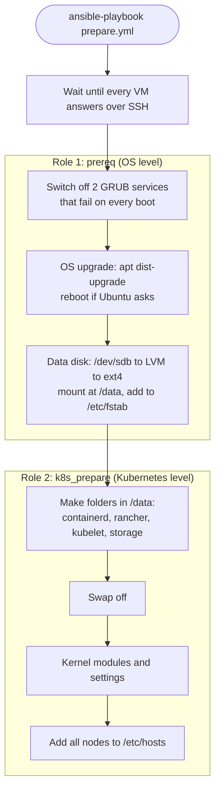

# Tutorial 3: Prepare the nodes with Ansible

> Status: tested on 2026-11-08 on the main lab computer (Ansible core 2.22, Ubuntu 26.04 VMs). Output below is from that run.

# What you will do

- Run one Ansible playbook, `prepare.yml`, against all 3 VMs.
- It upgrades Ubuntu, sets up the 20 GB data disk with LVM at `/data`, and gets every node ready for Kubernetes.
- Check the result on the VMs.
- Run it a second time and see that it changes nothing.
- Time needed: about 10 minutes, mostly the OS upgrade.

# What the playbook does



- Why each step exists: [The Ansible roles explained](../explanation/ansible-roles-explained.md).

# Before you start

- Finish [Tutorial 2: Create the VMs](02-create-vms.md). All 3 VMs must be `running`.
- Ansible is installed on your computer (from [Tutorial 1](01-install-tools.md)).

# Step 1: Go to the Ansible folder

**Run on: your computer**

```bash
cd kube-lab/ansible
ls
```

**Expected result**

```
ansible.cfg  inventories  prepare.yml  roles
```

- `ansible.cfg` tells Ansible where everything is. Ansible reads it because you are in this folder.
- **Run every `ansible` command from this folder.**

# Step 2: Check Ansible can reach every VM

**Run on: your computer** (in `ansible/`)

```bash
ansible cluster -m ansible.builtin.ping
```

- `cluster` is the group of all 3 VMs, from `inventories/single-control-plane/hosts.ini`.
- `-m ansible.builtin.ping` runs Ansible's test module. It logs in over SSH and checks Python works. It is not a network ping.

**Expected result**

```
node-1 | SUCCESS =>
    ansible_facts:
        discovered_interpreter_python: /usr/bin/python3.14
    changed: false
    ping: pong
```

- The same block appears for `control-plane` and `node-2`. The order can change from run to run.
- `ping: pong` means Ansible logged in and found Python 3.14 on the VM.

- If a VM shows `UNREACHABLE` right after `vagrant up`, wait one minute and try again. See "If something goes wrong" below.

# Step 3: Run the playbook

**Run on: your computer** (in `ansible/`)

```bash
ansible-playbook prepare.yml
```

- Ansible prints one `TASK` line per step, then a line per VM: `ok`, `changed` or `skipping`.

| You see    | Meaning                                                       |
|------------|---------------------------------------------------------------|
| `ok`       | The step was already done. Nothing changed                    |
| `changed`  | The step changed something on the VM                          |
| `skipping` | The step was not needed (for example: no swap to turn off)    |
| `fatal`    | The step failed. Ansible stops for that VM                    |

**Expected result**

- The OS upgrade and the reboot take most of the time. Wait for the `PLAY RECAP`.
- On a new VM it ends with one line per VM. The `ok`, `changed` and `skipped` numbers depend on how many updates there were, so yours will differ:

```
PLAY RECAP *********************************************************************
control-plane : ok=..   changed=..   unreachable=0    failed=0    skipped=..
node-1        : ok=..   changed=..   unreachable=0    failed=0    skipped=..
node-2        : ok=..   changed=..   unreachable=0    failed=0    skipped=..
```

- The important numbers are **`unreachable=0`** and **`failed=0`**.
- You may see this warning once. It is harmless: `[WARNING]: Module remote_tmp /root/.ansible/tmp did not exist and was created...`

# Step 4: Check the data disk

**Run on: your computer** (in `ansible/`)

```bash
ansible cluster -b -m ansible.builtin.command -a "lsblk /dev/sdb"
ansible cluster -b -m ansible.builtin.command -a "df -h /data"
ansible cluster -b -m ansible.builtin.command -a "ls /data"
```

- `-b` means "become root" (sudo).
- `-m ansible.builtin.command -a "..."` runs one command on every VM.
- Each result starts with a line such as `node-1 | CHANGED | rc=0 >>`. For these ad-hoc commands Ansible always says `CHANGED`, even though they only read. `rc=0` means the command worked.

**Expected result** (from `node-1`, the same on every VM)

```
NAME              MAJ:MIN RM SIZE RO TYPE MOUNTPOINTS
sdb                 8:16   0  20G  0 disk
└─data_vg-data_lv 252:0    0  20G  0 lvm  /data
```

```
Filesystem                   Size  Used Avail Use% Mounted on
/dev/mapper/data_vg-data_lv   20G  2.1M   19G   1% /data
```

```
containerd
kubelet
lost+found
rancher
storage
```

- `sdb` now holds the LVM volume `data_lv`, mounted at `/data`.
- The 4 Kubernetes folders are ready. `lost+found` is made by ext4 itself.

# Step 5: Check the rest

**Run on: your computer** (in `ansible/`)

```bash
ansible cluster -b -m ansible.builtin.shell -a 'systemctl is-system-running; grep data_vg /etc/fstab; lsmod | grep -E "^(overlay|br_netfilter) "; sysctl net.ipv4.ip_forward; getent hosts node-2'
```

**Expected result** (for each VM)

```
running
/dev/data_vg/data_lv /data ext4 defaults,nofail 0 0
br_netfilter           32768  0
overlay               233472  0
net.ipv4.ip_forward = 1
192.168.56.12   node-2
```

| Line                     | Proves                                                  |
|--------------------------|---------------------------------------------------------|
| `running`                | No failed services. The GRUB problem is gone            |
| The `/etc/fstab` line    | `/data` is mounted again at every boot                  |
| `br_netfilter`, `overlay`| The kernel modules Kubernetes needs are loaded          |
| `ip_forward = 1`         | The node can pass traffic between pods                  |
| `192.168.56.12 node-2`   | Nodes find each other by name                           |

# Step 6: Run it again

**Run on: your computer** (in `ansible/`)

```bash
ansible-playbook prepare.yml
```

**Expected result**

```
PLAY RECAP *********************************************************************
control-plane : ok=18   changed=0    unreachable=0    failed=0    skipped=5
node-1        : ok=18   changed=0    unreachable=0    failed=0    skipped=5
node-2        : ok=18   changed=0    unreachable=0    failed=0    skipped=5
```

- **`changed=0`**: everything was already done, so nothing changed. This is called **idempotent**: you can run it as often as you like.
- The data disk is never formatted again. The role sees the volume group already exists and leaves the disk alone.
- New Ubuntu updates are installed whenever you run it. That is how you keep the VMs up to date. See [Update the VMs](../how-to/update-the-vms.md).

# Done

- All 3 VMs are up to date, have `/data` on the 20 GB data disk with LVM, and are ready for Kubernetes.
- The 10 GB OS disk was not touched, apart from the OS upgrade.
- Next: install Kubernetes (tutorial coming next).

# If something goes wrong

| What you see                                   | Why it happens                                   | What to do                                    |
|------------------------------------------------|--------------------------------------------------|-----------------------------------------------|
| `UNREACHABLE` ... `Connection timed out` right after `vagrant up` or a rebuild | Your computer still remembers the old VMs' network card addresses for these IPs | Wait 1 minute and run again. The playbook also waits up to 5 minutes by itself |
| `UNREACHABLE` ... `Permission denied (publickey)` | The SSH key path is wrong, or the VM was rebuilt from another folder | Check `vagrant_machine` for each host in `inventories/single-control-plane/hosts.ini` and `ansible_ssh_private_key_file` in `group_vars/all/lab.yml` |
| `/dev/sdb is not blank, so it will not be touched` | The disk already holds something                | Check `data_disk_device`. To start clean, rebuild the VM with Vagrant |
| `Nothing is mounted at /data`                  | The k8s_prepare role ran without the prereq role | Run the whole `prepare.yml`, not only the k8s_prepare tags |
| The upgrade step waits a long time             | Ubuntu's own updater is running after first boot | Let it finish. The role waits up to 10 minutes for it |
| `[DEPRECATION WARNING]` lines                  | Messages from Ansible about its own future changes | Safe to ignore |
