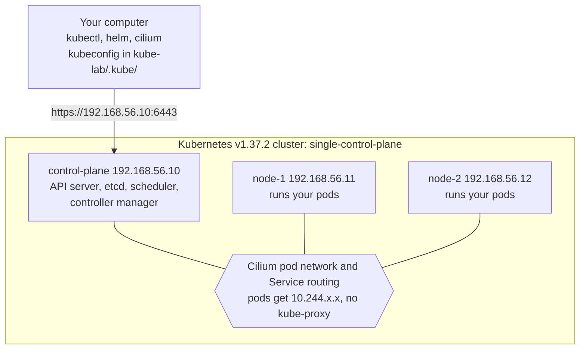
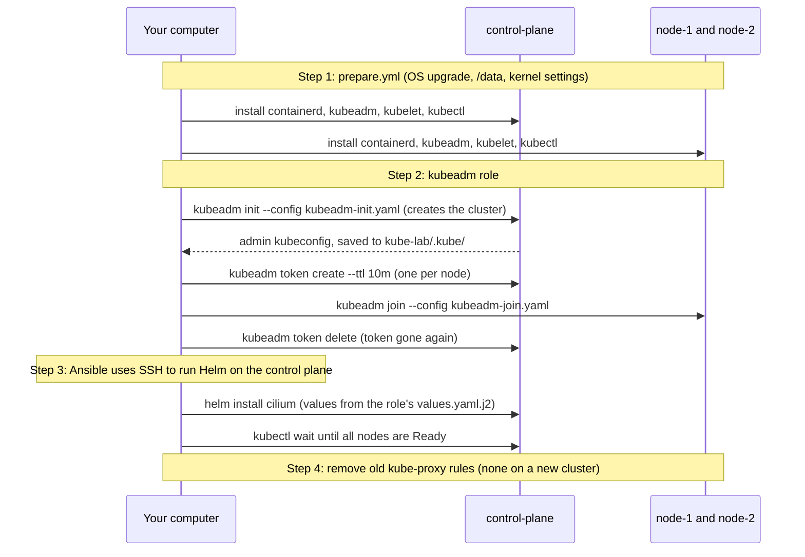

# Tutorial 4: Install the cluster (kubeadm and Cilium)

> Status: tested on 2026-11-08 on the main lab computer (Kubernetes v1.37.2, containerd 2.2.2, Cilium 1.20.4, Helm v4.3.1). Output below is from those runs.

# What you will do

- Check the settings file `cluster.yml`, which says what to install.
- Run one playbook, `site.yml`, that builds a full Kubernetes cluster on the 3 VMs.
- Use `kubectl`, `cilium` and `helm` from your own computer to look at it.
- Prove that pods on different nodes can talk to each other.
- Time needed: about 10 minutes.

# What you will have at the end



# Before you start

- Finish [Tutorial 3: Prepare the nodes](03-prepare-nodes.md). (`site.yml` runs `prepare.yml` again first, so it is fine if you skipped it.)
- These tools are on your computer. Check with the commands below:

**Run on: your computer**

```bash
kubectl version --client
helm version --short
cilium version --client
```

**Expected result**

```
Client Version: v1.37.2
v4.3.1+gc0d08d0
cilium-cli: v0.20.2 compiled with go1.27.3 on linux/amd64
```

- Missing one? Install them with Homebrew: `brew install kubectl helm cilium-cli`. See [Tutorial 1](01-install-tools.md).

# Step 1: Check the settings

**Run on: your computer**

```bash
cd kube-lab/ansible
grep -E '^(k8s_distro|kubernetes_version|cilium_version):' inventories/single-control-plane/group_vars/all/cluster.yml
```

**Expected result**

```
k8s_distro: kubeadm
kubernetes_version: "1.37.2"
cilium_version: "1.20.4"
```

- `k8s_distro: kubeadm` means: build the cluster with kubeadm.
- These 3 lines are all you need for this tutorial. Every other setting is explained in [Installing Kubernetes explained](../explanation/installing-kubernetes-explained.md).

# Step 2: Run the playbook

**Run on: your computer** (in `ansible/`)

```bash
ansible-playbook site.yml
```

What happens, in order:



**Expected result**

- `kubeadm init` takes 1 to 3 minutes. Cilium takes another 2 to 3 minutes.
- The run ends like this on a new cluster (from a real run, your numbers can differ a little):

```
PLAY RECAP *********************************************************************
control-plane : ok=48   changed=18   unreachable=0    failed=0    skipped=46
node-1        : ok=45   changed=15   unreachable=0    failed=0    skipped=49
node-2        : ok=45   changed=15   unreachable=0    failed=0    skipped=49
```

- The control plane runs Helm and the "wait for Ready" checks over SSH. Ansible installs Helm in `/data/helm` there.
- The `skipped` tasks are the RKE2 and upgrade steps, which are not needed here.
- You may see this message. It comes from inside the Ansible Kubernetes collection and is safe to ignore:
  `[DEPRECATION WARNING]: The 'status.values' return value is deprecated...`

# Step 3: Point kubectl at the cluster

**Run on: your computer** (in `kube-lab/`)

```bash
cd kube-lab
export KUBECONFIG=$PWD/.kube/single-control-plane.conf
```

- The kubeadm role copied the cluster's admin kubeconfig to `kube-lab/.kube/single-control-plane.conf`.
- `KUBECONFIG` tells kubectl, helm and cilium which file to use. It lasts until you close the terminal.
- The `.kube/` folder is in `.gitignore`. The file holds admin keys, so never commit or share it.

# Step 4: Look at the nodes

**Run on: your computer**

```bash
kubectl get nodes -o wide
```

**Expected result**

```
NAME            STATUS   ROLES           AGE     VERSION   INTERNAL-IP     ...   CONTAINER-RUNTIME
control-plane   Ready    control-plane   5m32s   v1.37.2   192.168.56.10   ...   containerd://2.2.2
node-1          Ready    <none>          5m19s   v1.37.2   192.168.56.11   ...   containerd://2.2.2
node-2          Ready    <none>          5m19s   v1.37.2   192.168.56.12   ...   containerd://2.2.2
```

| Column              | Check                                                                  |
|---------------------|------------------------------------------------------------------------|
| `STATUS`            | `Ready` on all 3. A node is only Ready once Cilium works on it         |
| `INTERNAL-IP`       | `192.168.56.x`, the private card. Never `10.0.2.15`                    |
| `VERSION`           | `v1.37.2`                                                              |
| `CONTAINER-RUNTIME` | `containerd://2.2.2`                                                   |

# Step 5: Look at the system pods

**Run on: your computer**

```bash
kubectl get pods -n kube-system -o wide
```

**Expected result** (shortened)

```
NAME                                    READY   STATUS    IP              NODE
cilium-4ljsl                            1/1     Running   192.168.56.11   node-1
cilium-8z8km                            1/1     Running   192.168.56.12   node-2
cilium-xnv6d                            1/1     Running   192.168.56.10   control-plane
cilium-envoy-...                        1/1     Running   ...             (one per node)
cilium-operator-545d9f95d6-wgj6j        1/1     Running   192.168.56.12   node-2
coredns-559f6c778d-4rcpb                1/1     Running   10.244.2.24     node-2
coredns-559f6c778d-pz7dg                1/1     Running   10.244.2.240    node-2
etcd-control-plane                      1/1     Running   192.168.56.10   control-plane
kube-apiserver-control-plane            1/1     Running   192.168.56.10   control-plane
kube-controller-manager-control-plane   1/1     Running   192.168.56.10   control-plane
kube-scheduler-control-plane            1/1     Running   192.168.56.10   control-plane
```

- Everything is `Running`.
- `coredns` pods have `10.244.x.x` addresses: they got them from Cilium, from the pod range.
- The other pods use the node's own IP (`192.168.56.x`). They are system pods that run directly on the node's network.
- `kube-controller-manager` or `kube-scheduler` may show 1 or 2 `RESTARTS`. That happens when the control plane is very busy during the first install (downloading images): they briefly lose their "leader" lease and restart themselves. It is normal once. It should not keep going up.

# Step 6: Check Cilium

**Run on: your computer**

```bash
cilium status --wait
```

**Expected result** (shortened)

```
    /¯¯\
 /¯¯\__/¯¯\    Cilium:             OK
 \__/¯¯\__/    Operator:           OK
 /¯¯\__/¯¯\    Envoy DaemonSet:    OK
 \__/¯¯\__/    Hubble Relay:       disabled
    \__/       ClusterMesh:        disabled

DaemonSet              cilium                   Desired: 3, Ready: 3/3, Available: 3/3
Deployment             cilium-operator          Desired: 1, Ready: 1/1, Available: 1/1
Helm chart version:    1.20.4
```

- `OK` for Cilium and the Operator, `3/3` for the DaemonSet: Cilium runs on every node.

# Step 7: Prove pods can talk across nodes

- This makes a test namespace, one test pod on `node-1`, one on `node-2`, and a small web server with a service.

**Run on: your computer**

```bash
kubectl create namespace nettest
kubectl -n nettest run test-node-1 --image=busybox:1.37 --restart=Never --overrides='{"spec":{"nodeName":"node-1"}}' -- sleep 600
kubectl -n nettest run test-node-2 --image=busybox:1.37 --restart=Never --overrides='{"spec":{"nodeName":"node-2"}}' -- sleep 600
kubectl -n nettest create deployment web --image=nginx:1.29 --replicas=2
kubectl -n nettest expose deployment web --port 80
kubectl -n nettest wait --for=condition=Ready pod --all --timeout=180s
kubectl -n nettest get pods -o wide
```

- `--overrides='{"spec":{"nodeName":"node-1"}}'` puts the pod on `node-1`, so the test really crosses nodes.
- `expose` creates a **service** named `web` in front of the 2 nginx pods.

**Expected result** (your IPs will differ)

```
NAME                   READY   STATUS    IP             NODE
test-node-1            1/1     Running   10.244.1.58    node-1
test-node-2            1/1     Running   10.244.2.47    node-2
web-689b9bdbdd-9b5gz   1/1     Running   10.244.2.175   node-2
web-689b9bdbdd-9vs7k   1/1     Running   10.244.1.231   node-1
```

Now test 4 things:

**Run on: your computer**

```bash
# 1. Pod on node-1 pings the pod on node-2 (use the IP of test-node-2 from above)
kubectl -n nettest exec test-node-1 -- ping -c 3 10.244.2.47

# 2. DNS finds the service by name
kubectl -n nettest exec test-node-1 -- nslookup web.nettest.svc.cluster.local

# 3. HTTP to the service reaches nginx
kubectl -n nettest exec test-node-2 -- wget -q -O - http://web

# 4. Pods can reach the internet
kubectl -n nettest exec test-node-2 -- wget -q -O /dev/null -T 10 http://example.com && echo ok
```

**Expected result**

| Test          | You see                                                  | Proves                                   |
|---------------|----------------------------------------------------------|------------------------------------------|
| 1. ping       | `3 packets transmitted, 3 packets received, 0% packet loss` | Cilium connects pods on different nodes |
| 2. nslookup   | `Address: 10.108.220.185` (an IP in `10.96.0.0/12`)      | CoreDNS works, services get IPs          |
| 3. wget web   | The nginx page, with `<title>Welcome to nginx!</title>`  | Services send traffic to pods            |
| 4. internet   | `ok`                                                     | Pods can download from the internet      |

Clean up:

```bash
kubectl delete namespace nettest
```

# Step 8: Check the data is on /data

**Run on: your computer** (in `ansible/`)

```bash
ansible cluster -b -m ansible.builtin.shell -a 'du -sh /data/*; df -h / /data'
```

**Expected result** (from `control-plane`)

```
1.8G    /data/containerd
129M    /data/etcd
1.1M    /data/kubelet
16K     /data/lost+found
4.0K    /data/rancher
4.0K    /data/storage
Filesystem                   Size  Used Avail Use% Mounted on
/dev/sda1                    8.6G  3.4G  5.3G  39% /
/dev/mapper/data_vg-data_lv   20G  2.0G   17G  11% /data
```

- `/data/rancher` stays empty with kubeadm. It is for RKE2.

- Container images (`/data/containerd`), the Kubernetes database (`/data/etcd`) and pod data (`/data/kubelet`) are all on the data disk.
- The OS disk `/` still has 5.3 GB free.

# Step 9: Run it again

**Run on: your computer** (in `ansible/`)

```bash
ansible-playbook site.yml
```

**Expected result**

```
PLAY RECAP *********************************************************************
control-plane : ok=41   changed=0    unreachable=0    failed=0    skipped=15
node-1        : ok=36   changed=0    unreachable=0    failed=0    skipped=20
node-2        : ok=36   changed=0    unreachable=0    failed=0    skipped=20
```

- `changed=0` everywhere: the cluster is already built, so nothing is done twice. `kubeadm init` and `kubeadm join` are skipped.

# Done

- You have a working Kubernetes v1.37.2 cluster built with kubeadm, with Cilium as the pod network.
- All Kubernetes data is on `/data`.
- How it all works: [Installing Kubernetes explained](../explanation/installing-kubernetes-explained.md).
- Next: [Tutorial 5: Switch to RKE2 and upgrade](05-switch-to-rke2-and-upgrade.md).

# If something goes wrong

| What you see                                   | Why it happens                                     | What to do                                    |
|------------------------------------------------|----------------------------------------------------|-----------------------------------------------|
| `has rke2 installed, but cluster.yml says k8s_distro: kubeadm` | RKE2 is on the VMs                 | `ansible-playbook reset.yml`, then `site.yml` again. See [Switch between kubeadm and RKE2](../how-to/switch-distribution.md) |
| `kind and apiVersion is mandatory` in the "Check the config file is valid" task | The kubeadm config is malformed | Check `roles/kubeadm/templates/kubeadm-init.yaml.j2` and the values in `group_vars/all/kubeadm.yml` |
| Nodes stay `NotReady`                          | Cilium is not running yet                          | `cilium status` and `kubectl -n kube-system get pods`. Wait, then run the playbook again |
| Helm: `failed to update the following repositories` or `no cached repo found` | A broken repository in your **personal** Helm setup | Should not happen: the role uses its own setup in `/data/helm/`. Check you have the latest role |
| `kubectl`: `connection refused` or `no such host` | `KUBECONFIG` is not set in this terminal         | Do step 3 again                               |
| `RESTARTS` of the scheduler keep going up      | The control plane is short of CPU or memory        | Check `free -h` and `uptime` on `control-plane`. Close other programs on your computer |

| `kubeadm join` fails with `could not find a JWS signature` | The join token expired (10 minutes) before the join finished | Raise `kubeadm_join_token_ttl` in `kubeadm.yml`, run `site.yml` again |
| `UNREACHABLE` on `node-1 -> control-plane` | A host in `hosts.ini` has no `vagrant_machine` | Add `vagrant_machine=<its name>` to every host |

# Extra checks

- **No kube-proxy**: Cilium does its job (`kubeProxyReplacement: true`). This finds nothing:

```bash
kubectl -n kube-system get pods -l k8s-app=kube-proxy
```

- **No join tokens left**: each node's token was deleted right after its join. On `control-plane`:

```bash
sudo kubeadm token list
```

- **Network across nodes**: pod to pod, DNS, ClusterIP and NodePort. See [Check the network works](../how-to/verify-the-network.md).
- Why it works like this: [Joining nodes explained](../explanation/joining-nodes-explained.md) and [Services without kube-proxy](../explanation/services-without-kube-proxy.md).
