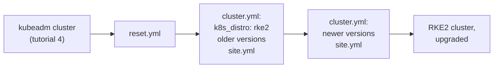
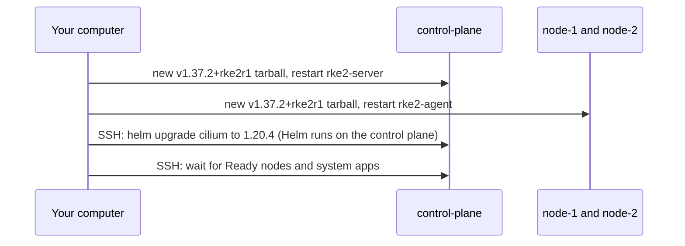

# Tutorial 5: Switch to RKE2 and upgrade it

> Status: tested on 2026-11-08 on the main lab computer (RKE2 v1.37.1+rke2r1 then v1.37.2+rke2r1, Cilium 1.20.3 then 1.20.4). Output below is from those runs.

# What you will do

- Remove the kubeadm cluster with `reset.yml`.
- Change one setting, `k8s_distro`, and build an RKE2 cluster with `site.yml`.
- Upgrade RKE2 and Cilium by changing 2 versions in `cluster.yml`.
- Time needed: about 20 minutes.



# Before you start

- Finish [Tutorial 4](04-install-the-cluster.md). The kubeadm cluster is running.
- Open a terminal in `kube-lab/ansible`.

# Step 1: Remove the kubeadm cluster

**Run on: your computer** (in `ansible/`)

```bash
ansible-playbook reset.yml
```

- It asks: `This deletes the cluster and all its data in /data. Type yes to continue`. Type `yes` and press Enter.

**Expected result** (from a real run)

```
PLAY RECAP *********************************************************************
control-plane : ok=17   changed=9    unreachable=0    failed=0    skipped=2
localhost     : ok=1    changed=1    unreachable=0    failed=0    skipped=0
node-1        : ok=17   changed=9    unreachable=0    failed=0    skipped=2
node-2        : ok=17   changed=9    unreachable=0    failed=0    skipped=2
```

What it did on every VM:

| Done                                          | Why                                                      |
|-----------------------------------------------|----------------------------------------------------------|
| Read `/etc/kube-lab/distro`: `kubeadm`        | To know what to remove                                   |
| `kubeadm reset`, removed packages and containerd | Removes kubeadm Kubernetes                            |
| Rebooted                                      | Clears mounts, network interfaces and firewall rules     |
| Emptied the `/data` folders, removed CNI files and the marker | A clean start for the next cluster       |
| Deleted `kube-lab/.kube/single-control-plane.conf` on your computer | The old cluster is gone            |

Check it is clean:

```bash
ansible cluster -b -m ansible.builtin.shell -a 'cat /etc/kube-lab/distro 2>/dev/null || echo none; du -sh /data; systemctl is-system-running'
```

**Expected result** (for each VM)

```
none
36K     /data
running
```

# Step 2: Choose RKE2

- Open `inventories/single-control-plane/group_vars/all/cluster.yml` in an editor.
- Change these 3 lines. The older versions are on purpose, so step 5 can show an upgrade:

```yaml
k8s_distro: rke2
rke2_version: "v1.37.1+rke2r1"
cilium_version: "1.20.3"
```

- Look at the RKE2 switches in `rke2.yml`. The lab turns RKE2's bundled ingress controller off:

```yaml
rke2_ingress_controller: none
rke2_enable_servicelb: false
rke2_disable: []
```

# Step 3: Build the RKE2 cluster

**Run on: your computer** (in `ansible/`)

```bash
ansible-playbook site.yml
```

- On the control plane: Ansible downloads the `v1.37.1+rke2r1` tarball, unpacks it into `/usr/local`, then `rke2-server` starts. The first start takes a few minutes.
- On `node-1` and `node-2`: the script runs as an agent, then `rke2-agent` joins on port 9345.
- On the control plane over SSH: Helm installs Cilium 1.20.3.

**Expected result**

- `failed=0` for every VM and for `localhost` in the `PLAY RECAP`.

# Step 4: Look at the RKE2 cluster

**Run on: your computer** (in `kube-lab/`)

```bash
cd ..
export KUBECONFIG=$PWD/.kube/single-control-plane.conf
kubectl get nodes -o wide
cilium status
```

**Expected result** (from a real run, shortened)

```
NAME            STATUS   ROLES                AGE     VERSION          INTERNAL-IP
control-plane   Ready    control-plane,etcd   4m10s   v1.37.1+rke2r1   192.168.56.10
node-1          Ready    <none>               2m50s   v1.37.1+rke2r1   192.168.56.11
node-2          Ready    <none>               2m50s   v1.37.1+rke2r1   192.168.56.12
```

```
Cilium:             OK
Operator:           OK
DaemonSet              cilium                   Desired: 3, Ready: 3/3, Available: 3/3
Helm chart version:    1.20.3
```

- `VERSION` ends in `+rke2r1`: this is RKE2.
- `ROLES` shows `etcd` on the control plane. RKE2 runs etcd as part of the server.

Check the data is on `/data`:

```bash
cd ansible
ansible cluster -b -m ansible.builtin.shell -a 'du -sh /data/rancher /data/kubelet'
cd ..
```

**Expected result** (from `control-plane`)

```
3.2G    /data/rancher
1.1M    /data/kubelet
```

- RKE2 keeps its images, containers and etcd in `/data/rancher/rke2`.

# Step 5: Upgrade RKE2 and Cilium

- In `cluster.yml`, raise both versions:

```yaml
rke2_version: "v1.37.2+rke2r1"
cilium_version: "1.20.4"
```

**Run on: your computer** (in `ansible/`)

```bash
cd ansible
ansible-playbook site.yml
```

What happens:



- The role sees the installed version (`v1.37.1+rke2r1`) is not the wanted one and upgrades. The control plane goes first, because Ansible runs each step on it before the nodes.

**Expected result**

- `failed=0` everywhere.

```bash
cd ..
kubectl get nodes
cilium status | grep -E 'Cilium:|Helm chart'
```

```
NAME            STATUS   ROLES                AGE   VERSION
control-plane   Ready    control-plane,etcd   36m   v1.37.2+rke2r1
node-1          Ready    <none>               35m   v1.37.2+rke2r1
node-2          Ready    <none>               35m   v1.37.2+rke2r1
```

```
Cilium:             OK
Helm chart version:    1.20.4
```

- All 3 nodes are on `v1.37.2+rke2r1` and Cilium is on 1.20.4. The cluster kept running during the upgrade.

# Step 6: Go back to kubeadm (optional)

- Same as steps 1 to 3, the other way round:

```bash
cd ansible
ansible-playbook reset.yml                       # type yes
# in cluster.yml: k8s_distro: kubeadm
ansible-playbook site.yml
```

# Done

- You switched distributions with one setting, and upgraded with two.
- Every other setting works the same way: [Change a setting or upgrade](../how-to/change-settings-and-upgrade.md).

# If something goes wrong

| What you see                                   | Why it happens                                    | What to do                                    |
|------------------------------------------------|---------------------------------------------------|-----------------------------------------------|
| `has kubeadm installed, but cluster.yml says k8s_distro: rke2` | You skipped step 1                 | Run `reset.yml`, then `site.yml` again        |
| `Cannot go from v1.37.2+rke2r1 down to ...`    | The version in `cluster.yml` is older than the installed one | Use the installed version or a newer one |
| Helm: `resource DaemonSet/kube-system/cilium not ready` | Cilium agents could not reach the API | Check `roles/cilium/templates/values.yaml.j2` still has `k8sServiceHost` and `k8sServicePort` (see [Installing Kubernetes explained](../explanation/installing-kubernetes-explained.md)) |
| Pods stay `ContainerCreating` for a few minutes after the install | RKE2 is still downloading its own images | Wait. `site.yml` waits for the system apps, so this only shows if you look early |
