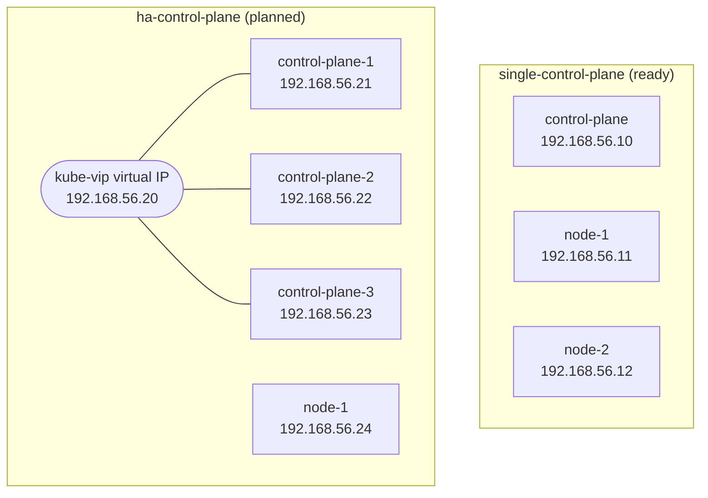

# Vagrant cluster layouts

- Each folder here holds one `Vagrantfile` for one cluster layout.
- Run `vagrant` commands **from inside the layout's folder**. Vagrant reads the `Vagrantfile` in the folder you are in.
- Each folder gets its own `.vagrant/` state folder (VM IDs and SSH keys). It is not committed to git.

| Folder                                           | Layout                          | VMs | Status  |
|--------------------------------------------------|---------------------------------|-----|---------|
| [single-control-plane/](single-control-plane/Vagrantfile) | 1 control plane, 2 nodes | 3   | Ready   |
| `ha-control-plane/`                              | 3 control planes, 1 node, kube-vip virtual IP | 4 | Planned |



# How to use a layout

**Run on: your computer**

```bash
cd vagrant/single-control-plane
vagrant up
```

# Rules every layout follows

| Rule                        | single-control-plane            | ha-control-plane (planned)       |
|-----------------------------|---------------------------------|----------------------------------|
| Folder name                 | `single-control-plane`          | `ha-control-plane`               |
| VirtualBox name prefix      | `kube-lab-single-`              | `kube-lab-ha-`                   |
| IP addresses                | `192.168.56.10` to `.12`        | `192.168.56.20` to `.24`         |
| Box                         | `cloud-image/ubuntu-26.04`      | `cloud-image/ubuntu-26.04`       |
| Size per VM                 | 3 CPU, 6 GB, 10 GB OS disk (from the box), 20 GB data disk | Same  |

- Different prefixes and IP ranges mean both layouts can exist at the same time without clashing.
- Running both at once needs 7 VMs: 21 CPUs and 28 GB of memory. On a 12 thread computer, run one layout at a time.
- Full explanation: [Cluster layouts](../docs/diataxis/explanation/cluster-layouts.md). Decision: [ADR 0007](../docs/adr/0007-one-folder-per-cluster-layout.md).
